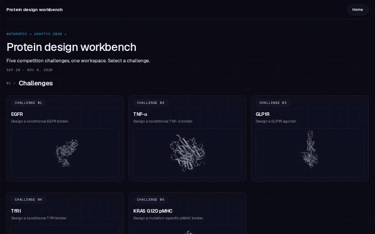

# Adaptyv protein design 2026 — the workshop

This is the local workspace for the **Anthropic × Adaptyv 2026 protein-design
competition** (proteinbase.com). It contains one folder per challenge under
`challenges/`, the shared tools under `tools/`, and a local website that shows
every challenge, experiment and structure.

## What the site looks like



The recording above shows the local website in a real browser: the index,
the five challenge cards and the tools table. The same take is a full-size
MP4 at `site/demo/workbench-home.mp4`. To record the tour again after a
page change, run `pdt serve` and then
`node site/scripts/record-demo.mjs --route home`.

## Deploy the website

The website is the local web app. The public site is the same pages, built as
a static export and deployed by GitHub Actions (see "Deploy the public site"
below).

```bash
make install              # one time: venv (Python 3.12) + editable install
source .venv/bin/activate # then you can use the pdt command
pdt serve                 # start the website: http://127.0.0.1:8737/
```

Open `http://127.0.0.1:8737/` in a browser. `pdt serve --port 9000` uses
another port. `pdt serve --open` also opens the browser. Press Ctrl-C to stop
the server.

The app has three levels: index → challenge home → experiment. Each experiment
page has these chapters: Strategy / Steps / Settings / Results / 3D view. The
app shows every structure in a 3D viewer that rotates slowly.

Static pages need no server. Open them from disk in any browser:

- the hub page `runs-dashboard.html` (`pdt dashboard` builds it).
- each run's `report.html` (tables, charts and a 3D view).
- each challenge history in `challenges/<c>/docs/` (figures embedded).

## Deploy the public site

The public site is a static export of the workbench, served by one Cloudflare
Worker. GitHub Actions builds and deploys it; nothing deploys from a laptop.
The full design is in [site/PLAN.md](site/PLAN.md).

One-time setup:

1. Add the repository secrets `CLOUDFLARE_API_TOKEN` and `CLOUDFLARE_ACCOUNT_ID`.
2. Create the D1 database: `npx wrangler@4.165.0 d1 create pdt-stats`. Put the
   returned id into `site/wrangler.toml`.
3. Register the hostname in Cloudflare Web Analytics and put the token into
   `site/config.json` (the token is public by design).
4. Set the counter salt, once the Worker exists:
   `npx wrangler@4.165.0 secret put COUNTER_SALT --config site/wrangler.toml`.
5. Set the repository variable `CF_DEPLOY` to `1` to arm the deploy.

Every push to `main` then deploys. To build and check the site locally:

```bash
pdt export --out site/dist
npx wrangler dev --config site/wrangler.toml --port 8788
```

The deploy job stops with a clear message while a step above is missing.

## Documentation

Each challenge has a `README.md` with its complete history, and a `docs/` folder
with the same history as one self-contained HTML page (figures embedded). The
dated log is in `notes/`, `records/` and `campaigns/`: one file per measurement,
negative results included. The `submission/` folder holds the submitted designs,
the design method and the methodology.

The strategy and the steps of every experiment are in
[EXPERIMENTS.md](EXPERIMENTS.md).

| # | Target | Complete history | Dated records | Submission |
|---|--------|------------------|---------------|------------|
| 01 | EGFR (conditional binder) | [README](challenges/01-egfr/README.md) — not attempted | — | — |
| 02 | TNF-α (conditional binder) | [README](challenges/02-tnfa/README.md) · [HTML](challenges/02-tnfa/docs/challenge-2-complete-history.html) | [notes/](challenges/02-tnfa/notes/) · [handoff/](challenges/02-tnfa/handoff/) | [8 designs, 2026-10-18](challenges/02-tnfa/submission/) |
| 03 | GLP1R agonist | [README](challenges/03-glp1r/README.md) · [HTML](challenges/03-glp1r/docs/challenge-3-complete-history.html) | [notes/](challenges/03-glp1r/notes/) · [records/](challenges/03-glp1r/records/) · [campaigns/](challenges/03-glp1r/campaigns/) | [20 designs, 2026-10-23](challenges/03-glp1r/submission/) |
| 04 | TfR1 (conditional binder) | [README](challenges/04-tfr1/README.md) · [HTML](challenges/04-tfr1/docs/challenge-4-complete-history.html) | [notes/](challenges/04-tfr1/notes/) · [records/](challenges/04-tfr1/records/) · [campaigns/](challenges/04-tfr1/campaigns/) | [20 designs, 2026-10-30](challenges/04-tfr1/submission/) |
| 05 | KRAS G12D pMHC | [README](challenges/05-pmhc/README.md) · [HTML](challenges/05-pmhc/docs/challenge-5-complete-history.html) | [notes/](challenges/05-pmhc/notes/) · [records/](challenges/05-pmhc/records/) · [campaigns/](challenges/05-pmhc/campaigns/) | [19 designs, 2026-11-08](challenges/05-pmhc/submission/) |

The working rules for agents and the mistakes log are in [AGENT.md](AGENT.md).

## Paths and layout

The repository is clone-location independent: every script finds the repository
root from its own file location. The shell scripts read `PDT_ROOT` first if you
set it. The dated notes were written under the repository's earlier name; the clone directory name does not matter.

Campaign work and tool environments live outside the repository, under `$HOME`:

| Path | Contents |
|---|---|
| `~/c2-work` … `~/c5-work` | campaign work dirs (backbones, folds, logs). Some scripts accept a `*_WORK` variable, for example `C0_WORK` and `FT_WORK`. |
| `~/tools` | tool checkouts: `ProteinMPNN`, `IPSAE`, `genie3`, `ArcRefine`, `LigandMPNN`, `BindCraft2`, `RFD4-Proteina`, `bionemo-agent-toolkit`, `binder-prescreen` |
| `~/.venvs` | tool environments: `tools`, `boltz` and `rfd3` (built by `make setup-gpu` and `make rfd3`), plus `mpnn`, `chai`, `genie3`, `boltzgen` and `bindcraft2` from their upstream packages |
| `~/.foundry/checkpoints` | the RFdiffusion3 checkpoint; `make rfd3` fetches and verifies it |
| `~/prescreen-dbs` | the novelty-prescreen sequence databases (`PRESCREEN_DB_ROOT`) |

## Author

Anton Chernysh — [github.com/Visn0](https://github.com/Visn0)

## Licence

This workspace's own work is **MIT** (`LICENSE`). You can use it for anything.
Keep the copyright notice.

The only paths not covered are the bundled viewers and fonts: NGL under
`tools/report/assets/`, 3Dmol.js and Geist under `tools/serve/static/`, and the
Mol* bundles under `challenges/*/viewers/`. Each one keeps its own licence in a
`.LICENSE.txt` file beside it. `ATTRIBUTION.md` names every one and its terms.
