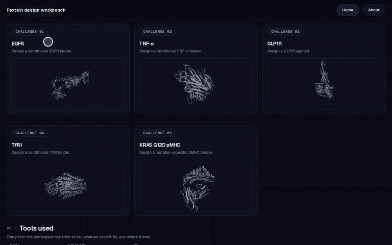

# Adaptyv protein design 2026 — the workshop

The workspace for the **Anthropic × Adaptyv 2026 protein-design competition**
(proteinbase.com): five protein-design challenges, one folder each under
`challenges/`, with every campaign kept and the submitted designs documented —
negative results included.

## The website

**https://protein-design-workbench.antonchernysh.workers.dev**



Or run it locally:

```bash
make install              # one time: venv (Python 3.12) + editable install
source .venv/bin/activate # then the pdt command is available
pdt serve                 # open http://127.0.0.1:8737/
```

## Documentation

Every challenge folder holds the same documents: `README.md` (its complete
history), `docs/` (the same history as one self-contained HTML page, figures
embedded), the dated log in `notes/`, `records/` and `campaigns/`, and
`submission/` with the submitted designs and the method documents.

| # | Target | Complete history | Dated records | Submission |
|---|--------|------------------|---------------|------------|
| 01 | EGFR (conditional binder) | [README](challenges/01-egfr/README.md) — not attempted | — | — |
| 02 | TNF-α (conditional binder) | [README](challenges/02-tnfa/README.md) · [HTML](challenges/02-tnfa/docs/challenge-2-complete-history.html) | [notes/](challenges/02-tnfa/notes/) · [handoff/](challenges/02-tnfa/handoff/) | [8 designs, 2026-10-18](challenges/02-tnfa/submission/) |
| 03 | GLP1R agonist | [README](challenges/03-glp1r/README.md) · [HTML](challenges/03-glp1r/docs/challenge-3-complete-history.html) | [notes/](challenges/03-glp1r/notes/) · [records/](challenges/03-glp1r/records/) · [campaigns/](challenges/03-glp1r/campaigns/) | [20 designs, 2026-10-23](challenges/03-glp1r/submission/) |
| 04 | TfR1 (conditional binder) | [README](challenges/04-tfr1/README.md) · [HTML](challenges/04-tfr1/docs/challenge-4-complete-history.html) | [notes/](challenges/04-tfr1/notes/) · [records/](challenges/04-tfr1/records/) · [campaigns/](challenges/04-tfr1/campaigns/) | [20 designs, 2026-10-30](challenges/04-tfr1/submission/) |
| 05 | KRAS G12D pMHC | [README](challenges/05-pmhc/README.md) · [HTML](challenges/05-pmhc/docs/challenge-5-complete-history.html) | [notes/](challenges/05-pmhc/notes/) · [records/](challenges/05-pmhc/records/) · [campaigns/](challenges/05-pmhc/campaigns/) | [19 designs, 2026-11-08](challenges/05-pmhc/submission/) |

More documentation: [EXPERIMENTS.md](EXPERIMENTS.md) — the strategy and steps
of every experiment · [AGENT.md](AGENT.md) — the working rules ·
[site/PLAN.md](site/PLAN.md) — the Cloudflare deployment.

## Author

Anton Chernysh — [github.com/Visn0](https://github.com/Visn0)

## Licence

This workspace's own work is **MIT** (`LICENSE`). You can use it for anything.
Keep the copyright notice.

The only paths not covered are the bundled viewers and fonts: NGL under
`tools/report/assets/`, 3Dmol.js and Geist under `tools/serve/static/`, and the
Mol* bundles under `challenges/*/viewers/`. Each one keeps its own licence in a
`.LICENSE.txt` file beside it. `ATTRIBUTION.md` names every one and its terms.
