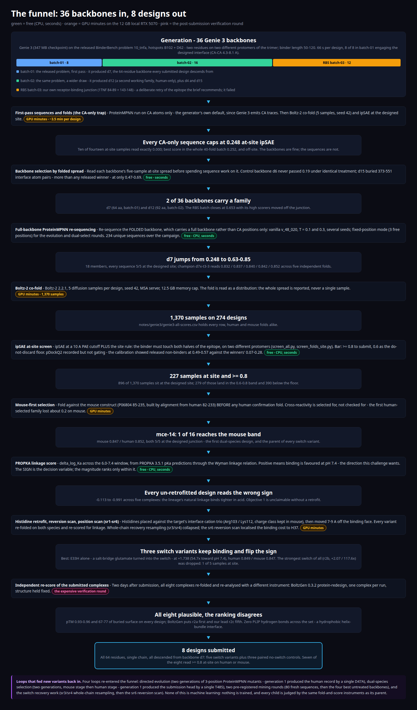
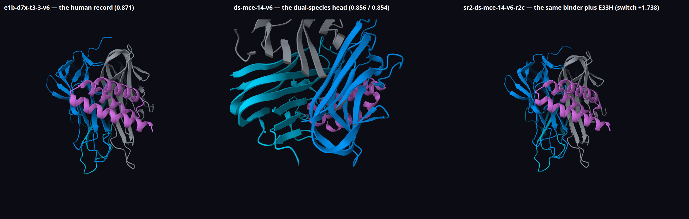
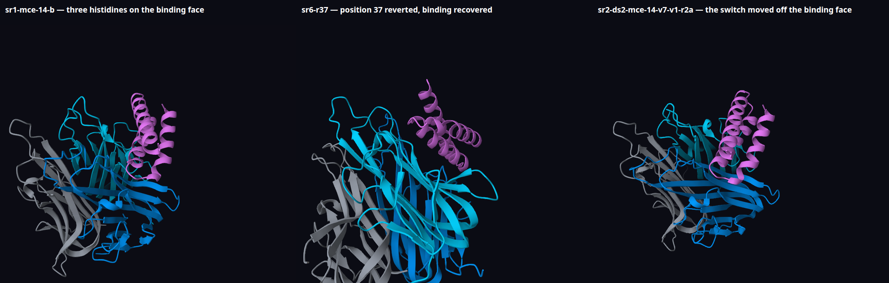

# 02 — TNF-α (conditional binder) · the complete history

This document tells the whole story of the TNF-alpha conditional-binder
campaign, from the first failure analysis to the submitted eight designs.
It names every tool, every decision, and the reason for each. The
companion records are `lineage.json` (the site's own history),
`notes/` (the research and the evidence tables), and `submission/`
(what was actually uploaded).

Status: submitted 2026-10-18, eight designs, submission 1 on Proteinbase
marked DESIGNATED. No wet-lab data exists for any design here;
everything below is computational evidence.

---

## 1. The target and the three objectives

The brief ranks three objectives, in this order
(the previous README, `notes/master-plan.md`):

1. **pH-selective binding**: bind human TNF-alpha at **pH 7.4**, with **no
   detectable binding at pH 6.0**. The direction is inverted relative to
   challenge 1 — the binder is meant to *let go* in the acidifying
   endosome so it can be recycled rather than consumed.
2. **Mouse cross-reactivity**, measured at pH 7.4 — the same molecule must
   also hold the mouse protein, so the design can be tested in mice.
3. **Affinity** — bind strongly.

The recommended epitope in the brief is the receptor-binding site at the
interface between two protomers of the TNF-alpha trimer (PDB 1TNF).

All three objectives had to land on **one molecule**. That is the whole
difficulty: each objective pulls the sequence in a different direction,
and a design that wins any one of them alone is worth nothing here.

---

## 2. The biology in plain words

**What TNF-alpha is.** TNF-alpha is a signalling protein the immune
system releases to start inflammation. Too much of it drives rheumatoid
arthritis, Crohn's disease and psoriasis; the biggest-selling drugs of the
last two decades (adalimumab, infliximab) are antibodies that mop it up.

**Why it is a trimer.** The active form is three identical copies of the
same protein locked together into a cone — a trimer. The three copies are
called protomers. The receptors it activates sit in the *grooves between*
protomers, so the functional surfaces of TNF-alpha are seams, not faces.
A binder aimed at such a seam has to touch two protomers at once. This is
not a detail: the released campaign's own wet-lab winners all did exactly
that ("every winner's contact list we checked (6 of 13) spans two or
three target chains", `notes/filter-calibration.md`), and the
at-site screen used throughout this campaign *requires* the two halves of
the epitope to be touched on **different** protomers.

**What "pH 7.4 bind, pH 6.0 release" means physically.** Blood and the
space between cells sit at about pH 7.4. When a cell swallows something,
the bubble it swallows it in (the endosome) is deliberately acidified,
down to about pH 6.0 and lower. A binder that holds at 7.4 and lets go at
6.0 therefore releases its cargo inside the cell and can be carried back
out and reused. The chemistry that makes this possible is almost always
**histidine**. Of the twenty amino acids, histidine is the only one whose
charge flips in this exact window: near-neutral at pH 7.4, positively
charged at pH 6.0. Put a histidine on the binder facing a positively
charged residue on the target, and you get a switch: neutral at 7.4, so
the binder holds; positive at 6.0, so two positive charges push each other
apart and the binder leaves. That one sentence is the mechanism behind
every switch design in this campaign
(`submission/methodology.md`, `notes/linkage-check.md`).

**Why mouse cross-reactivity is hard.** Human and mouse TNF-alpha are
similar but not identical. Where the sequences differ *inside the designed
contact patch*, a binder tuned on one species can fail on the other. The
phase-0 measurement found both a safe case and a trap
(`notes/research-phase-0.md`):

| residue | human | mouse | consequence |
|---|---|---|---|
| 103 | Arg | Lys | both positive — charge class **kept**, safe for a switch |
| 112 | Lys | Lys | identical — safe |
| 73 | His | Tyr | charge class **lost** — a switch built here works on human only |

The practical finding came later and was blunter: cross-reactivity has to
be **selected for, not checked for**. The first family kept the designed
interface on mouse but at roughly 0.2 lower interface confidence
(`lineage.json`, chapter `mouse-check`), and the fix was to reverse the
order of work — fold against mouse first, confirm on human second.

**What is actually being measured here.** Nothing in this project measures
binding. Everything is a *structure prediction* and a score computed from
it. The main number, ipSAE, answers "does the prediction put a confident
interface between these two chains". It does not answer "will this stick in
a tube". Chapter 4 is about what that distinction cost.

---

## 3. The reference structures and the released dataset

**1TNF** (`inputs/1TNF.cif`, `data/epitope-analysis/1TNF.pdb`) —
the crystal structure of the human TNF-alpha trimer, and the target file
for every generation run. A crystal structure is a map of where every atom
sits, worked out by firing X-rays through a grid of billions of aligned
copies of the molecule. It is one frozen pose, not a movie.

**3WD5 and 4G3Y** (`data/epitope-analysis/`) — TNF-alpha caught in the
grip of the two approved antibody drugs, adalimumab and infliximab. These
were used to locate a real, functionally validated epitope on the trimer
(the "antibody groove"), and as the source of the S1 hotspot set.

**2TNF** (`inputs/2TNF.cif`) — a second TNF-alpha crystal form, kept as
an input.

**The construct, exactly.** Every fold in the campaign used the same
chains: the human construct **P01375 82–233** and the mouse construct
**P06804 85–235** (`handoff/README.md`,
`submission/design-method.md`). Two facts about it are recorded because
they would otherwise silently break comparisons: the 1TNF construct
differs from the UniProt sequence at one position (1TNF 219 is Leu, the
UniProt residue is Asp), and all folds must use the same construct or the
numbers are not comparable (`handoff/README.md`). The mouse target was
built by aligning human 82–233 onto mouse 85–235; the designed site remaps
to positions 107 and 67 (`lineage.json`, chapter `mouse-check`).
Note that `inputs/human_tnf.fasta` is labelled P01375 **77–233** — a
wider slice than the 82–233 the fold records name; the fold YAMLs are the
authority for what was folded.

**The released campaign — the single most valuable asset in this
challenge.** Anthropic published a TNF-alpha binder-design dataset
(`Anthropic/claude-protein-binder-design`, CC BY 4.0): **150 designs with
real wet-lab outcomes from two labs**, plus in-silico metrics from nine
predictor arms including `ipsae_min_boltz2` — the same metric family used
here. That dataset turned "pick a threshold and hope" into a calibration
problem with an answer key. Chapter 4 is what it said.

**What was measured on the trimer directly** (our own script, reported in
`notes/research-phase-0.md`):

| what was looked at | what was found |
|---|---|
| can one binder reach the cation trio | CA–CA spans A103–B103 10.7 Å, A103–B112 8.7 Å, B103–B112 12.9 Å — all under 13 Å, inside the ~15 Å one binder can span |
| is the trio's neighbourhood clean | no: the nearest acidic side chains are 3.1–4.7 Å away (B104/Glu, C104/Glu), and they are also the affinity anchors — a binder histidine aimed at a cation can be screened by them |
| how polar the antibody groove is | very (3–15% apolar) — expect a charged interface, which suits a salt-bridge switch but needs explicit polar contacts |

One number did not reconcile and is recorded as an open item: a published
baseline quotes a 20.2 Å maximum span for its version of the switch trio,
while all three of our pairs sit under 13 Å
(`notes/research-phase-0.md`).

---

## 4. The doctrine: calibrate the filters before trusting them

This campaign made two calibration moves before design work, and both
changed the outcome.

### 4.1 Calibrating the acceptance bar against real wet-lab results

The original bar was `ipSAE_min >= 0.6 AND pDockQ2 >= 0.23` — the
AlphaFold-DB style default, set without ever having seen a known binder.
Re-scoring the released campaign fixed it
(`notes/filter-calibration.md`, 2026-10-16):

| `ipsae_min_boltz2` bucket | bound / n | win rate |
|---|---|---|
| ≥ 0.8 | 9 / 35 | **25.7 %** |
| 0.7 – 0.8 | 3 / 30 | 10.0 % |
| 0.6 – 0.7 | 0 / 22 | **0 %** |
| 0.4 – 0.6 | 0 / 20 | 0 % |
| < 0.4 | 1 / 36 | 2.8 % |

The 0.6–0.7 band bound **nothing** in 22 attempts. So 0.6 became a
"do not discard" floor and **0.8 became the submission line**. The base
rate across all 150 designs was 8.7 %.

The same dataset answered a bigger question — which generator to use:

| generator | bound / n | win rate |
|---|---|---|
| Genie 3 | 8 / 23 | **34.8 %** |
| PXDesign | 4 / 57 | 7.0 % |
| RFdiffusion3 | 1 / 40 | 2.5 % |
| RFdiffusion | 0 / 20 | 0 % |
| BoltzGen | 0 / 8 | 0 % |
| BindCraft | 0 / 2 | 0 % |

The generator in use at that moment was the 2.5 % one. That single table
is why the whole campaign was restarted on Genie 3.

Six released designs were then folded through our own pipeline as an
instrument check (`notes/calibration/fold-scores.csv`):

| design | lab outcome | our ipSAE | our pDockQ2 | their ipSAE |
|---|---|---|---|---|
| rank05 (Genie 3) | binder, KD 4.2 nM, mouse+ | 0.901 | 0.283 | 0.878 |
| rank15 (PXDesign) | binder, KD 0.70 nM | 0.863 | 0.245 | 0.907 |
| rank02 (Genie 3) | binder, KD 2.1 nM, mouse+ | 0.269 | 0.068 | 0.057 |
| loser Mythos r08 | non-binder | **0.906** | 0.567 | 0.920 |
| loser Mythos r03 | non-binder | **0.910** | 0.506 | 0.895 |
| loser Mythos r04 | non-binder | **0.894** | 0.490 | 0.895 |

Three verdicts came out of that table, and all three were obeyed for the
rest of the campaign:

- **the pipeline is correct** — our numbers reproduce theirs within ±0.03;
- **a high score is not a promise** — three never-bound designs outscored
  every winner, and their pDockQ2 (0.49–0.57) sat far above every
  winner's (0.07–0.28). pDockQ2 was therefore **reported but never used as
  a gate**, because it is non-discriminative on this target;
- **a low score is not a disqualification** — a genuine 2.1 nM
  mouse-cross-reactive binder scores 0.06 in their table and 0.269 in
  ours. The metric is rank-grade, not a measurement.

A fourth finding set the design strategy: of the three mouse-cross-reactive
binders in that dataset, human affinities were 2.1 / 4.2 / 18.9 nM, and
**nothing weaker than 19 nM bound mouse at all**. Cross-reactivity arrives
with tightness.

### 4.2 Calibrating *where* the interface is — the site rule

The second calibration is the finding this challenge contributed to every
later challenge in the repo (`notes/campaign-close.md`,
`notes/x3-strategy.md`):

> `ipSAE` answers "is there an interface here", **not** "is the interface
> where the design put it".

The evidence, measured on the earlier track's own folds:

- its single "passing" fold (ipSAE 0.733) sits **15–18 Å from the groove
  it was designed for**; the samples that *do* land on the groove score
  at most 0.433;
- across the X3 folds, the 9 samples that sit on their designed epitope
  score **0.000**, while the batch's highest score (0.769) sits 18 Å away;
- the fold model has favourite surfaces of its own — the drug groove
  (K65/Q67/E110) and the receptor-binding loops (R31/A33, Y84–91,
  A145–S147) — and it prefers them over whatever patch the design program
  was aimed at.

Consequence, enforced from then on: **selection requires score AND site
together**. The check is `handoff/scripts/screen_folds_site.py`, and in
the Genie 3 campaign it is the `at_site` / `cross` columns of
`notes/genie3/genie3-all-scores.csv`: a sample counts only if the
binder touches both halves of the epitope and does so on two different
protomers.

A third, smaller calibration rule came from the same period and stayed in
force: the **full-trimer loophole check** — any design with atoms where a
missing protomer would sit is discarded whatever it scores
(`notes/master-plan.md`, stop rule 4).

---

## 5. The closed track: the third-party pipeline, and why it was replaced

Before the submitted campaign existed there was a different one. It is
closed, it produced no submitted design, and it is in this document
because its negatives are the reason the second attempt worked. The full
post-mortem is `notes/campaign-close.md`; the engines and upstream
snapshot it used were removed from this tree on 2026-11-08, so every file
here is our own work.

The track's own stage table (`notes/campaign-close.md`):

| stage | designs | result |
|---|---|---|
| X1 — BoltzGen, three hotspot sets (Tamarind) | 150 | **0 docked**, best ipSAE ≈ 0.005 |
| X2 — RFdiffusion3, the drug groove (Tamarind) | 72 | one fold cleared the bar — at a *different* site |
| W2 — the 8-design shortlist, local GPU | 8 | best ipSAE 0.733, again off-site |
| X3-A/B/C — local RFD3 on three patches | 72 | 0 that clear the bar **and** sit on the designed patch |
| X3-D — the patch the fold model prefers | 96 | 0 of 6 folded, same result |

**Total: 18 designs co-folded, 90 predicted samples, zero samples that
clear the bar and sit on the designed epitope.**

What each stage actually taught:

- **X1** (`notes/x1-results.md`) answered the hotspot question and
  closed it. Best design→target ipTM 0.356, best ipSAE 0.005, pDockQ2
  0.000 across all three sets — and the *no-hotspot* diagnostic set did no
  better than the targeted ones. So the site choice was not the limiter.
  The top designs press against the trimer (162 of 639 binder atoms within
  4 Å) with essentially zero interface confidence: "touching, not
  docking". Meanwhile the trimer's own internal interfaces scored 0.30–0.44
  — the model predicts the target fine; it is the designed interface that
  is absent. Pre-registered stop rule 1 fired.
- **X2** (`notes/x2-results.md`) was the generator swap, and it worked
  as placement: RFdiffusion3 put **72 of 72** designs on the 60s loop and
  **58 of 72** across the groove spanning two protomers. One independent
  Boltz-2 co-fold passed the bar in **1 of 5 samples** (ipSAE 0.804,
  ipSAE_min 0.606, pDockQ2 0.236); one sample was near, one partial, and
  two lost the interface entirely. Recorded as a qualified positive with
  seed variance as the caveat. 27 of the 72 raw designs had
  physically impossible geometry (minimum heavy-atom distance under 2.0 Å,
  worst 0.34 Å) — raw diffusion output needs screening.
- **W2** (`notes/w2-fold-triage.md`) folded the eight-design shortlist
  against human and mouse. One design (`groove-1_0_model_1`, 73 aa)
  reached ipSAE 0.733 human / 0.810 mouse; no design cleared both halves of
  the bar; six of eight stayed under 0.45 and two showed no interface at
  all. It also recorded an uncomfortable fact honestly: that design folds
  onto *mouse* better than human, which for a human-selective design is
  the wrong direction — logged as a risk, not a pass.
- **X3** (`notes/x3-strategy.md`) changed both the epitope and the
  target representation. The patch map ranked the real TNFR-binding
  surface (the 84–89 and 143–148 loops) above anything X1/X2 had targeted,
  and the key measurement was that pairing one protomer's loop with its
  **neighbour's** turns an impossible 35–49 Å span into a feasible
  **15.3 Å** one — set X3-A = `A83, A87, A89, B147`. Trimming the target
  from 456 residues/~3600 atoms to 195/1543 cut generation from 302 s to
  50 s per design and GPU memory from 11.88 to 8.8 GiB. Generation then
  behaved: 24/24 designs at the switch trio, 21/24 at the X2 groove
  (the control that tied the local box to the validated Tamarind run),
  11/24 at the receptor site. And the folds still refused: best scores
  0.012–0.230, none at the bar.

**Four bugs found on the way**, each of which cost real time or produced a
wrong number (`notes/campaign-close.md`):

1. IPSAE names its report after the model file, not the PAE file — copying
   Boltz outputs under new names silently drops the pLDDT file and pDockQ2
   collapses to a floor value (0.0073 instead of 0.1325) while ipSAE stays
   right.
2. `infer_ori_strategy` must be `hotspots` for binder design. Without it
   the diffusion origin comes from the structure's centre of mass and the
   binder is generated **inside** the target: 12 designs had 24–61 atoms
   under 2 Å of the target. After the fix: 0–2 atoms.
3. A contig range must not skip a residue — a trimmed target needs its
   contig built from the surviving blocks (`handoff/rfd3/make_patch.py`)
   or RFD3 aborts.
4. A site check keyed by set name against per-design folders silently
   passes everything: every fold was scored against an empty site map and
   reported "no contact" until the map was matched by prefix.

**Decision.** On the pre-registered rule ("if W2 fails, stop the campaign
track and record the negative") the track was closed on 2026-10-16.
Nothing from it was submitted. Its two transfers were the site rule and
the pitfall list.

---

## 6. The pipeline, stage by stage

This is the pipeline that produced the submission: one methodology
throughout — **Genie 3 → ProteinMPNN → Boltz-2 → IPSAE**, with PROPKA
bolted on for the pH layer.



*The whole pipeline as a funnel: 36 Genie 3 backbones in three batches,
234 unique sequences designed on them, 1,370 Boltz-2 samples scored, and
the eight designs that were submitted. Green chips are free CPU steps
measured in seconds, orange chips cost GPU minutes on the 12 GB local
card, and the pink chip is the post-submission verification round. The
note at the bottom shows the loops that fed new variants back in — two
evolution generations, two dual-species generations, two mining rounds and
the switch recovery scan; none of them is machine learning, nothing is
trained, and every child is judged by the same fold-and-score
instruments.*

**Stage 1 — Generation (Genie 3).** *Hypothesis:* the generator choice
dominates everything else, and the released-campaign calibration names
Genie 3. *Procedure:* Genie 3 (aqlaboratory, 347 MB checkpoint,
Apache-2.0), run on the released BinderBench problem `10_tnfa` — hotspots
**B102 + D62**, two residues on two different protomers, binder length
50–120. *Numbers* (`notes/genie3-feasibility.md`): 8 designs in 525 s
(66 s each), peak 2.43 GiB host memory, about 4.5 GB GPU; a 100-design
batch would take about 1.8 h. Placement: **8 of 8 designs engage the
designed interface** (CA–CA 4.3–8.1 Å to the hotspots, 18–32 target
residues within 10 Å). *Decision:* the generator is usable and reliable at
placement; it was never the problem again. Three batches were generated in
all — batch-01 (8), batch-02 (16) and an RBS batch-03 (12) on our own
receptor-site junction.

**Stage 2 — Sequence design, and the trap that nearly ended the
campaign.** *Hypothesis:* ProteinMPNN can write a sequence for a generated
backbone. *What went wrong:* the first pass ran ProteinMPNN on **CA atoms
only** (the generator's own default setting, since Genie 3 emits CA
traces). Every sequence produced that way capped at **0.248** at-site
ipSAE — ten of the fourteen at-site samples scored exactly **0.000**
(`notes/genie3-feasibility.md`). The best score in the whole 40-fold
batch was 0.252, and it was off-site. *The fix:* re-sequence the **folded**
backbone — which has a full backbone, not just CA positions — with
full-backbone ProteinMPNN (vanilla `v_48_020`). *Numbers after the fix*
(`notes/genie3-round2-family.md`): the same d7 backbone went from
capped-at-0.248 to **18 members spanning 0.63–0.85, every sequence's five
folds at the designed site**. That one change is the difference between
this campaign and its predecessor.

**Stage 3 — Pick backbones by their folded spread, not by their scores.**
*Hypothesis:* backbone quality dominates sequence quality, so backbones
should be selected before sequences are expanded. *Evidence:* control
backbone d6 stayed at or below 0.19 under identical full-backbone
treatment, while d7 produced a whole family; d15 produced interfaces of
373–551 atom pairs — *larger* than any released winner — at only 0.47–0.69,
showing that more contact is not more confidence
(`notes/genie3-round2-family.md`). *Decision:* read the backbone's
at-site fold spread first; expand only the backbones that reproduce. Two
families survived: **d7** (64 residues) and **d12** (92 residues).

**Stage 4 — Co-folding (Boltz-2).** Every candidate is co-folded with the
target construct: **5 diffusion samples, seed 42**, Boltz-2 2.2.1, MSA
server, on the local RTX 5070 (12 GB), under a 12.5 GB memory cap. Cost
about 3.5 min per design (3 min of it MSA). The fold is treated as a
*distribution*: the champion's whole five-sample spread is reported, never
a single lucky sample. Over the campaign this produced **1,370 samples
across 274 designs** (`notes/genie3/genie3-all-scores.csv`).

**Stage 5 — The at-site screen (IPSAE).** ipSAE at a 10 Å PAE cutoff,
plus the site rule from chapter 4: the binder must contact both halves of
the epitope, on two different protomers. Script: `screen_all.py`
(working tree). The bar: **ipSAE ≥ 0.8 to submit, 0.6 as the
do-not-discard floor**; pDockQ2 recorded but not gating. Of the 1,370
samples, 896 sit at the designed site; of those, 279 score in the 0.6–0.8
band and **227 score ≥ 0.8** (the remaining 390 are at site but below the
floor).

**Stage 6 — Mouse-first selection.** *Hypothesis (initially wrong):* a
design selected on human will be checked on mouse and will hold.
*Numbers:* it did not. The family's champions kept the designed interface
on mouse but roughly 0.2 lower
(`notes/genie3/genie3-all-scores.csv`, the `mc-*` rows):

| design | human at-site ipSAE | mouse at-site ipSAE |
|---|---|---|
| d7x-t3-3 | 0.852 (5/5) | 0.636 (5/5) |
| e1b-d7x-t3-3-v6 | 0.871 (5/5) | 0.632 (5/5) |
| m1-d7b-3 | 0.825 (5/5) | 0.770 (3/5) |
| b2x-d12-2 | 0.788 (5/5) | 0.426 (5/5) |
| d7x-t3-1 | 0.826 (5/5) | 0.258 (3/5) |

For reference, the released campaign's three mouse-cross-reactive winners
folded through the same pipeline against mouse read 0.886 (rank05), 0.867
(rank03) and 0.218 (rank02 — the known metric outlier, a real 2.1 nM
binder that scores near zero in every tool). *Decision:* reverse the
order. From that point candidates are folded against **mouse first**, and
only mouse survivors earn a human confirmation fold.

**Stage 7 — The pH layer (PROPKA + the Wyman linkage).** Every complex is
scored for `delta_log_Ka` — the change in binding strength over the
6.0→7.4 window, computed from PROPKA pKa predictions through the Wyman
linkage relation (`tools/switch/linkage_score.py` in the working tree;
the metric is documented in `tools/insights.py`). **Positive means
binding is favoured at pH 7.4 — the direction this challenge wants.** The
sign is the decision variable; the magnitude is rank-grade only.

**Stage 8 — Selection and controls.** Designs are ranked on the three
objectives together, and every switch design is submitted **with its
no-switch parent** — the same binder with the histidine removed — so that
whatever the lab sees between a pair is the switch and nothing else
(`submission/methodology.md`).

---

## 7. The campaigns and experiments

Two campaigns are on record in `lineage.json`. The first is the
negative; the second is fourteen experiments under one methodology. The
per-experiment texts below follow that file; the numbers are cross-checked
against `notes/genie3/genie3-all-scores.csv` and
`notes/calibration/*.csv`.

### 7.1 C2 campaign — RFdiffusion3 (2026-10-15 → 16) · verdict: negative

Tools: RFdiffusion3, Boltz-2, IPSAE. 40 backbones across two batches (w1,
w2) around the B102/D62 junction and the human groove; each candidate
co-folded with the human construct at 5 samples, seed 42, on the local
GPU; scored with IPSAE at a 10 Å cutoff against the bar
`ipSAE >= 0.6 AND pDockQ2 >= 0.23`. Result: **0 of 18 designs cleared the
bar at the designed site.** Good whole-complex ipTM (0.92–0.96), weak
interfaces. Closed 2026-10-16 as a documented negative, with two lessons:
generator choice dominates (Genie 3 8/23 versus RFdiffusion3 1/40 in the
calibration) and the acceptance line belongs at 0.8. This campaign is the
lineage-level record of the track described in chapter 5; its designs stay
in the table with their scores rather than being discarded.

### 7.2 Genie 3 campaign — the night run (2026-10-17 → 18) · verdict: record

279 design records, 234 unique binder sequences, 1,370 folds, from the
first 0.25 to the submission set. Fourteen experiments:

**Calibration — the bars** (10-16; Boltz-2, IPSAE). The released-dataset
work of chapter 4: ipSAE 0.8 as the submission line, 0.6 as the
do-not-discard floor, pDockQ2 0.23 reported not gated, reproducibility
within ±0.03. *Outcome: bars fixed before generation.*

**Generation — Genie 3** (10-17; Genie 3). 8 designs on problem `10_tnfa`,
all 8 on the designed interface; CA-only ProteinMPNN sequences capped at
0.248. *Outcome: the first families land around 0.25 at-site ipSAE — and
the CA-only trap is identified.*

**The d7 family** (10-17; ProteinMPNN, Boltz-2, IPSAE). Chain A of the d7
fold becomes the template; full-backbone ProteinMPNN at T = 0.1 and 0.3
over several seeds gives 18 variants. Champion **d7x-t3-3**: five
independent folds read 0.832 / 0.837 / 0.840 / 0.842 / **0.852**, all 5/5
at site, 209 interface atom pairs. Fresh sampling reproduced it — 9 of 10
new sequences landed 0.75–0.85 at site, so the family is not one lucky
draw. For scale, the released real binders read 0.86–0.91 through this
same protocol. *Outcome: d7 is the working scaffold.*

**Directed evolution** (10-17; ProteinMPNN, Boltz-2, IPSAE). Fixed-position
ProteinMPNN around the champions, 3 mutable positions per variant.
Generation 1: 24 variants; **`e1b-d7x-t3-3-v6` = the champion plus ONE
substitution (D47A) → 0.871**, the project's human record. Generation 2
converged: nothing beat v6 (best child 0.863). Two setup bugs (the
mutation template, and one-letter residue codes) were caught by the
validation gate before any fold was spent
(`notes/lineage-best-design.md`). *Outcome: v6 heads the ladder at
human 0.871 / mouse 0.632.*

**Mouse check + calibration** (10-17; Boltz-2, IPSAE). The table in stage
6 above. *Outcome: the species gap measured; cross-reactivity must be
selected for.*

**Mouse-directed redesign (mce)** (10-17; ProteinMPNN, Boltz-2). 64
ProteinMPNN sequences on the same d7 backbone, re-sequenced toward the
mouse-conserved contacts; the 16 best-predicted folded **against mouse**.
One hit: **`mce-14`** — mouse 0.847 (5/5), human 0.852 (5/5), 78 %
identical to d7x-t3-3 (50 of 64 positions), i.e. a genuinely different
sequence on the same backbone rather than a point mutant. A Mol* visual
check confirmed it hugs the trimer the same way on both species
(`notes/views-review-mce14.md`). *Outcome: the first dual-species hit.*

**Dual-select generation 1 (ds)** (10-17; ProteinMPNN, Boltz-2). Selection
pressure on both species at once: mouse stage first (all five mce-14
mutants held mouse at 0.839–0.863), then a human confirmation stage (all
six promoted designs 5/5 at site). **`ds-mce-14-v6` = mce-14 + T48S:
mouse 0.854 / human 0.856** — better than its parent on both targets.
*Outcome: the submission head.*

**Dual-select generation 2 (ds2)** (10-17; ProteinMPNN, Boltz-2, Mol*).
8 of 9 mutants at or above 0.847 on mouse; **`ds2-mce-14-v7-v1` set the
mouse record at 0.868** (human 0.824). But no design beat ds-mce-14-v6's
combined profile. *Outcome: the family has plateaued; ds2-mce-14-v7-v1 is
kept for the ladder.*

**pH linkage check — the missing objective** (10-17; PROPKA 3.5.1). The
first time the top-ranked objective was measured on the lineage, and the
answer was bad (`notes/linkage-check.md`):

| design | delta_log_Ka | fold selectivity | sites |
|---|---|---|---|
| ds-mce-14-v6 (human) | −0.113 | 0.8 | 2 |
| v6 (human) | −0.167 | 0.7 | 1 |
| ds-mce-14-v6 (mouse) | −0.712 | 0.2 | 2 |
| ds-mce-14-v7 (mouse) | −0.946 | 0.1 | 3 |
| mce-14 (mouse) | −0.991 | 0.1 | 4 |

Every design binds **more** in acid — the lineage did not merely lack a
switch, its natural linkage ran the wrong way, 1.3–1.4× on human targets
and 5–10× on mouse. Objective 1 was unclaimable, and the design would
likely fail "no detectable binding at pH 6.0" outright. *Outcome: a
recorded negative, and a named retrofit to attempt.*

**The switch — histidine retrofit and E33H** (10-18; PROPKA 3.5.1,
ProteinMPNN, Boltz-2). The campaign's decisive experiment, in four moves
(`notes/lineage-best-design.md`, `notes/calibration/sr*.csv`):

1. *Round 1 (sr1) — the sign flips.* Nine histidine mutants on the dual
   backbones. The strongest read **+0.877 (7.5×)** — but the variant that
   also survived the mouse fold was the b-class, **`sr1-mce-14-b`**
   (mce-14 + L37H + L43H + G45H): human 0.659 / mouse 0.703, both 5/5,
   switch **+0.836 (6.9×)**. The histidines cost roughly 0.15–0.2 of
   binding confidence.
2. *Recovery (sr3/sr4).* Whole-chain resampling to buy the binding back
   collapsed on these backbones — recorded as a negative.
3. *Reversion scan (sr6).* Reverting the histidines one at a time
   localised the binding cost to **H37**. `sr6-r37` (the b-class with
   position 37 back to Leu) reads human 0.811 / **mouse 0.872 — the
   project's best mouse score** — with a much weaker switch, +0.169 (1.5×).
4. *Alternative positions (sr2) — the winner.* A scan of histidine sites
   7–9 Å from the interface cations, away from the binding face. **E33H
   alone** — converting a glutamate that forms a salt bridge to a
   conserved interface lysine into a histidine — gave
   **`sr2-ds-mce-14-v6-r2c`: human 0.849, mouse 0.847 (both 5/5 at the
   designed junction), switch +1.738 = 54.7× toward pH 7.4**, against its
   parent's −0.113. All three objectives on one molecule, at the cost of
   0.007 of human confidence.

*Outcome in `lineage.json`:* "sr1 carries the engineered linkage; the
pH objective stays open" — i.e. the mechanism is engineered and scored,
not demonstrated.

**The d12 family — second scaffold** (10-17; ProteinMPNN, Boltz-2). 16
designs from batch-02, re-sequenced full-backbone: 0.62–0.83, every
sequence 5/5 at the designed leg, and `b2x-d12-2` buries 311 atom pairs —
winner scale. It is also the only family that passed the old pDockQ2 leg
(0.20–0.30, versus d7's 0.08–0.16). But the mouse verdict killed it:
`b2x-d12-2` reads human 0.788 / **mouse 0.426**. *Outcome: a second
working scaffold, human-context only; the d7 lineage carries the dual
objective.*

**Mining-01 — the d7 plateau** (10-17; ProteinMPNN, Boltz-2;
pre-registered). 80 further sequences across both backbones and three
temperatures, 20 folded. Best new design 0.837 — under the 0.85 of the
incumbent. `m1-d7b-3` (0.825) and `m1-d7a-4` (0.804) joined the ladder.
*Outcome: the family ceiling measured.*

**Mining-02 — fresh backbones** (10-17; ProteinMPNN, Boltz-2;
pre-registered). The four best *untreated* backbones from both Genie 3
batches, vanilla MPNN, top six sequences folded each (24 folds). Best
0.599 at site (5/5) — a near-miss. *Outcome: no third family; the family
space in both batches is closed.*

**RBS batch-03 + redesign** (10-17; Genie 3, ProteinMPNN, Boltz-2). The
receptor-binding-site junction (1TNF file residues 84–89 + 143–148, a
custom problem JSON reusing the released target files) retried under the
now-fixed protocol. Genie 3 placed 3 of 12 designs on **both** junction
halves with winner-scale contact counts, but all twelve CA-only folds read
0.000–0.438, and full-backbone redesigns of the three best backbones (18
more folds) stayed at 0.000–0.653 — with the high scorers moved **off**
the junction. *Outcome: the RBS negative holds even under the fixed
protocol. Epitope difficulty gates the fix.*

### 7.3 One lineage, in one line

    Genie 3 (10_tnfa) → d7 backbone → full-backbone ProteinMPNN
      → d7x-t3-3 (0.852) → D47A → e1b-d7x-t3-3-v6 (human record 0.871)
    d7 backbone → mouse-directed re-sequencing → mce-14 (first dual hit)
      → T48S → ds-mce-14-v6 (0.856 / 0.854) → ds2 (mouse record 0.868)
      → sr1 histidine retrofit → sr2 alternative positions → E33H
      → sr2-ds-mce-14-v6-r2c (0.849 / 0.847, switch +1.738)

All eight submitted designs are **64 residues** and all eight descend from
the **same Genie 3 backbone, d7**. The full ancestry with the mermaid
diagram is `notes/lineage-best-design.md`.



*Three members of the single surviving lineage, each on the human
TNF-alpha trimer (the three protomers in blue, cyan and gray; the binder
in magenta). Each panel is that design's own Boltz-2 fold, its best
at-site sample - not a shared frame, so the poses are comparable only in
the sense that each is self-consistent. Left: `e1b-d7x-t3-3-v6`, the human record (0.871) that could
not hold mouse. Centre: `ds-mce-14-v6`, the dual-species head
(0.856 human / 0.854 mouse) and the paired no-switch control. Right:
`sr2-ds-mce-14-v6-r2c`, the same binder with one substitution (E33H) that
adds the pH switch. In every panel the binder lies along the seam where
two protomers meet — the geometry the at-site screen enforces.*

---

## 8. Every tool, when and why

| tool | role | when | why |
|---|---|---|---|
| Genie 3 (aqlaboratory, 347 MB ckpt) | backbone generation | the submitted campaign | the released calibration's best generator by win rate (8/23); fast (66 s/design) and reliable at placement (8/8 on-epitope) |
| ProteinMPNN (`v_48_020`) | sequence design | every experiment after generation | inverse folding; full-backbone mode is mandatory (CA-only caps at 0.248) |
| ProteinMPNN fixed-position mode | directed evolution and dual-select | evolution, ds, ds2, sr | 3 free positions per variant — single-substitution steps that can be attributed |
| Boltz-2 2.2.1 | co-folding, all interface reads | everywhere | the workhorse oracle; 5 samples, seed 42, 12.5 GB cap, ~3.5 min/design |
| IPSAE (Dunbrack) | interface scoring from PAE | everywhere | ipSAE_min was the best single predictor of lab binding in the 2025 meta-analysis of 3,766 designs |
| `screen_all.py` / `screen_folds_site.py` | the at-site screen | everywhere | score alone selects interfaces anywhere on the target; site + score together is the rule |
| PROPKA 3.5.1 + `linkage_score.py` | pH linkage (`delta_log_Ka`) | the switch work | the only instrument in the stack that reads objective 1 at all |
| Mol* (`molstar_views.py`), headless Chromium | viewpoint renders, visual review | mce/v6 review, viewers | checks the pose a score cannot show |
| released Anthropic dataset | calibration | before generation | the bars, the generator choice, the mouse-tightness link |
| RFdiffusion3 | backbone generation | the closed track (X2, X3) | replaced; 1/40 in the calibration |
| BoltzGen 0.3.2 | generation (X1), then re-scoring | X1; the 10-20 verification | 0/150 docked as a generator; useful later as an independent scorer |
| Tamarind Bio (free tier) | hosted runs of BoltzGen/RFD3/Boltz-2 | X1, X2 | the only route to BoltzGen (24 GB floor, local card has 12); 10 jobs/month, fully spent |
| `memlimit.py`, `watch_resources.py` | resource caps and logging | every local job | the Windows host crashed twice under load; caps became mandatory |

**Not used, and why.** BindCraft (PyRosetta licence, 0/2 in the
calibration); original RFdiffusion (no Blackwell kernels); Proton-PottsMPNN
— protonation-aware sequence design, which sounds ideal here, but its
transitions only reach pH 4.0–5.8, below the 6.0–7.4 window this challenge
needs (`notes/research-phase-0.md`).

**The hardware, correctly.** The plans assumed an RTX 5070 Ti with 16 GB;
the machine turned out to be an **RTX 5070 with 12 227 MiB**
(`notes/pc-session-1.md`, `notes/gpu-box-setup.md`). Boltz-2 needs
about 11.3 GiB of host memory for a 4-chain ~540-residue complex and none
of the usual levers reduced it, so the WSL VM was raised from 12 GB to
16 GB, after which folds peak at 7.6 GiB and run at full speed
(`notes/x3-strategy.md`).

---

## 9. How the designs were evaluated, and how "better" was decided

The rules were fixed **before** the designs existed
(`notes/research-phase-0.md` for the bands,
`notes/filter-calibration.md` for the bars,
`notes/master-plan.md` for the stop rules).

**Step 1 — the score bar.** ipSAE at a 10 Å PAE cutoff, read on the
binder→target interface. `≥ 0.8` submit · `0.6–0.8` possible · `< 0.6`
discard. pDockQ2 recorded (`≥ 0.23` was the old second leg) but **not
gating**, because the calibration showed it non-discriminative on this
target — the released non-binders scored 0.49–0.57 against the winners'
0.07–0.28.

**Step 2 — the site rule.** A sample counts only if the binder contacts
both halves of the designed epitope and does so **on two different
protomers**. Scores and sites are reported together
(`at_site`, `cross` in `notes/genie3/genie3-all-scores.csv`).

**Step 3 — the spread, not the sample.** Five Boltz-2 samples per design;
the champion's whole spread is reported, and designs are compared on
best-at-site with the at-site count beside it (`5/5`, `3/5`, …). A design
whose interface appears in 1 of 5 samples is not treated as a design that
binds — that was precisely the earlier track's error.

**Step 4 — the species order.** Mouse first, human second. A design that
does not hold on mouse is removed before a human fold is considered
(`submission/design-method.md`).

**Step 5 — the switch sign.** `delta_log_Ka > 0` is required for a switch
design. The sign is the decision variable; the magnitude ranks within the
sign.

**Step 6 — one substitution at a time.** Evolution and dual-select steps
move 3 positions at most, so every gain is attributable: D47A bought
+0.019 human; T48S bought both species; E33H bought +1.851 of linkage for
−0.007 human.

**Step 7 — paired controls.** Every switch design is submitted together
with its no-switch parent, so the lab measures the switch and not the
scaffold.

**Step 8 — stop rules and diversity.** The pre-registered stop rules
(`notes/master-plan.md`): stop the track if nothing docks in any
hotspot set; do not scale a setup whose pass rate is below 1 %; discard
any design that violates the full-trimer loophole check whatever it
scores; cap at two designs per backbone.

**What "better" explicitly did *not* mean.** Not the highest linkage
score: `sr2-ds-mce-14-v6-r2b` reads **+2.07 (117.6×)** — the strongest
switch the project ever measured — and was **not** submitted, because its
binding collapsed: best ipSAE 0.722 with only **1 of 5** samples at the
designed site (`notes/calibration/sr2-ranked.csv`,
`notes/genie3/genie3-all-scores.csv`). The same reasoning dropped the
sr1 c-class (+0.877, the strongest round-1 switch) because it lost mouse.
Objective 1 ranks first in the brief, but a switch on a molecule that does
not bind is worth nothing.

---

## 10. How the design serves objective 1: the pH switch



*Three ways the campaign placed the switch on the same 64-residue
scaffold, each shown on the human trimer. Left: `sr1-mce-14-b`, three
histidines (L37H + L43H + G45H) on the binding face — the sign flips
(+0.836) but binding drops to 0.659. Centre: `sr6-r37`, the same design
with position 37 reverted, which recovers binding (mouse 0.872, the
project record) and loses most of the switch (+0.169). Right:
`sr2-ds2-mce-14-v7-v1-r2a`, two histidines moved off the binding face
(Q30H + E33H) — binding kept (0.843 / 0.860) with a +0.734 switch. The
submitted champion is the single-substitution version of this last
geometry.*

The chain of reasoning, end to end:

1. **The mechanism is chosen from chemistry, not search.** Histidine is
   the only residue whose charge changes across 6.0–7.4. Place it facing a
   positively charged target residue and you get: neutral at 7.4, the
   binder holds; protonated at 6.0, two positive charges repel, the binder
   leaves (`submission/methodology.md`).
2. **The target offers a usable cation site, and it survives mouse.** The
   trio Arg103 / Lys112 on neighbouring protomers sits within 13 Å, and
   both positions keep their charge class in mouse (R103→K, K112→K). The
   neighbouring glutamates are a known screening risk and were recorded as
   such (`notes/research-phase-0.md`).
3. **The objective was measured before it was claimed.** The linkage check
   found the lineage running the wrong way, −0.11 to −0.99 across five
   complexes. That negative is on the record in `notes/linkage-check.md`
   and in `lineage.json`, and it is the reason the retrofit exists.
4. **The first retrofit worked on paper and cost binding.** Three
   histidines on the binding face: +0.836, but human confidence down to
   0.659.
5. **The reversion scan found which histidine was expensive.** H37. That
   gave both a recovered binder (`sr6-r37`) and the idea for the next step.
6. **Moving the switch off the binding face solved it.** Histidines 7–9 Å
   from the interface cations, on positions 30 and 33 instead of 37/43/45.
   `E33H` alone converts a salt-bridge glutamate into the switch and reads
   **+1.738 (54.7×)** with human 0.849 and mouse 0.847 — a 0.007 cost
   against its no-switch parent.
7. **The honest limit.** The scorer is rank-grade and measured
   **conservative by about two orders of magnitude** against its FcRn
   reference: FcRn, a known greater-than-100-fold real switch, scores
   −1.02 in this instrument (`notes/submission-set-2026-10-18.md`).
   54.7× is also above every value the scorer produced in its own
   validation. So the readable parts are the **sign** and the **relative
   ranking**, not the fold number — and the paired controls exist so that
   the assay can measure the real one.

---

## 11. How the design serves objective 2: mouse cross-reactivity

1. **It was measured, not assumed.** The mouse construct (P06804 85–235)
   was built by alignment from the human one and folded with the identical
   protocol. The first measurement showed a ~0.2 gap.
2. **It was then selected for.** Mouse became the primary filter: 64
   sequences designed toward the mouse-conserved contacts, 16 folded on
   mouse, one hit (`mce-14`, mouse 0.847). Human retention was confirmed
   on the same molecule afterwards (0.852).
3. **Both dual-select generations kept both reads in the loop
   simultaneously**, which is how `ds-mce-14-v6` came out better than its
   parent on *both* targets and how the mouse record (0.868) was set.
4. **The visual check agreed.** Headless Mol* renders of `mce-14` on both
   species show the same pose: an elongated helical element along the
   trimer edge, a continuous contact band on one face, 38 interface
   residues on mouse and 40 on human, contacting two protomers in both
   cases, with the engaged binder positions nearly identical (7–46 on
   both) (`notes/views-review-mce14.md`).
5. **The limit, stated plainly.** "Cross-reactivity here means co-fold
   confidence at the designed site on both species, nothing more"
   (`notes/submission-set-2026-10-18.md`). It is not a measured
   cross-species affinity, and the calibration dataset's own warning
   applies: among released designs, only the tightest human binders bound
   mouse at all.

---

## 12. The submitted eight

Uploaded 2026-10-18 from
`submission/competition-submission-2026-10-18.csv`, all eight carrying
the design method `Genie 3 + ProteinMPNN + Boltz-2`
(`submission/design-method.md`). Submission 1 on Proteinbase is marked
**DESIGNATED**. Every design is 64 residues, single chain
(`molecule_class` `single_chain`), and descends from the Genie 3 backbone
d7.

| # | design | substitutions from its parent | human | mouse | switch (delta_log_Ka) | role |
|---|---|---|---|---|---|---|
| 1 | `sr2-ds-mce-14-v6-r2c` | E33H | 0.849 (5/5) | 0.847 (5/5) | **+1.738 (54.7×)** | the lead — all three objectives |
| 2 | `sr2-ds2-mce-14-v7-v1-r2a` | Q30H + E33H | 0.843 (5/5) | 0.860 (5/5) | +0.734 (5.4×) | switch on the mouse-record family |
| 3 | `sr2-ds-mce-14-v6-r2a` | Q30H + E33H | 0.851 (5/5) | 0.852 (5/5) | +0.629 (4.3×) | switch on the champion family |
| 4 | `sr6-r37` | L43H + G45H | 0.811 (5/5) | **0.872 (5/5)** | +0.169 (1.5×) | best mouse score in the project |
| 5 | `sr1-mce-14-b` | L37H + L43H + G45H | 0.659 (5/5) | 0.703 (5/5) | +0.836 (6.9×) | alternative switch geometry |
| 6 | `ds-mce-14-v6` | T48S (no switch) | 0.856 (5/5) | 0.854 (5/5) | −0.113 | best no-switch dual; control for #1 and #3 |
| 7 | `ds2-mce-14-v7-v1` | T3A + A9L vs mce-14, no switch | 0.824 (5/5) | 0.868 (5/5) | −0.198 | mouse-record no-switch; control for #2 |
| 8 | `e1b-d7x-t3-3-v6` | D47A (no switch) | **0.871 (5/5)** | 0.632 (5/5) | not scored | the human record |

Three of the eight are paired no-switch controls by design. The lead
design's sequence is:

    SETARIRAARAEAEALLAQAKAAKNAEARQAAHRAILLYDRALAGDASALAPAEAALAKARALV

with the switch histidine at position 33 (its parent carries Glu there).

**The independent re-score.** Two days after submission the eight
complexes were re-scored with a different instrument — BoltzGen 0.3.2's
`protein-redesign` protocol, which folds and analyses a fixed complex
(`notes/boltzgen-rescoring-2026-10-20.md`):

| design | ipTM | min interface PAE | pTM | dSASA | bb RMSD |
|---|---|---|---|---|---|
| sr2-ds-mce-14-v6-r2a | 0.844 | 4.88 | 0.963 | 68.6 | 0.93 |
| sr6-r37 | 0.830 | 5.32 | 0.954 | 67.7 | 1.05 |
| e1b-d7x-t3-3-v6 | 0.820 | 5.83 | 0.957 | 72.5 | 1.20 |
| sr2-ds2-mce-14-v7-v1-r2a | 0.785 | 6.90 | 0.959 | 67.7 | 0.75 |
| sr2-ds-mce-14-v6-r2c | 0.727 | 8.72 | 0.949 | 77.0 | 1.05 |
| ds-mce-14-v6 | 0.613 | 10.27 | 0.951 | 77.2 | 0.70 |
| ds2-mce-14-v7-v1 | 0.606 | 10.49 | 0.935 | 69.1 | 2.28 |
| sr1-mce-14-b | 0.596 | 11.92 | 0.934 | 69.9 | 4.90 |

Three findings, all recorded as they came: **nothing in the submission is
structurally implausible** (pTM 0.93–0.96, 67–77 of buried surface in
BoltzGen's own units); **the ranking disagrees with ours** — BoltzGen puts
r2a first and our lead r2c fifth, and neither metric is ground truth, so
both views stay represented in the submitted set; and **zero PLIP
hydrogen bonds on every design** — the family binds through a hydrophobic
helix-bundle interface, consistent with the scaffold's composition.

---

## 13. What is honest and what is not yet known

- **Nothing here is wet-lab validated.** There is no assay data for any
  design in this project. Every number above is a structure prediction or
  a score computed from one.
- **The submitted designs are not on the brief's recommended epitope.**
  They sit on the released problem's B102/D62 two-protomer junction. The
  two campaigns aimed explicitly at the receptor-binding junction — X3-A
  (`A83, A87, A89, B147`) and RBS batch-03 — both produced zero designs
  that clear the bar **and** sit on the designed site, under the fixed
  protocol. `notes/genie3-round2-family.md` names the productive
  surface "the benchmark's groove-adjacent surface" and states the
  conclusion: epitope difficulty gates everything. The records do not map
  the released problem's B102/D62 into 1TNF numbering, so this document
  cannot state how far apart the two sites actually are.
- **The switch magnitude is the weakest claim in the set.** The scorer is
  rank-grade, conservative by roughly two orders against its own FcRn
  reference, and 54.7× is above every value it produced in validation. The
  sign is the result; the paired controls exist precisely so the assay can
  supply the number.
- **Cross-reactivity means co-fold confidence on both species.** Nothing
  in this project measures a cross-species affinity ratio.
- **The main metric is rank-grade, by measurement.** In the calibration,
  three never-bound released designs outscored every wet-lab winner, and a
  real 2.1 nM binder scored 0.06. The ≥ 0.8 band bound about 26 % of the
  time. "Promising" is the strongest word the evidence supports.
- **The campaign is narrow by construction.** All eight submitted designs
  are the same 64-residue backbone and the same helical fold. Mining-02
  looked for a third family and found none; the d12 family failed mouse.
  A single-scaffold submission has a single-scaffold failure mode.
- **pDockQ2 was never satisfied by the submitted family.** The d7 lineage
  reads 0.08–0.18 on the pose leg, well under the 0.23 of the original
  bar. That leg was dropped on calibration evidence, not because the
  designs passed it.
- **Zero predicted hydrogen bonds at the interface** across all eight
  designs (BoltzGen/PLIP). Expected for a hydrophobic helix-bundle
  interface, but it is a real developability note.
- **Negatives are kept, not buried.** The RFdiffusion3 campaign, the
  BoltzGen X1 zero, the CA-only sequencing trap, the inverted natural
  linkage, the sr3/sr4 recovery collapse, the two mining plateaus and the
  RBS negative are all on the record in `lineage.json` and
  `notes/`. The fold outputs were pruned on 2026-10-18 (229 directories
  deleted, 3.19 GB) but every deleted design's sequence is archived in
  `notes/genie3/archive-all-designs.csv` and its scores remain in
  `notes/genie3/genie3-all-scores.csv`
  (`notes/genie3/CLEANUP-2026-10-18.md`).

**Three places where this challenge's own records disagree**, flagged here
rather than silently resolved:

1. `notes/submission-set-2026-10-18.md` lists `ds-mce-14-v6` as
   "human 0.854 / mouse 0.856". The primary records —
   `lineage.json`, `notes/genie3/genie3-all-scores.csv` (the
   human-stage `dsh-` row reads 0.856, the mouse-stage `ds-` row 0.854)
   and the committed viewer page — all read **human 0.856 / mouse
   0.854**. The two species are swapped in that one line of the note; this
   document follows the primary records.
2. `lineage.json` records per-design `pdockq2` values around 0.82 for
   the Genie 3 designs (e.g. 0.8263 for `e1b-d7x-t3-3-v6`), while
   `notes/genie3/genie3-all-scores.csv` reads 0.121–0.181 for the same
   five folds. The screen CSV is the pDockQ2 record used throughout this
   document; the lineage field looks like a different quantity carrying
   the wrong label.
3. `lineage.json` names the best round-1 switch mutant as
   "G45H + L37H + S48H", but the submitted `sr1-mce-14-b` sequence
   differs from `mce-14` at positions **37, 43 and 45** (L37H, L43H,
   G45H), and position 48 is unchanged. The lineage phrase describes the
   c-class variant that scored +0.877 and then lost mouse; the b-class
   that was submitted is the 37/43/45 version. The submitted CSV is the
   authority for what the sequence is.

Two further gaps worth naming: the mouse-score range quoted in
`notes/lineage-best-design.md` ("0.46–0.64") does not cover the
measured spread of the five mouse-check folds (0.258–0.770 in
`notes/genie3/genie3-all-scores.csv`), and no record in this tree maps
our eight design names onto the Proteinbase ids shown on the submission
page (`crimson-swan-quartz`, `gentle-raven-ivy`, `noble-ram-granite`,
`golden-ram-willow`, `silver-mole-bronze`, `calm-dove-leaf`, …) — the
README states that mapping is still to be confirmed.

---

## Folder structure

```
challenges/02-tnfa/
├── README.md        this document
├── lineage.json     the campaign record the local web app renders
├── docs/figures/    the figures embedded above, plus a self-contained HTML build
├── notes/           the dated working log - calibration, linkage checks, the submission set
├── submission/      the uploaded CSV, the methodology and the design-method text
├── experiments/     Boltz-2 fold specs for `pdt exp run`
├── handoff/         the GPU-box package: designs, fold inputs, records
├── inputs/          committed target files (1TNF, human and mouse TNF sequences)
├── data/            heavy data, gitignored - `make fetch-data`
├── viewers/         Mol* explorers, including the multiview page
├── videos/          rendered clips
└── md-movies/, mn-movies/   the movie build scripts (MD playback, Blender)
```

The working tree with every fold, script and experiment record lives outside
the repo at `~/c2-work/genie3/`; the figures above were built from it.
