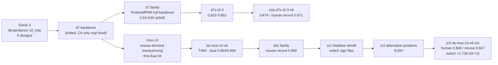

# How the best design was generated — full lineage of `sr2-ds-mce-14-v6-r2c`

The best design of challenge 02, in one line of ancestry:

    Genie 3  ->  d7 family (ProteinMPNN)  ->  directed evolution  ->
    mouse-directed redesign  ->  dual-select generations  ->
    histidine switch retrofit  ->  E33H

## The generations, step by step

**Step 0 — calibration (before any design).** The released Anthropic/Adaptyv
campaign (150 TNF-alpha designs, 13 wet-lab binders) was re-scored through this
pipeline. It set the bars: submission line ipSAE >= 0.8; mouse cross-reactivity
tracks tightness (only the tightest designs bound mouse); the generator choice
matters (Genie 3 8/23 vs PXDesign 4/57 vs RFdiffusion3 1/40); and the pipeline
itself reproduces the released scores within +/-0.03. Files:
`notes/filter-calibration.md`, `notes/calibration/`.

**Step 1 — Genie 3 backbone generation.** The released TNF-alpha problem
(`10_tnfa`, hotspots B102 + D62) was generated with Genie 3 (aqlaboratory,
347 MB checkpoint): 8 designs; all 8 placed on the designed interface. The
`d7` backbone (64-residue binder) was the one that survived folding. Files:
`~/c2-work/genie3/tnfa-smoke-01.yaml`, `notes/genie3-feasibility.md`.

**Step 2 — the d7 family (the first real win).** Key lesson: CA-only
ProteinMPNN sequences capped at 0.248 ipSAE. Re-sequencing the FOLDED
backbone with full-backbone ProteinMPNN (vanilla `v_48_020`) gave 18 variants
spanning 0.63-0.85, all at the designed site; champion `d7x-t3-3`
(0.832-0.852). Backbone first, then many sequences on it — the winners are
family-structured. Files: `notes/genie3-round2-family.md`,
`notes/genie3/family.csv`.

**Step 3 — directed evolution.** Fixed-position ProteinMPNN around the
champions (3 mutable positions per variant). `e1b-d7x-t3-3-v6` = champion +
ONE substitution (D47A) reached 0.871 — the human-target record. Two setup
bugs (mutation template, one-letter residue codes) were caught by the
validation gate before any fold was spent. Files:
`~/c2-work/genie3/evolution-01/`.

**Step 4 — mouse-directed redesign (mce).** The mouse check showed the family
kept the designed interface on mouse but at degraded scores (0.46-0.64) —
below the band of released mouse binders (0.73-0.89). Fix: select ON mouse.
The same d7 backbone was re-sequenced (64 sequences, 16 folded vs mouse):
`mce-14` was the first dual hit (mouse 0.704-0.847 / human 0.693-0.852, both
5/5 at the designed junction). Files: `~/c2-work/genie3/mouse-directed/`.

**Step 5 — dual-select generations.** Fixed-position mutants of the dual hits:
`ds-mce-14-v6` (T48S; mouse 0.854 / human 0.856) beat its parent on both
targets; generation 2 (`ds2`) pushed the mouse side to 0.868
(`ds2-mce-14-v7-v1`). Files: `~/c2-work/genie3/dualselect-01/`, `-02/`.

**Step 6 — histidine switch retrofit (sr1).** The challenge ranks pH-selective
binding first, and the linkage check proved the lineage had NO switch — in fact
an inverted one (tighter at pH 6.0). The upstream campaign's mechanism
(histidines facing interface cations) was retrofitted onto the dual
backbones: three His at positions 37/45/43 (`sr1-mce-14-b`: human 0.659 /
mouse 0.703, both 5/5, switch +0.836 = 6.9x the right way). The strongest
variant (c-class, 7.5x) lost mouse. Files: `~/c2-work/switch-retrofit-01/`.

**Step 7 — alternative positions (sr2) — the winner.** A scan of alternative
His sites (positions 30/33, 7-9 A from the interface cations) kept binding
intact: `E33H` alone (converting a salt-bridge residue into the switch)
produced **`sr2-ds-mce-14-v6-r2c`**: human 0.849, mouse 0.847 (both 5/5 at
the designed junction) and the strongest switch this project has measured
(+1.738 = 54.7x toward pH 7.4). Whole-chain resampling recovery (sr3/sr4)
failed on these backbones; the reversion scan (sr6) localized the binding
cost to H37; `sr6-r37` reads the project's best mouse score (0.872).

## The tools (what each one does in this pipeline)

| tool | role |
|---|---|
| Genie 3 (`~/tools/genie3`) | backbone generation (BinderBench problem files) |
| Boltz-2 (`~/.venvs/boltz`) | co-folding: 5 diffusion samples, seed 42, 12.5 GB memory cap |
| ProteinMPNN (`~/tools/ProteinMPNN`) | sequence design: full-backbone and fixed-position modes |
| `screen_all.py` | ipSAE + designed-site screen (contacts to the two-protomer junction) |
| PROPKA + `tools/switch/linkage_score.py` | pH-selectivity: delta_log_Ka over the 6.0-7.4 window |
| `tools/report/molstar_views.py` | Mol* viewpoint renders (visual review) |
| released campaign data | calibration bars (files under `notes/calibration/`) |

## The selection logic (what each step kept)

- Every fold batch is screened with the same rule: best ipSAE at the designed
  two-protomer junction, 5 samples.
- A family survives on backbone quality first; sequences are expanded on the
  surviving backbone.
- Cross-reactivity must be SELECTED for (mouse folds before human confirmation).
- The switch is scored by PROPKA linkage; the SIGN is the decision variable.
- Negative results are recorded, never silently dropped (see
  `notes/linkage-check.md`, `~/c2-work/switch-retrofit-01/README.md`).

## The evidence trail

- Scores of every design ever folded: `notes/genie3/genie3-all-scores.csv`
  (fold rows), `notes/genie3/family.csv` (sequences + spreads).
- Switch evidence: `notes/calibration/sr*-ranked.csv`, `notes/linkage-check.md`.
- Visual review: `notes/views-review-mce14.md`, renders under `viewers/views/`.
- Working tree (folds, yamls, scripts, experiment READMEs):
  `~/c2-work/genie3/` — cleaned 2026-10-18: fold outputs kept only for the
  designs cited in these documents; every removed sequence is archived in
  `~/c2-work/genie3/archive-all-designs.csv`.
