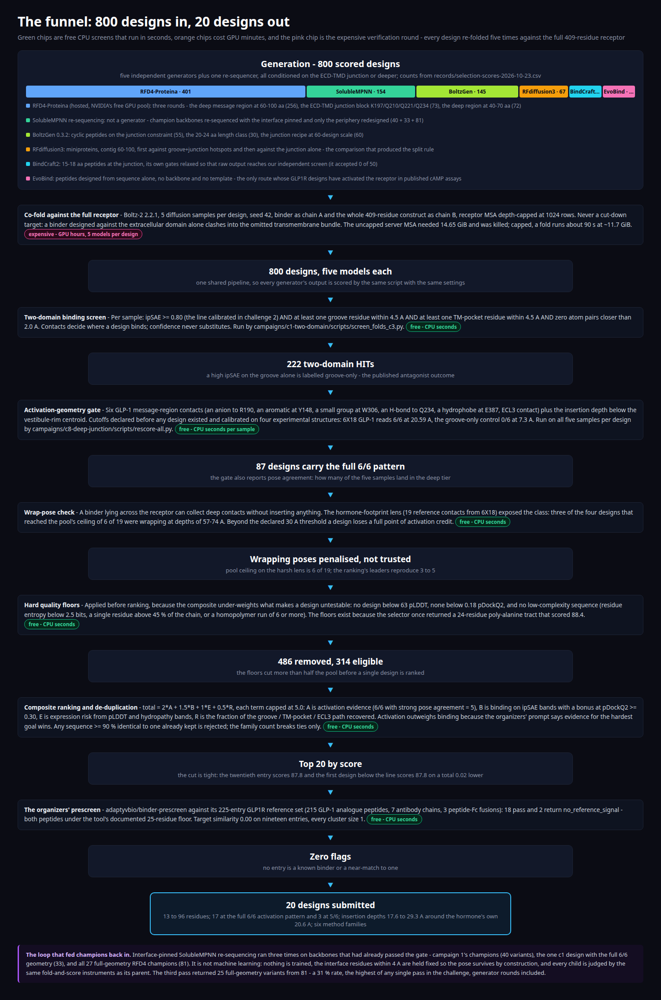
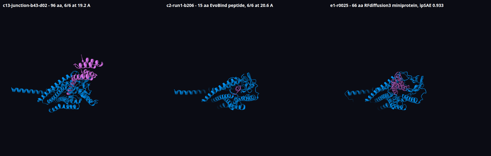
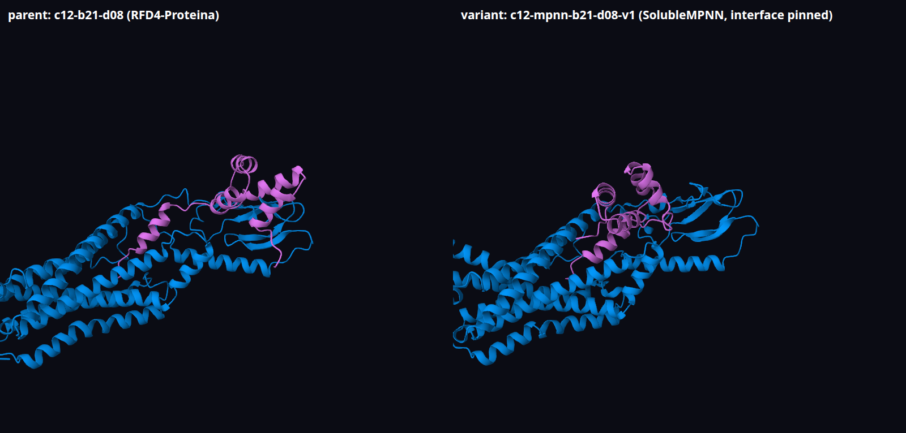

# 03 — GLP1R agonist · the complete history

This document tells the whole story of the GLP1R agonist campaign, from the
scraped challenge page to the submitted twenty designs. It names every tool,
every decision, and the reason for each. The companion records are
`lineage.json` (the campaign history the website renders), `notes/`
(the research and the per-round records), `campaigns/` (the working dirs
and every script), `records/` (the score and prescreen tables) and
`submission/` (the shipped file and the two method texts).

Status: the repo marks the challenge **complete** — twelve campaigns, 800
scored designs, a twenty-design file built on 2026-10-23, two days before
the 2026-10-25 deadline (`../../README.md`, the previous README). Nothing
here is wet-lab validated. No upload receipt and no assay result is
recorded anywhere in the tree; everything below is computational evidence.

---

## 1. The target and what "agonist" means

The brief was captured on 2026-10-18 from the competition hub and the
challenge page (`notes/brief.md`). The target:

| field | value |
|---|---|
| target | human GLP1R, UniProt P43220-1 |
| segment | residues 24–432 (409 aa): the extracellular domain, seven transmembrane helices, the start of the tail |
| supply | receptor in DDM/CHS detergent (assay 13944-H18H-DD, N-FLAG / C-His; proprietary thermostabilising mutations not listed — the public sequence is wild type) |
| recommended epitope | the **peptide-binding groove of the extracellular domain** — where GLP-1, exendin-4 and semaglutide dock |
| structure reference | PDB 6X18, chain R |
| conditions | none — no species, no pH |

Two objectives, in the organizers' order:

1. **Affinity** against human GLP1R, measured on the detergent receptor.
2. **Activation** — a confirmed agonist in a cell-based reporter assay
   (cAMP → secreted alkaline phosphatase → luminescence, compared with
   untreated cells and a reference agonist).

**The objective is functional, and that is the whole difficulty.** A binder
that does not activate does not count. This is the one thing that separates
challenge 3 from every other binder challenge in this repo: the second
objective is not a property of the interface strength, it is a property of
the *pose*. The receptor is a switch, and the question is not "does the
design hold the switch" but "does it push it".

**Our reading of the brief, recorded before any generation**
(`notes/strategies.md`, `submission/methodology.md`). The organizers
recommend the groove. Our reading of the published mechanism was that the
groove is only the **address** half of the job, and that the **message**
half — the part that actually flips the switch — sits deeper, where the
hormone's own N-terminus reaches into the transmembrane bundle. So the
campaign targeted the junction between the two: the place where the
extracellular domain hands over to the membrane-embedded part. That split
reading, address versus message, is the single decision the rest of the
project executes.

---

## 2. The biology in plain words: a switch, and why the groove alone is a trap

**What GLP1R is.** A receptor sitting in the membrane of a cell, of the
family called class-B G-protein-coupled receptors. "Coupled to a G protein"
means: when the right molecule binds the outside of the receptor, the part
of the receptor inside the cell changes shape and grabs a messenger protein
(Gs), which starts a chemical cascade (cAMP). GLP1R is the incretin
receptor — the one the GLP-1 drug class (semaglutide and relatives) targets
to control blood sugar and appetite.

**What the natural agonist does.** The hormone GLP-1 is a 30-residue
peptide, and it binds in two places at once (`notes/research-brief.md`,
citing 10.1016/j.cell.2016.05.023 and 10.1074/jbc.M109.033829):

- its **C-terminal helix** sits in the groove of the extracellular domain —
  a cradle that sticks up above the membrane. This is the address: it is
  what makes the hormone stick to this receptor and not another.
- its **N-terminus** threads down into the transmembrane bundle, past the
  extracellular loops, into a pocket inside the receptor. This is the
  message: these are the contacts that move the helices.

On activation the whole receptor rearranges. In the resting (apo) state the
extracellular domain lies down on the transmembrane part, burying 928 Ų of
surface; in the peptide-bound active state it stands up along the peptide,
that interface shrinks to roughly 350 Ų, the domain's tip travels 18–28 Å,
and the sixth transmembrane helix develops the kink that lets Gs dock
(10.1038/s41467-020-14934-5; 10.1038/nature22394).

**Why the groove alone is a trap — the single most important fact in this
challenge.** Occupying the groove is enough to *block* the hormone and not
enough to *replace* it. The record is unambiguous
(`notes/research-brief.md`):

- the only published de-novo GLP1R extracellular-domain miniproteins
  (dGl1_024, IC50 61 nM; mGl1_008, IC50 39 nM; made with RFdiffusion plus
  MetaGen and screened by yeast display over roughly 17,000 designs) are
  **antagonists** (10.1101/2025.03.23.644666);
- the same study's companion receptors — GLP1R, GIPR, GCGR, CGRPR — all
  yielded antagonists; an agonist was obtained only for a different
  receptor, MRGPRX1;
- of 13 published anti-GLP1R antibodies, the one agonist among them was an
  antibody fused to a GLP-1 peptide; the antibody part alone did not
  activate (10.1080/19420862.2021.1893425).

Non-peptide agonists exist and they all touch the membrane-embedded part,
never the groove alone: orforglipron binds the upper bundle against the
domain's Trp33 lid plus ECL2 and TM1/2/3/7 (a partial, Gs-biased agonist),
danuglipron overlaps the GLP-1 site and reproduces GLP-1 pharmacology, and
TT-OAD2 sits at the ECL3/TM6–7 rim (partial and slow)
(10.1073/pnas.2014879117; 10.1016/j.molcel.2020.09.020;
10.1038/s41586-019-1902-z).

Two public challenge-3 repositories were found during the research pass,
both targeting the extracellular groove, and **both state outright that
they do not engineer activation and do not expect their binders to
activate**. One of them also recorded the trap that follows from using a
cut-down target: binders designed against the extracellular domain alone
clash into the transmembrane bundle that was omitted from the design target
(`notes/research-brief.md`). That became a rule here: generate against a
fragment if you must, but always *fold* against the full receptor.

**A designed agonist versus the natural hormone.** Both are peptides or
small proteins, and they differ in what matters:

| | GLP-1, the hormone | our designed molecules |
|---|---|---|
| origin | evolved; a human hormone | designed in days by five generators |
| size | 30 residues | 13–96 residues in the submitted set |
| what it touches | all four sub-sites: groove 6/6, junction 4/4, TM pocket 4/4, ECL3 5/8 — 19 receptor residues in all | the best in our pool reproduce 6 of those 19 |
| evidence of agonism | decades of pharmacology | a geometry score calibrated on four experimental structures |
| what decides | the clinic | the organizers' cAMP reporter assay |

**What the competition actually measures, and what it does not.** Binding
is measured first; only confirmed binders go into the activation assay. So
a design must survive two gates in the real world, and the second one has
no public in-silico predictor at all. That absence is the subject of
chapter 4.

---

## 3. The reference structures and what we measured on them

**Why structures matter here.** A single receptor molecule is far too small
to photograph. Structures come from X-ray crystallography or cryo-electron
microscopy: many copies of the molecule, a beam, a diffraction or image
series, and mathematics that turns the pattern into atom positions. Every
geometric number in this project is measured on such files with our own
scripts; nothing is estimated.

**The primary file: 6X18** (2.1 Å, 10.1016/j.molcel.2020.09.020) — GLP-1
bound to GLP1R with the Gs protein attached: the active state, caught with
the hormone in place. Our own read of the file
(`notes/groove-contacts.md`, produced by
`campaigns/c1-two-domain/scripts/analyze_6x18.py`):

- chains A (355 residues), B (338), G (56), N (126), P (30), R (384);
- **chain R is the receptor**, aligned identity **0.969** against the
  challenge segment in UniProt numbering — close enough to use directly;
- **chain P is GLP-1**, 30 residues;
- **56 receptor residues sit within 4.5 Å of the peptide**, and they fall
  into three zones: the extracellular groove (residues 30–145), the
  ECD/TMD junction (148–241) and the transmembrane pocket (297–392). The
  full list is in that note; the hotspot file is
  `inputs/groove-hotspots.csv`.

Those 56 residues were cut into the four sub-site sets that every screen in
this project uses (`campaigns/c1-two-domain/scripts/screen_folds_c3.py`):

| sub-site | residues (UniProt P43220 numbering) | what it is |
|---|---|---|
| groove | D67, Y69, Y88, W91, R121, E128 | the address: the cradle on top |
| junction | K197, Q210, Q221, Q234 | where the domain hands over to the membrane part |
| TM pocket | T298, N300, I309, I313 | the top of the bundle, on the hormone's path inward |
| ECL3 / TM6–7 | 376, 377, 380, 381, 384, E387, 388, 391 | the loop region that reorganizes on activation; 387 is a published reach anchor |

**The calibration ladder.** Four more experimental structures were used, not
as design targets but as a measuring stick for the activation scorer
(chapter 4): **6X18** (GLP-1, full agonist), **6B3J** (exendin-P5, the
known G-protein-biased full agonist), **7LLL** (exendin-4, full agonist)
and **9IVG** (GLP-1(9-36), the weak partial agonist metabolite). Their
numbers are in `notes/agonism-geometry-2026-10-20.md`.

**Supporting files named in the research brief** (`notes/research-brief.md`):
3IOL for the extracellular-domain groove contacts (the hormone's
hydrophobic face Leu25/Phe28/Ile29/Leu32/Val33 packing the groove, Val33
hydrogen-bonding Arg121, Lys26 to Glu128), 5NX2 (active-like), **6LN2**
(peptide-free, closed extracellular domain — the resting state), 6XOX /
6X1A / 6X19 (small-molecule complexes) and 6ORV (TT-OAD2).

**One measurement that saved the project from a silent error.** A contact
depth means nothing if the folded receptor is in the wrong state: a closed,
self-inhibited receptor makes unrelated contacts look like reach. So the
folds were checked against 6X18 directly — for the campaign-1 leader
`e1-r0025` the intra-receptor CA distances agree with 6X18 within 2–4 Å at
residues 67/91/121–300/234, i.e. Boltz folded the receptor **active** with
the depth-capped MSA (`notes/strategies.md`,
`campaigns/c1-two-domain/LEARNINGS.md`). The learnings file states the
rule plainly: verify the receptor state before trusting any depth metric,
every time.

---

## 4. The doctrine: no tool predicts agonism, so build and calibrate one

**The problem, stated.** The published record says confidence scores do not
separate agonists from antagonists (A. Muratspahic et al., Nature 2026, as
quoted in `notes/agonism-geometry-2026-10-20.md`). An independent
October 2026 benchmark found that interface-confidence scores have **zero
association with epitope engagement** at all
(`notes/scoring-upgrades-2026-10-19.md`). And the project's own research
pass found no open-weight GLP-1R potency model and no trustworthy open
PPI-affinity head. In short: the metric that would answer objective 2 did
not exist, and the metrics that did exist could not even be trusted to say
*where* a design binds.

Three consequences were adopted as doctrine, each of them recorded with its
evidence:

1. **The designed-site contact screen is mandatory, for every design, from
   every generator.** Confidence numbers rank, contacts decide.
2. **A generator's own metrics are never a filter.** Two measurements
   forced this. BoltzGen's internal ipTM called its best junction designs
   weak at 0.21–0.41 while our independent screen put the same designs at
   ipSAE 0.77–0.86 (`campaigns/c3-boltzgen-cyclic/README.md`). And
   BindCraft2 accepted **0 of 50** trajectories by its own gate — yet among
   its rejected raw output was the best design in the challenge at that
   date (`c5-bc2-l18_bfe509d11b1b8f27`, ipSAE 0.861, a two-domain HIT;
   `notes/best-per-campaign.md`). A generator's gate would have thrown
   away the winner.
3. **Rank on metrics that were measured against outcomes.** The screen was
   upgraded on 2026-10-19 from the 3,766-binder meta-analysis (Overath et
   al. 2025, bioRxiv 10.1101/2025.08.14.670059), which found **ipSAE_min
   the single best predictor** of real binding; the screen now extracts
   ipSAE, ipSAE_d0chn, ipTM_af, pDockQ, pDockQ2 and LIS from every IPSAE
   report, plus binder pLDDT and inter-chain PAE
   (`notes/scoring-upgrades-2026-10-19.md`). The same pass fixed a
   column mislabel: what the screen called pDockQ2 had been reading pDockQ.

### 4.1 The activation-geometry gate

On 2026-10-20 a community scan found the first usable activation scorer: an
unmerged but openly readable file, `scripts/activation_geometry.py` in pull
request #98 of `charleneleong-ai/ai4science`. It does not predict agonism
statistically — it **measures the activating geometry directly**, feature by
feature, with cutoffs declared before any design exists. It was run
verbatim, never modified. (The third-party copy was removed from the repo
in commit 33f8592; it runs from
`~/c3-work/c8-agonism/scorers/activation_geometry.py`, which is outside the
repository. The scorer's own comments are the source for the parameters
below.)

**The six features** — the GLP-1 message region's pharmacophore, ranked by
the mutational cost of losing each one, all in UniProt P43220 numbering,
with cutoffs set 1.0 Å looser than the distance the native complex
achieves:

| # | feature | what the design must place, and where | cutoff |
|---|---|---|---|
| 1 | `anion_to_R190` | a carboxylate oxygen at Arg190's guanidinium nitrogens | 4.2 Å |
| 2 | `aromatic_at_Y148` | an aromatic ring at Tyr148 (also 141/144/388) | 4.5 Å |
| 3 | `small_at_W306` | any atom at Trp306's ring edge | 4.5 Å |
| 4 | `hbond_to_Q234` | a hydrogen-bond partner at Gln234's amide | 4.0 Å |
| 5 | `hydrophobe_at_E387` | a hydrophobic contact at Glu387/388 | 4.5 Å |
| 6 | `ecl3_contact` | any contact at 372/373/380 | 4.5 Å |

**Plus a depth.** How far below the mouth of the receptor the ligand
reaches. The mouth is defined by the receptor itself — the centroid of the
vestibule-rim residues 205, 210, 211, 214, 215, 221, 298, 299, 300, 372,
380 — and the direction is the vector from that centroid to the centroid of
the pocket floor (234, 237, 241, 306, 310, 313, 387). The deepest ligand
atom projected on that axis is the reported depth. No membrane is modelled,
which is why the axis is taken from the protein.

**The tiers**, straight from the scorer's constants: `wrong_face` if more
contacts are intracellular than either extracellular-domain or
transmembrane; **`deep` if the depth is ≥ 16.0 Å and at least 3 features are
satisfied**; `shelf` if depth ≥ 10.0 Å; otherwise `groove`.

**Calibration: reproduced, not trusted.** The gate was run on four
experimental structures before it was allowed to score a single design, and
it reproduced the source's numbers exactly, including the known quirks
(`notes/agonism-geometry-2026-10-20.md`):

| structure | ligand | features | depth | the quirk |
|---|---|---|---|---|
| 6X18 | GLP-1, full agonist | **6/6** | 20.59 Å | — |
| 6B3J | exendin-P5, full agonist | 4/6 | 23.57 Å | misses the R190 anion at 5.03 Å — it is the known G-protein-biased agonist |
| 7LLL | exendin-4, full agonist | 4/6 | 18.92 Å | misses the Q234 bond at 4.93 Å |
| 9IVG | GLP-1(9-36), weak partial | 1/6 | 14.15 Å | — |
| — | GLP-1 16-36 (groove-only control) | 0/6 | 7.3 Å | the source's own negative control |

That ladder is what gives the gate meaning: a design's score means the same
thing the lab's agonists and partial agonists mean. A full agonist reads
4–6 features at 18.9–23.6 Å; a groove-only ligand reads 0 features at 7 Å.

**The gate's declared limit, and the mitigation.** The scorer scores the
pose it is given, not whether the design would adopt it. The mitigation is
pose agreement: every design is folded five times and the gate is run on
every sample, so the gate reports **two separate figures** — the feature
count from the best sample, and how many of the five samples land in the
deep tier. The notation `6/6 d19.2 5/5` therefore reads: the best sample
reproduced all six contacts at 19.2 Å, and all five samples were deep.

### 4.2 The second, harsher lens, and what it caught

A design can pile up contacts without inserting anything. To catch that,
a second scorer measures how much of the **hormone's whole footprint** each
design reproduces (`campaigns/c3-boltzgen-cyclic/scripts/agonist_likeness.py`,
documented in `notes/agonist-likeness-2026-10-20.md`). GLP-1 in 6X18
touches 19 receptor residues: groove 6/6, junction 4/4, TM pocket 4/4,
ECL3 5/8. The metric is the fraction of those 19 a design reproduces, and
it is harsh on purpose.

The result, over 644 folded designs (`notes/likeness-finding-2026-10-22.md`):

- **no design in the pool is agonist-like in absolute terms.** The pool
  ceiling is **6 of 19**; the top-ranked full-geometry designs reproduce 3
  to 5 of 19.
- Four designs hit the 6/19 ceiling — and the depth check disqualified
  three of them immediately. Their apparent reach came from **wrapping
  poses**, insertion depths of 57 to 74 Å: a binder lying *across* the
  receptor, not inserting into it. Their pattern was an artifact of
  counting contacts on a molecule draped over the target.
- Exactly one design survived both lenses at the time:
  `c12-mpnn-b13-d01-v3` (6/6 at 23.9 Å, 5/5 agreement, likeness at the
  ceiling, ipSAE 0.855). It was swapped into the twenty on 2026-10-22 and
  then swapped back out by the 2026-10-23 pure-score rebuild (chapter 8).
- An earlier run of the same metric over 146 designs had put the ranking's
  leaders at 0.26–0.32 and noted that the likeness ranking disagrees with
  the affinity ranking (`notes/agonist-likeness-2026-10-20.md`). It does;
  the disagreement is the wrap-pose problem.

The wrap-pose threshold was fixed at **30 Å** and applied as a penalty, not
a veto: in the final rubric a 6/6 design deeper than 30 Å loses a full
point of activation credit.

**The methodological conclusion, recorded verbatim in the finding note:** a
screen can only discard, it cannot supply a feature the generator never
produced. The likeness dead-end said the pool already contained everything
groove/junction conditioning could reach, and that the remaining upside lay
in aiming *generation* at the pattern — which is the shelved
reward-guidance work of chapter 6.

### 4.3 The instrument matrix

| instrument | what it was asked | what it read | action taken |
|---|---|---|---|
| ipSAE (IPSAE on Boltz-2 folds) | does it bind? | the bar is the challenge-2-calibrated 0.8; the challenge's best read is 0.934 | the binding bar; kept throughout |
| pDockQ2, LIS, pDockQ, ipTM_af, inter-chain PAE | interface quality | all extracted per sample from the IPSAE report | pDockQ2 entered the composite; the rest are recorded |
| binder pLDDT, Kyte-Doolittle hydropathy | will it express? | pool-wide; the submitted set spans pLDDT 63.4–86.2 | the expression term and a hard floor |
| the two-domain contact screen | *where* does it bind? | 222 two-domain HITs across the pool | mandatory triage; confidence never substitutes for it |
| the activation-geometry gate | does it reproduce the activating geometry? | calibrated 6/6 @ 20.59 Å on GLP-1, 0/6 @ 7.3 Å on the groove-only control | the primary ranking axis |
| the agonist-likeness lens | how much of the hormone's whole footprint? | pool ceiling 6/19; exposed the wrapping class at 57–74 Å | a disqualifier for wrap poses |
| BoltzGen's internal metrics | can the generator rank its own output? | ipTM 0.21–0.41 where our screen read 0.77–0.86 | never used as a filter |
| BindCraft2's own gate | same question | accepted 0 of 50, including the then-best design | never used as a filter |
| DeorphaNN | an orphan-GPCR agonism model | blocked on its input requirements (AF-multimer plus Arpeggio) | not integrated; recorded as a blocker (commit f24aca5) |
| reward-guided RFD4 (metric guidance) | aim generation at the gate itself | five attempts, all memory-killed: 13.29/13.30 GiB at a 15.6 GB WSL cap, then 19.84/19.12/20.03 GiB after raising the VM to 23 GB | shelved with the metric and config ready; see chapter 6 |
| the organizers' prescreen (`adaptyvbio/binder-prescreen`) | is it novel, is it a known binder? | clean on every candidate set run | a release gate |

---

## 5. The pipeline, stage by stage

Each stage states its hypothesis, the numbers it produced, and the decision
that followed.



*The whole pipeline as a funnel: 800 designs from five generators plus one
re-sequencer, the filter at every stage, and the tool behind every metric.
Green chips are free CPU steps that run in seconds, orange chips cost GPU
minutes, and the pink chip is the expensive verification round — the
five-sample Boltz-2 co-fold of every design against the full 409-residue
receptor, which every number downstream is computed from. The note at the
bottom marks the loop that fed champions back in: interface-pinned
SolubleMPNN re-sequencing, which ran three times and produced 154 of the
800 designs.*

**Stage 1 — Generation.** *Hypothesis:* the activating pose needs the
junction, so conditioning generation on the junction will produce it more
often than conditioning on the groove. *Procedure:* five independent
generators, each a different bet on the same question, generating against a
fragment of the receptor (RFdiffusion3 needs the target under ~250 residues
to run at all) or against the annotated full construct. *Numbers:* 800
designs scored in total, by generator family:

| colour in the funnel | generator | designs | what the conditioning asked for |
|---|---|---|---|
| blue | RFD4-Proteina (hosted) | 401 | three rounds: the deep message region (256), the ECD–TMD junction block (73), the deep region at 40–70 aa (72) |
| green | SolubleMPNN re-sequencing | 154 | not a generator: re-sequences existing champion backbones with the interface pinned (40 + 33 + 81) |
| lime | BoltzGen | 145 | cyclic peptides at the junction (55), 20–24 aa peptides (30), the junction recipe at scale (60) |
| amber | RFdiffusion3 | 67 | miniproteins, contig `60-100`, against the groove+junction set and then the junction alone (`inputs/rfd3-e1.json`, `inputs/rfd3-e1b.json`) |
| cyan | BindCraft2 | 18 | 15–18 aa peptides at the junction, gates relaxed so raw output reaches our screen |
| pink | EvoBind | 15 | peptides designed from sequence alone, no backbone, no template |

The counts come from `records/selection-scores-2026-10-23.csv`, whose
eleven family labels sum to 800 (337 + 73 + 72 + 67 + 60 + 55 + 40 + 33 +
30 + 18 + 15). The table above regroups them by *what made the sequence*:
the selector's 337 "rfd4-proteina" rows are the 256 deep-round designs
**plus** their 81 re-sequenced variants, because both share the `c12`
prefix, so those 81 are counted under SolubleMPNN here (40 + 33 + 81 =
154) and the RFD4 slice holds only the three generation rounds
(256 + 73 + 72 = 401).

*Decision:* the junction conditioning won on both generators that tested
it, and the hosted RFD4-Proteina rounds won on every axis. Both findings are
in chapter 6.

**Stage 2 — The co-fold (the expensive step).** *Hypothesis:* a Boltz-2
co-fold against the **full** 409-residue construct, never a fragment, is
the only honest way to see whether a design clashes into the part of the
receptor the generator never saw. *Procedure
(`submission/design-method.md`):* Boltz-2 2.2.1, 5 diffusion samples per
design, seed 42, binder as chain A, the full construct as chain B, receptor
MSA depth-capped at 1024 rows. *Numbers:* the uncapped server MSA needed
14.65 GiB and was killed by the memory watchdog; fetched once and capped,
folds run at about 90 s and ~11.7 GiB
(`campaigns/c1-two-domain/LEARNINGS.md`,
`campaigns/c1-two-domain/scripts/fetch_msas.py`). *Decision:* this
became the one shared pipeline — every design from every generator is
re-folded here, so all 800 are scored by the same script with the same
settings.

**Stage 3 — The two-domain binding screen.** *Hypothesis:* a high ipSAE
with the binder sitting only on the groove is the known antagonist outcome,
so the screen must test the footprint, not just the score. *Procedure
(`campaigns/c1-two-domain/scripts/screen_folds_c3.py`):* per sample,
ipSAE ≥ **0.8** (the line calibrated in challenge 2: below it, nothing bound
in the wet lab) **and** ≥ 1 groove residue within 4.5 Å **and** ≥ 1
TM-pocket residue within 4.5 Å **and** zero atom pairs closer than 2.0 Å.
A design meeting the contact test but not the score is labelled
`groove-only`. *Numbers:* the campaign table totals **222 two-domain
HITs** across the twelve campaigns
(`notes/campaign-tables-2026-10-23.md`; its per-campaign figures do not
always match the campaign notes — see chapter 11). *Decision:* kept as the
binding objective's record for every campaign; the clash column is what
catches the trap the public repos fell into.

**Stage 4 — The activation-geometry gate.** *Hypothesis:* a design that
independently reproduces the hormone's message-region geometry is the best
available bet on agonism. *Procedure:* the calibrated gate of chapter 4,
run on every one of the five samples of every design
(`campaigns/c8-deep-junction/scripts/rescore-all.py`, which parses the
scorer's report lines with regexes so column padding cannot shift fields,
and caches per-sample rows because the per-sample scoring is the expensive
half — one scorer subprocess per model). *Numbers:* **87 of 800 designs
carry the full 6/6 pattern on at least one sample**; the first full rescore
(2026-10-20) covered 213 designs and 1,065 samples and found six.
*Decision:* the gate became the primary ranking axis, and its verdict
redirected generation twice — campaign 8 exists only because the gate said
the c3 junction recipe produced 4 of the first 6 perfect geometries.

**Stage 5 — The wrap-pose check.** *Hypothesis:* deep contact counts can be
faked by a binder lying across the receptor. *Numbers:* 40 of the deep-tier
designs in the first rescore sat at depths of 40–68 Å; of the four designs
that reached the likeness ceiling, three were wrapping at 57–74 Å.
*Decision:* a declared 30 Å threshold; beyond it the activation score loses
a point, and the flagged designs are not trusted.

**Stage 6 — Quality floors, then the composite, then de-duplication.**
*Hypothesis:* the composite under-weights the things that stop a design
from ever being tested, so those must be hard floors applied before
ranking. *Procedure
(`campaigns/c8-deep-junction/scripts/select-top20.py`):* no design below
**63 pLDDT**, none below **0.18 pDockQ2**, and no low-complexity sequence
(residue entropy < 2.5 bits, or a single residue above 45 % of the chain, or
a homopolymer run of 6 or more). Then rank by
`total = 2·A + 1.5·B + 1·E + 0.5·R` (chapter 8), then reject any sequence
≥ 90 % identical to one already kept. *Numbers:* the floors **remove 486 of
the 800 scored designs and leave 314 eligible**. The floors exist because
the selector once returned a 24-residue poly-alanine tract that scored 88.4
— the comment in the script says so. *Decision:* floors first, score
second, diversity only as a tie-break.

**Stage 7 — The organizers' prescreen.** *Procedure:* the organizers' own
public tool, `adaptyvbio/binder-prescreen`, whose GLP1R reference set is
225 curated entries (215 GLP-1 analogue peptides, 7 antibody chains, 3
peptide-Fc fusions). *Numbers:* on the shipped twenty
(`records/prescreen-report-rubric-2026-10-23.csv`): **18 pass, 2 return
`no_reference_signal`** — both of them peptides (13 and 15 residues), which
is the tool's documented blind spot for sequences under 25 residues, not a
failure. Target similarity is 0.00 for nineteen of the twenty and 0.095 for
the twentieth; every cluster size is 1, so no two entries are duplicates by
the platform's own check. An earlier run on 2026-10-21 over 17 lead
candidates returned **zero flags** (9 pass, 8 `no_reference_signal`).
*Decision:* the file ships.

---

## 6. The campaigns (twelve in all)

Each campaign below names its date, strategy, tools and result. The
primary record is `lineage.json`, whose twelve experiments carry the
per-step text, the tool list and the outcome for each; the per-campaign
working notes are in `campaigns/*/README.md` and `notes/`.



*The same epitope reached three ways. Left: `c13-junction-b43-d02`, the
96-residue junction-conditioned RFD4 champion that leads the submission (6/6
at 19.2 Å, all five samples deep, ipSAE 0.918). Middle: `c2-run1-b206`, the
15-residue EvoBind peptide that reproduces the full pattern at 20.6 Å — the
hormone's own depth in 6X18 is 20.59 Å. Right: `e1-r0025`, the 66-residue
RFdiffusion3 miniprotein with the pool's highest ipSAE at 0.933 and 5 of 6
contacts. The receptor is the same full 409-residue construct in all three
panels; the designs differ by a factor of six in size and land in the same
place. Each panel comes from its own campaign's viewer page, so the
receptors were superposed onto the left panel's frame (CA RMSD 5-7 A, the
folds' own conformational spread) and all panels share one camera; the
binder is magenta, the receptor blue.*

**Why the numbering has gaps.** The campaigns are numbered c1, c2, c3, c5,
c6, c7, c8, c9, c12 (twice), c13, c14 — and the gaps have three different
explanations:

- **c4 was merged into c3.** It ran as `c4-junction-scale`, 30 more
  junction designs on the identical spec, and both the lineage record (the
  chapter whose id is literally `c4` inside the c3 experiment) and the
  README treat it as c3's fourth batch
  (`campaigns/c3-boltzgen-cyclic/README.md`).
- **c12 is two entries** because the generation round and the re-sequencing
  pass over its own champions are separate experiments in `lineage.json`
  (`c12-rfd4-proteina` and `c12-mpnn-variants`), and the selector maps both
  to the `c12` family prefix.
- **c10 and c11 have no record at all.** Searching the whole challenge tree
  and the git history for them returns exactly two artifacts: a prepared
  generation spec, `inputs/rfd3-c11.json` ("c11-deep": a local
  RFdiffusion3 run against the full construct with deep hotspots
  R118/R178/R275/R276/R277/R283/R357/R361), for which no design, fold or
  score exists anywhere; and the shelved reward-guided RFD4 plan
  (`notes/rfd4-guidance-plan.md`, added 2026-10-22 in commit fa7cb4a,
  closed the same day in commit 13be510, removed from the tree in commit
  33f8592). The record does not say which of those was c10 and which c11,
  or whether the numbers were simply skipped. What the shelved plan does
  record is a complete negative: the metric-guidance route — differentiating
  a soft version of the activation gate against the model's predicted clean
  state, the only method that would have aimed generation *at* the pattern
  instead of filtering into it — was coded, registered and never run,
  because five attempts were memory-killed (13.29 and 13.30 GiB against a
  15.6 GB WSL cap on both the full and the trimmed target, then 19.84,
  19.12 and 20.03 GiB after `wsl --shutdown` raised the VM to 23 GB). The
  decomposition is recorded too: an eager baseline of ~14.5 GiB plus about
  5 GiB that `torch.compile` adds and `compile_lengths=null` does not
  remove. The metric and the config are ready for any machine with 20+ GiB
  of headroom.

**Not every campaign is the same kind of experiment.** Three kinds appear
below. (1) *A new generator at the same site*: c1 (RFdiffusion3), c2
(EvoBind), c3 (BoltzGen), c5 (BindCraft2), c12 (RFD4-Proteina). (2) *A new
region or a new length band with a generator that already works*: c7 (20–24
aa), c8 (the c3 recipe at scale), c13 (the junction block on RFD4), c14
(40–70 aa on RFD4). (3) *No new generation at all*: c6, c9 and c12's
variant pass re-sequence backbones that already exist.

**C1 — two-domain miniproteins** (2026-10-18 → 10-19; `partial`). Tools:
RFdiffusion3, ProteinMPNN, Boltz-2, IPSAE. Strategy S1 of
`notes/strategies.md`: generate miniproteins that dock the groove *and*
extend toward the transmembrane pocket. Three generation experiments —
E1 (43 backbones, groove+junction hotspots), E1b (60, junction only), E1b2
(80, the junction repeat) — plus E3, a fixed-interface ProteinMPNN
refinement round. 183 backbones generated; 77 designs folded (8 folds lost
to memory kills were recovered in a retry pass); 335 samples screened.
**Result: 39 of 335 samples are two-domain hits across 21 distinct
designs.** The campaign's decisive measurement is the hotspot comparison:
**junction-only conditioning gave 25 % two-domain designs in E1b2 against
14 % for groove+junction in E1** — the "split rule" that every later
campaign inherited. Best design `e1-r0025`: ipSAE 0.933, pDockQ2 0.493, a
66-residue binder whose 4.5 Å contact map covers 17 groove residues, 17
junction residues, 5 TM-top residues and 7 ECL3/TM6–7 residues including
E387. Two negatives were recorded as carefully as the positive: plain
ProteinMPNN re-sequencing **collapses to poly-alanine** on RFdiffusion3's
alanine-rich helices (e1-r0007's chain A is ~45 % alanine), and
`low_memory_mode=True` is a trap on large targets. (Count note: the lineage
viewer carries 57 c1 designs, the 10-20 campaign table says 57, the final
rescore table says 67, and `notes/strategies.md` says 77 folded — see
chapter 11.)

**C2 — peptide agonists with EvoBind** (2026-10-19; `promising`). Tools:
EvoBind, Boltz-2, IPSAE. The rationale is the only experimental agonism
prior available: EvoBind is the one published pipeline whose GLP1R designs
have **activated the receptor in cAMP assays** (a dual GCGR/GLP1R cyclic
agonist at EC50 32 nM). Four runs against the 207-residue fragment, 300
iterations each: run 1 (15 aa linear, best iteration 206), run 2 (15 aa
cyclic, converged to the ALAWCVNFIEDRAPS family), run 3 (20 aa cyclic,
stopped at 245 of 300 but converged by iteration ~229) and run 4 (12 aa
cyclic, 298 iterations, converged to IVGETCPVKCFC). **The length sweep is
the result: 15 aa is the sweet spot.** 15 aa gave three hits at ipSAE
0.83–0.88; 20 aa gave none (best 0.780, groove-only, binder pLDDT 33–55);
12 aa gave none (best 0.802 with zero groove contacts, pLDDT 23–55). One
honest method note: runs 1 and 2 were launched without
`--receptor_if_residues`, so EvoBind picked its own site on the whole
fragment — and picked the orthosteric region anyway. The campaign's peptide
`c2-run1-b206` (MLIRYFVNQQRNYNP) went on to carry the full 6/6 geometry at
20.6 Å and is the only non-RFD4 peptide in the final twenty.

**C3 — BoltzGen cyclic peptides, including the c4 scale batch**
(2026-10-20; `promising`). Tools: BoltzGen 0.3.2, Boltz-2, IPSAE,
reactifpTM. A second, independent peptide generator at the same site. Four
batches: batch 1 on the groove+junction constraint (7 single-design runs,
all weak), batch 2 on the junction alone (the c1 lesson, and the better
batch), batch 3 twelve more junction designs, batch 4 — logged as campaign
4 — thirty more. 55 designs screened; **7 two-domain HITs**. Two findings
of lasting value. First, the junction-only constraint transferred from a
different generator: deeper reach (tm 1–4, ecl3 4–7) and better sample
consistency. Second, **BoltzGen's own metrics ranked its best designs
wrongly** (its ipTM 0.21–0.41 against our 0.77–0.86) — the measurement
behind doctrine 2 of chapter 4. Operationally: the pipeline fits a 12 GB
card only at one design per run with a fresh output directory, because
retries into the same directory accumulate state (a failed 10-design run
made the next "1-design" retry regenerate all 11 and die at 13.9 GiB).
Four of the first six perfect activation geometries came from this
campaign's junction batches.

**C5 — BindCraft2 peptides** (2026-10-20; `promising`). Tools: BindCraft2,
Boltz-2, IPSAE. A third generator at the junction, 50 trajectories,
15–18 aa, with BindCraft2's gates deliberately relaxed so that raw output
would reach our independent screen. **BindCraft2 accepted 0 of 50 by its
own gate.** 18 designs screened on our pipeline, 4 two-domain HITs — and
one of them, `c5-bc2-l18_bfe509d11b1b8f27` (ipSAE 0.861), was the best
design in the challenge at that date. The lineage still records this
campaign's verdict detail as "Pending full screening", which is stale: the
campaign tables and `notes/best-per-campaign.md` carry the finished
numbers.

**C6 — SolubleMPNN re-sequencing of the c1 champions** (2026-10-20;
`record`). Tools: SolubleMPNN (run from the LigandMPNN checkout with
`--model_type soluble_mpnn`), Boltz-2, IPSAE. This campaign exists because
of c1's poly-alanine failure and one tool measurement: SolubleMPNN produces
28 % mean alanine where ProteinMPNN produced 47 % on the same backbone. Five
champion backbones (e1b2-r0036, e1-r0014, e1b-r0059, e1-r0025, e1b-r0037),
binder residues within 4.5 Å of the receptor **pinned**, only the periphery
redesigned at temperature 0.1, 8 sequences per backbone, 40 designs folded.
**20 samples cleared the two-domain bar** — the challenge's running total
went from 49 to 80 in one campaign. `c6-e1-r0025-s2` reads ipSAE **0.934**
with the full groove (6 of 6 groove residues), the highest ipSAE of the
whole challenge; `c6-e1b-r0059-s5` took the composite lead at 19.42 with
the deepest reach recorded at the time (groove 5/6, tm 4/4, ecl3 8/8). The
finding: one backbone produced a whole family better than the original on
affinity, groove coverage and reach — the measured repeat of a challenge-2
precedent.

**C7 — extended-length peptides, 20–24 aa** (2026-10-20; `partial`). Tools:
BoltzGen, Boltz-2, IPSAE. The one untried length class, everything else
held at c3's best configuration. 30 designs sampled, **5 two-domain HITs**.
*Verdict: viable, not superior.* Longer peptides cover **more** of the
groove — two of them touch all six groove residues, which no 15 aa peptide
did — but they do not beat the 15–18 aa band on affinity (best 0.834 against
0.934). No design from this campaign carries the 6/6 geometry, and none
entered the submission. An honest negative with a clear cause.

**C8 — the junction recipe at scale** (2026-10-21; `promising`). Tools:
BoltzGen, Boltz-2, IPSAE, the activation-geometry gate. This campaign
exists because of one measurement: the gate's first full rescore said the
c3 junction-only configuration had produced 4 of the 6 perfect geometries
in the whole pool. So the identical spec was run 60 more times. **The yield
held: 3 more 6/6 designs** — `c8-run41` (6/6 at 21.0 Å, 5/5 agreement),
`c8-run13` (6/6 at 17.6 Å, 4/5, and also a two-domain HIT — the strongest
both-lens design of the time) and `c8-run20` (6/6 at 18.1 Å but only 1/5
agreement, flagged). 105 of 300 samples landed in the deep tier. The
activation pool went from six designs to nine. `c8-run13`, a 13-residue
peptide, is in the final twenty.

**C9 — re-sequencing the 6/6 miniprotein** (2026-10-21; `record`). Tools:
SolubleMPNN, Boltz-2, IPSAE, the activation-geometry gate. The c6 recipe
applied to the one c1 design that carried the full activation geometry:
`e1b2-r0065`, the 84-residue miniprotein, 47 interface positions pinned.
33 variants folded. **5 carry the full 6/6 pattern, several deeper than the
parent**, and 13 are two-domain HITs. `c9-e1b2-r0065-s4` (ipSAE 0.911, 5/6
at 21.2 Å) led the campaign and entered the 2026-10-21 twenty. (Record
conflict: the README, `notes/campaign-tables-2026-10-23.md` and
`notes/best-per-campaign.md` all describe this campaign as "SolubleMPNN
on c3 champions", while `lineage.json`, every design id in it and the
viewer page `viewers/multiview/c9-solublemnn-resequenced.html` say the
parent is `e1b2-r0065`, a campaign-1 design. The primary record wins: the
parent is the c1 miniprotein. The selector's family label for these designs
is `solublemnn-c3`, which is where the confusion comes from.)

**C12 — RFD4-Proteina on NVIDIA's hosted GPU pool** (2026-10-22; `record`).
Tools: RFD4-Proteina (hosted), Boltz-2, IPSAE, the activation-geometry
gate. The strongest open generator the project had not used, available free
on NVIDIA's Hugging Face Spaces until 2026-11-04, conditioned on the deep
message region (TM pocket and ECL3) — the half of the activation span no
earlier generator had reached. **256 designs** across a medium-thinking and
a high-thinking round, 8 designs per request, design segment 60–100
residues, receptor 1–409 fixed in the annotated CIF
(`inputs/rfd4-c12.yaml`). The spec's hotspot atom selections name the
message region explicitly — T298, R299, N300, W306, R380 and L384, written
in fold numbering (fold n = UniProt n − 23) as residues 275, 276, 277, 283,
357, 361. Every design re-folded against the full
construct by the same pipeline as everything else. **27 carry the full 6/6
geometry, 68 are two-domain HITs, and 769 of 1,280 samples are deep** — the
best rate the target had seen on both axes. `c12-b3-d01` reads 6/6 at
22.0 Å with 5/5 agreement, ipSAE 0.899, pDockQ2 0.450 and pLDDT 83.3. Two
operational notes: only the dedicated GPU pool works (the free ZeroGPU tier
refused an 8-design medium request at 462 s), and the Space requires a
signed-in browser session — an API token does not pass its gate, which was
verified in the Space's own source
(`campaigns/c12-rfd4-proteina/README.md`).



*The re-sequencing loop in one picture. Left: `c12-b21-d08`, the 81-residue
RFD4-Proteina champion (6/6 at 20.1 Å, 5/5, ipSAE 0.869). Right:
`c12-mpnn-b21-d08-v1`, the interface-pinned SolubleMPNN variant of the same
backbone — the interface residues within 4 Å are held fixed and only the
periphery is redesigned, so the pose is preserved by construction (6/6 at
20.3 Å, 5/5, ipSAE 0.869, pLDDT 79.8 against the parent's 79.1). Both are in
the submitted twenty; this pass produced the best full-geometry yield of the
challenge, 25 of 81. Each panel comes from its own campaign's viewer page,
so the receptors were superposed onto the left panel's frame (CA RMSD 5-7 A,
the folds' own conformational spread) and all panels share one camera; the
binder is magenta, the receptor blue.*

**C12 re-sequencing — SolubleMPNN on every full-geometry backbone**
(2026-10-22; `record`). Tools: SolubleMPNN, Boltz-2, IPSAE, the gate. The
c6/c9 recipe applied to all 27 of c12's 6/6 champions: interface residues
within 4 Å pinned, the top three deduped variants per backbone
(confidence-ranked and pin-verified), **81 variants folded**. **25 carry
the full 6/6 pattern — 31 %, the best full-geometry rate of any single pass
in the challenge, generator rounds included.** 26 are two-domain HITs; 328
of 405 samples deep. Four of these variants are in the final twenty.

**C13 — RFD4 conditioned on the ECD–TMD junction** (2026-10-22; `record`).
Tools: RFD4-Proteina (hosted), Boltz-2, IPSAE, the gate. The test of the
split rule on the new generator: condition on the junction block alone —
**K197, Q210, Q221, Q234** — instead of the deep region, same length band,
same everything else (`inputs/rfd4-c13-junction.yaml`,
`notes/c13-junction-2026-10-22.md`). **73 designs; 15 carry the full 6/6
geometry — 21 %, the best full-geometry rate of any generator
configuration in the challenge** — 27 two-domain HITs, and 285 of 365
samples (78 %) in the deep tier. It produced the overall best design,
`c13-junction-b43-d02`: 6/6 at 19.2 Å with 5/5 agreement, ipSAE 0.918,
pDockQ2 0.471, pLDDT 86.2 (the highest in the submitted set), and a
two-domain HIT. Seven of the twenty submitted designs come from this round.
The split rule now had three independent confirmations: RFdiffusion3 (c1),
BoltzGen (c3/c8) and RFD4-Proteina (c13).

**C14 — RFD4 at the short length band, 40–70 aa** (2026-10-23; `record`).
Tools: RFD4-Proteina (hosted), Boltz-2, IPSAE, the gate. The deep
conditioning at the size class campaign 1 had proven, generated against a
trimmed target (`inputs/target-trimmed-150-432.cif`, contig
`40-70, /0, B150-409`) and folded against the full construct as always
(`inputs/rfd4-c14-short-deep.yaml`). **72 designs; 6 full 6/6
geometries, 13 two-domain HITs — 18 %, the best two-domain rate of any
round** — and 162 of 360 samples deep. Two designs entered the twenty:
`c14-short-b46-d02` and `c14-short-b47-d08`, both 42 residues, tied at
92.2. The finding: the short band is a genuinely different and useful
design class — fewer perfect geometries, more real binders.

---

## 7. Every tool, when and why

| tool | role | when | why |
|---|---|---|---|
| RFdiffusion3 | backbone generation, 60–110 aa miniproteins | C1 | the receptor-target standard; 33 s per design at 213 residues, peak 6.9 GiB |
| EvoBind / EvoBind2 | peptide design from sequence, no backbone step | C2 | the only pipeline whose GLP1R designs activated the receptor in published cAMP assays |
| BoltzGen 0.3.2 | cyclic-peptide generation with its own scoring suite | C3, C7, C8 | a second generator; the released version avoids the mandatory ESMFold2 worker of `main` (13.2–23.0 GiB VRAM, does not fit 12 GB) |
| BindCraft2 | peptide generation with forced targeting | C5 | a third generator; its own gate accepted 0 of 50 and was overruled |
| RFD4-Proteina (hosted) | backbone generation on NVIDIA's free GPU pool | C12, C13, C14 | the strongest generator for this target; 401 designs and 48 full geometries |
| RFdiffusion3, local RFD4 | a local generation route | the shelved c11 work | never completed a design on this box; memory-blocked |
| SolubleMPNN (LigandMPNN codebase) | interface-pinned re-sequencing | C6, C9, C12 variants | 28 % alanine against ProteinMPNN's 47 %; the highest full-geometry yield per pass (31 %) |
| ProteinMPNN | sequence design | C1 (E2/E3) | collapsed to poly-alanine on alanine-rich backbones; replaced |
| Boltz-2 2.2.1 | the co-fold and every fold read | everywhere | the shared oracle: 5 samples, seed 42, full 409-residue receptor, MSA capped at 1024 rows |
| IPSAE | ipSAE, ipSAE_d0chn, ipTM_af, pDockQ, pDockQ2, LIS | everywhere | the interface metrics; ipSAE_min was the best predictor in a 3,766-binder meta-analysis |
| `activation_geometry.py` (ai4science PR #98) | the activation gate: 6 features plus depth | C8 onward, and a full rescore of everything before it | the only direct measurement of the activating geometry; calibrated on four experimental structures |
| `agonist_likeness.py` (ours) | the 19-contact hormone-footprint lens | 2026-10-20, 10-22 | exposed the wrapping class (57–74 Å) that the gate alone would have trusted |
| Biopython / MMCIFParser, numpy | contact maps, clash counts, depth | the screen | the measurement layer of `screen_folds_c3.py` |
| Gemmi | structure parsing in the gate | C8 onward | the scorer's own dependency |
| reactifpTM | an extra interface read on the leaders | C3 and after | all leaders ≥ 0.975; re-run after every new batch |
| `adaptyvbio/binder-prescreen` | the organizers' novelty/known-binder screen | 2026-10-21, 10-23 | the public replica of the submission gate; zero flags both times |
| `tools.analysis.validate_submission` | submission-file validator | every rebuild | the shipped CSV is checked by `make select` |
| Mol* (`viewers/`) | 3D verification of every pose | throughout | the poses were render-verified, not only scored |
| DeorphaNN | an orphan-GPCR agonism model | 2026-10-18 | not integrated: its inputs need AF-multimer plus Arpeggio |
| RareFoldGPCR | a second cAMP-validated peptide-agonist route | considered, not run | CC-BY-NC weights; license review not cleared |

---

## 8. How the designs were evaluated, and how "better" was decided

The evaluation moved three times, and each move is on the record with its
reason. This matters more than the final formula: the ranking changed when
a measurement said it should.

**Composite v1 — reach-weighted** (2026-10-18, campaign 1):
`tm*3 + ecl3*1.5 + ipSAE`. Reach dominates because reach is the agonism
proxy; affinity is a term, not the key. Used to pick c1's twenty.

**Composite v2 — the meta-analysis update** (2026-10-19):
`ipSAE*3 + pDockQ2*2 + LIS + tm*2 + ecl3`. Driven by two things: the
corrected pDockQ2 column, and the 3,766-binder finding that ipSAE-family
metrics are the best predictors of real binding
(`campaigns/c2-peptide-agonists/README.md`). Re-ranking the pool on v2
put three peptides into the twenty.

**The rubric composite — activation first** (2026-10-21 onward). The
organizers published the prompt their own selector uses, and
`notes/submission-selection-2026-10-21.md` records what it changes:
the row order of the design file *is* the ranking; evidence for the hardest
goal beats a strong score on an easier one; at least three screens must be
recorded per design (pLDDT, ipSAE, mean Kyte-Doolittle hydropathy); method
novelty counts. For GLP1R the hardest goal is activation, so the composite
was rebuilt around it:

`total = 2·A + 1.5·B + 1·E + 0.5·R`, each term capped at 5.0, maximum 25.0;
the reported score is that total rescaled to 0–100
(`campaigns/c8-deep-junction/scripts/select-top20.py`).

| term | weight | bands |
|---|---|---|
| **A** — activation evidence | 2.0 | 6/6 with ≥ 80 % of samples deep = 5.0; 6/6 at ≥ 60 % = 4.5; 6/6 below that = 4.0; 5/6 = 3.5 (+0.5 at ≥ 80 % agreement); 4/6 = 2.0; shelf tier = 1.5; groove tier = 1.0; wrong face = 0. **A depth above 30 Å costs 1.0** |
| **B** — binding | 1.5 | ipSAE ≥ 0.90 = 5; ≥ 0.85 = 4; ≥ 0.80 = 3; ≥ 0.75 = 2; else 1. **+0.5 if pDockQ2 ≥ 0.30**, capped at 5 |
| **E** — expression risk | 1.0 | the mean of a pLDDT band (≥ 70 = 5, ≥ 60 = 4, ≥ 50 = 3, else 2) and a hydropathy band (−0.5…0.5 = 5, −1…1 = 4, else 3) |
| **R** — reach | 0.5 | `(groove/6 + tm/4 + ecl3/8) / 3 × 5` — the fraction of the activation path recovered |

Ties break on insertion agreement, then depth.

**The hard quality gate, applied before ranking** — because the composite
under-weights the things that make a design untestable: pLDDT ≥ 63,
pDockQ2 ≥ 0.18, and no low-complexity sequence (entropy ≥ 2.5 bits, no
residue above 45 % of the chain, no homopolymer run of 6 or more). It
removes **486 of the 800** scored designs and leaves **314** eligible. The
script's own comment records why the floors exist: they used to be applied
by hand to the chosen twenty, and the selector "could and did return
designs below them — including a 24-residue poly-alanine tract that scored
88.4".

**Diversity is a preference, not a gate.** The note's reading of the
organizers' "25 % per track" was later corrected — the 25 % allocates
screening capacity between tracks, it is not a per-family cap, and the
selection prompt itself is not public ("will be published after the
competition"), so its treatment of within-submission similarity is unknown.
The selector therefore fills by score and uses the family count only to
order designs that **tie** on `total`, so diversity never costs a
better-scoring design its slot. Near-duplicates are rejected outright: a
sequence ≥ 90 % identical to one already kept, at equal length, is skipped.
That rule lives in one place now, because an earlier version had the
selector and the submission builder filtering differently and producing two
different sets of twenty.

**One bug worth naming.** The family function used to prefix-match with
`startswith("c1-")`, which matched no campaign numbered 10 or above — so
every c12/c13/c14 design fell into one shared "other" bucket and the
per-family cap discarded most of them. The fix anchors the match on the
text before the first dash. The three best campaigns of the challenge were
being penalised by a string comparison.

**What the final sort actually did.** Ranking the 314 eligible designs by
`total` and admitting down the list produced the twenty in
`submission/competition-submission-rubric-2026-10-23.csv`. Four designs
in the top 24 by score are **not** in the file:
`c12-mpnn-b32-d03-v2` (rank 14 by score, pLDDT 48.2), `c12-b22-d02`
(rank 16, pLDDT 52.2) and `c12-mpnn-b22-d02-v3` (rank 17, pLDDT 58.9) all
sit below the 63 pLDDT floor; `c12-mpnn-b3-d01-v2` (rank 20) is also
absent, and the records do not say whether the floor or the 90 %-identity
check against its parent `c12-b3-d01` removed it. The cut is tight: the
twentieth entry scores 87.8 on a total of 21.96, and the first design below
the line is `c9-e1b2-r0065-s4` at 21.94 — campaign 9's champion missed the
final file by **0.02 composite points**, having been in the 2026-10-21
twenty.

---

## 9. How the designs aim at activation, not just at binding

This is objective 2, the one with no public predictor, and it runs through
every stage of the project:

1. **The epitope choice is the whole bet.** The organizers recommended the
   groove. The published record says groove occupancy produces antagonists.
   So every campaign after the first batch conditioned on the **junction**
   or deeper — and the measurement justified it three times on three
   different generators (c1 25 % vs 14 %, c3/c8 on BoltzGen, c13's 21 %
   full-geometry rate on RFD4).
2. **The screen tests the footprint, not only the score.** A design needs a
   groove contact *and* a TM-pocket contact *and* zero clashes to be called
   a hit. A high ipSAE on the groove alone is labelled `groove-only` and
   ranks accordingly.
3. **The full receptor is always the fold target.** Never the extracellular
   domain alone, because the public attempts show that a binder designed
   against a cut-down target clashes into the bundle that was removed —
   and the clash column is what makes that visible.
4. **The activation evidence is weighted twice as heavily as binding**
   (2.0 against 1.5) and four times as heavily as reach, because the
   organizers' own prompt says evidence for the hardest goal wins.
5. **The gate means what the lab means.** Its cutoffs were declared before
   any design existed and calibrated on four experimental structures whose
   pharmacology is known — a full agonist, a biased full agonist, another
   full agonist, a weak partial agonist — plus a groove-only negative
   control that reads 0/6. A design scored 6/6 at 20 Å is being compared
   with GLP-1's own 6/6 at 20.59 Å.
6. **Reach that comes from wrapping is not reach.** The second lens and the
   30 Å threshold exist to catch exactly that, and they disqualified three
   of the four designs that reached the pool's likeness ceiling.
7. **The honest limit.** Every statement above is a structural prediction.
   The cAMP reporter assay decides. What can be said is that the selection
   loop was built, from the gate's calibration onward, to prefer designs
   that reproduce the hormone's own activating geometry at the hormone's own
   depth, and that the submitted set carries the strongest such geometries
   the project produced.

---

## 10. The submitted twenty

The shipped file is `submission/competition-submission-rubric-2026-10-23.csv`
— name, sequence, `molecule_class` (`single_chain` for all twenty). Row
order is the ranking. The per-design numbers below come from
`records/selection-scores-2026-10-23.csv` (score, total, family) and
`viewers/multiview/submission.html` (ipSAE, pDockQ2, the gate string).

| # | design | len | activation | ipSAE | pDockQ2 | score | family |
|---|---|---|---|---|---|---|---|
| 1 | c13-junction-b43-d02 | 96 | 6/6 d19.2 5/5 | 0.918 | 0.471 | **95.4** | rfd4-junction |
| 2 | c13-junction-b36-d07 | 78 | 6/6 d21.6 5/5 | 0.888 | 0.327 | 93.8 | rfd4-junction |
| 3 | c13-junction-b41-d04 | 80 | 6/6 d24.6 5/5 | 0.902 | 0.243 | 93.6 | rfd4-junction |
| 4 | c14-short-b46-d02 | 42 | 6/6 d29.3 4/5 | 0.854 | 0.312 | 92.2 | rfd4-short-band |
| 5 | c14-short-b47-d08 | 42 | 6/6 d21.6 5/5 | 0.870 | 0.328 | 92.2 | rfd4-short-band |
| 6 | c12-b3-d01 | 69 | 6/6 d22.0 5/5 | 0.899 | 0.450 | 91.7 | rfd4-proteina |
| 7 | c12-b21-d08 | 81 | 6/6 d20.1 5/5 | 0.869 | 0.335 | 91.6 | rfd4-proteina |
| 8 | c12-mpnn-b21-d08-v1 | 81 | 6/6 d20.3 5/5 | 0.869 | 0.312 | 91.2 | rfd4-proteina |
| 9 | c12-mpnn-b10-d07-v2 | 67 | 6/6 d20.3 5/5 | 0.853 | 0.314 | 91.1 | rfd4-proteina |
| 10 | c2-run1-b206 | 15 | 6/6 d20.6 4/5 | 0.873 | 0.358 | 90.6 | evobind-peptide |
| 11 | e1-r0025 | 66 | 5/6 d20.1 | **0.934** | 0.400 | 90.3 | rfd3-miniprotein |
| 12 | c8-run13 | 13 | 6/6 d17.6 4/5 | 0.854 | 0.432 | 90.1 | boltzgen-junction |
| 13 | c13-junction-b39-d07 | 74 | 6/6 d26.7 5/5 | 0.886 | 0.204 | 90.1 | rfd4-junction |
| 14 | c12-b8-d08 | 74 | 6/6 d21.4 4/5 | 0.863 | 0.186 | 88.9 | rfd4-proteina |
| 15 | c12-b27-d08 | 72 | 5/6 d18.6 | 0.910 | 0.329 | 88.4 | rfd4-proteina |
| 16 | c12-mpnn-b2-d03-v1 | 62 | 6/6 d22.8 4/5 | 0.857 | 0.216 | 88.4 | rfd4-proteina |
| 17 | c13-junction-b40-d06 | 80 | 6/6 d22.1 5/5 | 0.840 | 0.459 | 88.2 | rfd4-junction |
| 18 | c13-junction-b37-d03 | 61 | 6/6 d24.6 5/5 | 0.884 | 0.285 | 88.2 | rfd4-junction |
| 19 | c13-junction-b40-d01 | 76 | 5/6 d19.3 | 0.903 | 0.215 | 88.1 | rfd4-junction |
| 20 | c12-mpnn-b32-d03-v1 | 64 | 6/6 d18.1 5/5 | 0.863 | 0.279 | 87.8 | rfd4-proteina |

**What the set looks like.** Seventeen of the twenty carry the full 6/6
activation pattern and three carry 5/6 — and the three 5/6 designs are
there because the composite weights binding and expression alongside
activation: `e1-r0025` and `c12-b27-d08` and `c13-junction-b40-d01` all
read ipSAE ≥ 0.90. All seventeen 6/6 entries score the maximum 5.0 on the
activation term, meaning at least four of their five samples land in the
deep tier. Insertion depths span **17.6 to 29.3 Å** around the hormone's
own 20.6 Å. ipSAE runs 0.840 to 0.933, pDockQ2 0.186 to 0.471, pLDDT 63.4
to 86.2, and the normalized score 87.8 to 95.4
(`submission/methodology.md`). Lengths run 13 to 96 residues: two
peptides (13 and 15) and eighteen miniproteins (42–96).

**By origin.** Seventeen of the twenty come from the three RFD4-Proteina
rounds — eight from the deep message-region round (four of them
re-sequenced variants), seven conditioned on the ECD–TMD junction, two from
the 40–70 aa band. The other three are one RFdiffusion3 miniprotein
(`e1-r0025`), one EvoBind peptide (`c2-run1-b206`) and one BoltzGen
junction peptide (`c8-run13`) — six method families in all. The campaigns
that contributed nothing to the file are c3, c5, c6, c7 and c9, and their
campaign-level findings are what the later rounds were built on.

**The prescreen on the shipped file**
(`records/prescreen-report-rubric-2026-10-23.csv`): 18 pass, 2
`no_reference_signal` (the two peptides, under the tool's 25-residue
floor). Target similarity 0.00 on nineteen entries and 0.095 on
`c14-short-b47-d08`; every cluster size is 1; no entry is a known binder or
a near-match to one.

---

## 11. What is honest, and what the records do not agree on

**The limits.**

- **Nothing here is wet-lab validated.** No assay result, no upload
  receipt, and no wet-lab number of our own appears anywhere in the tree.
  The affinity and EC50 values quoted in chapters 2 and 6 are literature
  values from the research brief, not measurements of ours.
- **Agonism has no validated in-silico predictor, and ours is a geometry
  proxy.** The gate measures whether a design reproduces one reference
  agonist's pharmacophore at depth. It is calibrated, declared in advance
  and reproduced on four experimental structures — and it is still a
  structural proxy against a single reference pose. A different agonist
  pose would shift every number.
- **The gate scores the pose it is given.** Five-sample pose agreement is
  the mitigation the scorer's own documentation recommends; it is not a
  solution.
- **No design is agonist-like in absolute terms.** The pool ceiling on the
  harsh 19-contact lens is 6 of 19, and the submitted leaders sit at 3–5.
  The full hormone touches all 19.
- **The one method that would have aimed generation at the pattern was
  never run.** The reward-guided RFD4 route was coded and shelved on
  memory; the upside it represented is unmeasured.
- **The receptor is folded, not embedded.** No membrane is modelled; the
  depth axis is derived from the receptor's own rim and floor residues
  precisely because of that.
- **Five of twelve campaigns contributed no submitted design.** They are
  reported above with their numbers, not quietly dropped.

**Where the records disagree with each other.** In each case the primary
record (`lineage.json`, `records/`, `submission/`) is preferred and
the conflict is named:

1. **Campaign 9's parent backbone.** The README,
   `notes/campaign-tables-2026-10-23.md` and
   `notes/best-per-campaign.md` call it "SolubleMPNN on c3 champions";
   `lineage.json`, every design id (`c9-e1b2-r0065-*`) and the viewer
   page say the parent is `e1b2-r0065`, a **campaign-1** design. The
   primary record is right; the prose notes inherited the selector's
   family label `solublemnn-c3`.
2. **Campaign 1's design count.** `notes/strategies.md` says 77 designs
   folded from 183 backbones; `notes/campaign-tables-2026-10-20.md` and
   `lineage.json`'s protein list say 57; the final rescore table and
   `records/selection-scores-2026-10-23.csv` say 67. The 67 is the count
   the shipped selection actually scored and is used here; the records do
   not reconcile the three figures.
3. **Campaign 7's design count.** The campaign README and
   `notes/best-per-campaign.md` say 30 designs sampled; the lineage
   summary, the campaign tables and the gate rescore say 18. The selection
   record carries **30** `boltzgen-long-peptide` rows, which is exactly why
   the project total is 800 in `records/` and 788 in the campaign table
   — the 12-design difference is entirely c7.
4. **What "deep" means.** `notes/campaign-tables-2026-10-23.md` defines
   deep as "samples that insert (depth ≤ 30 Å)", and
   `submission/methodology.md` calls the agreement figure "the number of
   samples that insert at all, our declared 30 Å depth threshold". Neither
   is the scorer's definition: `activation_geometry.py` assigns the deep
   tier at **depth ≥ 16.0 Å with ≥ 3 features satisfied**, and the 30 Å
   number is the separate wrap-pose penalty. The distinction is checkable in
   the data — `c6-e1b-r0037-s3` reads "5/6 d49.9 **5/5**", which would be
   impossible under a ≤ 30 Å rule.
5. **The deep-sample column of `notes/campaign-tables-2026-10-23.md`
   changes units mid-table.** The c1–c7 rows count *designs* (53/67, 9/15,
   34/55, 13/18, 30/40, 10/18) while the c8–c14 rows count *samples*
   (105/300, 95/165, 769/1280, 328/405, 285/365, 162/360). Its total row,
   1,893/3,447, matches neither sum: the numerator adds the mixed column
   (149 + 1,744), and 3,447 corresponds to no denominator in the table
   (designs would give 213, samples 1,065 + 2,875 = 3,940). The per-campaign
   figures from c8 on are internally consistent and are the ones quoted
   above; the total is not used.
6. **The two-domain HIT counts do not agree between the records.** For
   campaign 8 the lineage summary says 14 two-domain samples, its chapter
   outcome says 11 HITs, the campaign table says 12 and the commit message
   for the round says 11. For campaign 3 the lineage and
   `notes/best-per-campaign.md` both say 7 HIT designs while the
   campaign table says 9. For campaign 1 the campaign notes say 39 HIT
   samples across 21 designs while the table says 26. The likely cause is
   that the notes count HIT *designs* and the 2026-10-23 table counts
   something else per campaign, but no record states the column's
   definition. Campaign-level HIT numbers in this document follow the
   campaign's own note; the table's 222 total is quoted only as a total.
7. **Campaign 5's verdict is stale in the lineage.** `verdict_detail` still
   reads "Pending full screening", though the campaign finished with 18
   designs screened and 4 HITs.
8. **The 2026-10-21 selection note is superseded, and says so.** Its
   "Final outcome" section describes a twenty that campaigns 12–14 later
   displaced, and it records two of its own misreadings (the 25 % rule and
   the availability of the selection prompt). The shipped file and the
   2026-10-23 tables are authoritative.
9. **The likeness-driven swap did not survive.** `c12-mpnn-b13-d01-v3` was
   swapped into the twenty on 2026-10-22 as the only design to pass both
   lenses; the 2026-10-23 pure-score rebuild dropped it (it scores 85.2,
   rank 56 of 800). The same rebuild dropped campaign 9's
   `c9-e1b2-r0065-s4`, which `notes/best-per-campaign.md` still
   describes as having "entered the submission twenty".
10. **`c2-run1-b206`'s pDockQ2** reads 0.217 in the campaign-2 decision
    table and 0.358 in every later table and in the shipped record. The
    later value is from the corrected column (the screen's "pDockQ2" had
    been reading pDockQ until 2026-10-19); the early number should be read
    as pDockQ.
11. **"c8-deep-junction" is a misleading name.** The campaign ran the c3
    *junction-only* cyclic-peptide spec unchanged; "deep" refers to the
    gate's depth tier, not to a different hotspot set. The campaign tables
    call it "deep conditioning", which invites the wrong reading.

---

## Folder structure

```
challenges/03-glp1r/
├── README.md        this document
├── lineage.json     the campaign record the local web app renders
├── docs/figures/    the figures embedded above, plus a self-contained HTML build
├── campaigns/       one directory per campaign: its scripts, specs and results
├── notes/           the dated working log, the strategy notes and the campaign tables
├── records/         the selection scores and the final ranking
├── submission/      the uploaded CSV, the methodology and the design-method text
├── inputs/          committed target files and reference structures
├── viewers/         Mol* multiview pages, one per campaign
├── videos/          rendered clips
└── submission-package-2026-10-2{2,3}.zip   the packages as uploaded
```

The fold outputs themselves live outside the repo under `~/c3-work/`.
