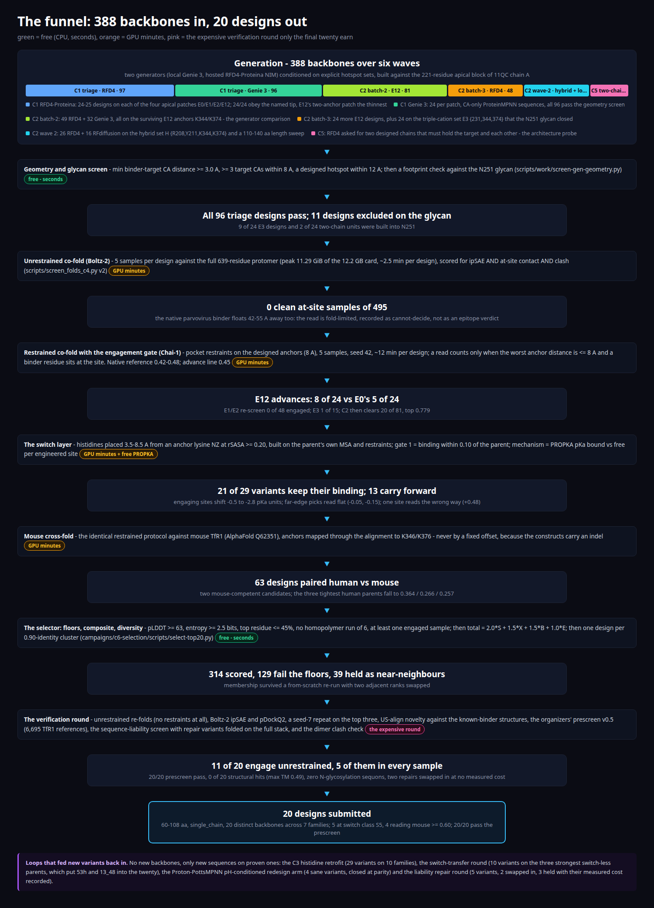
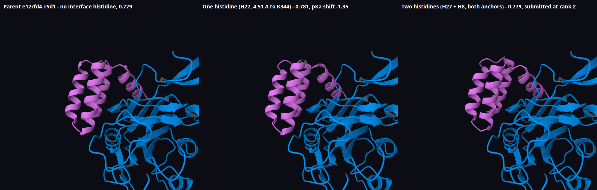
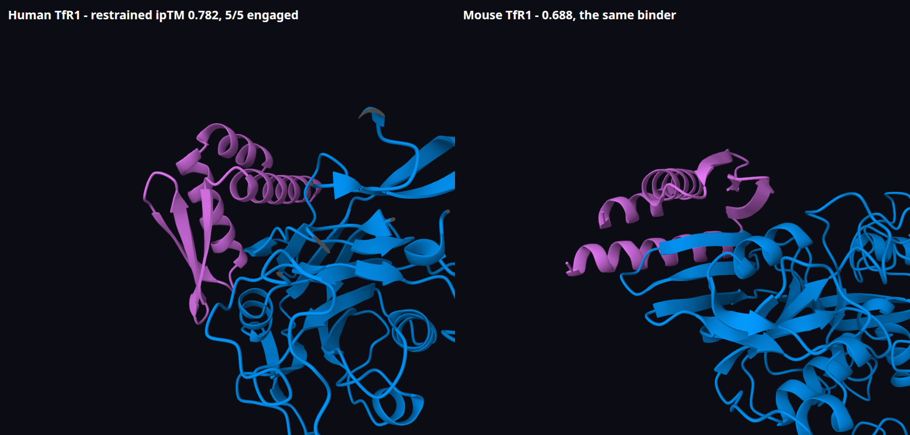
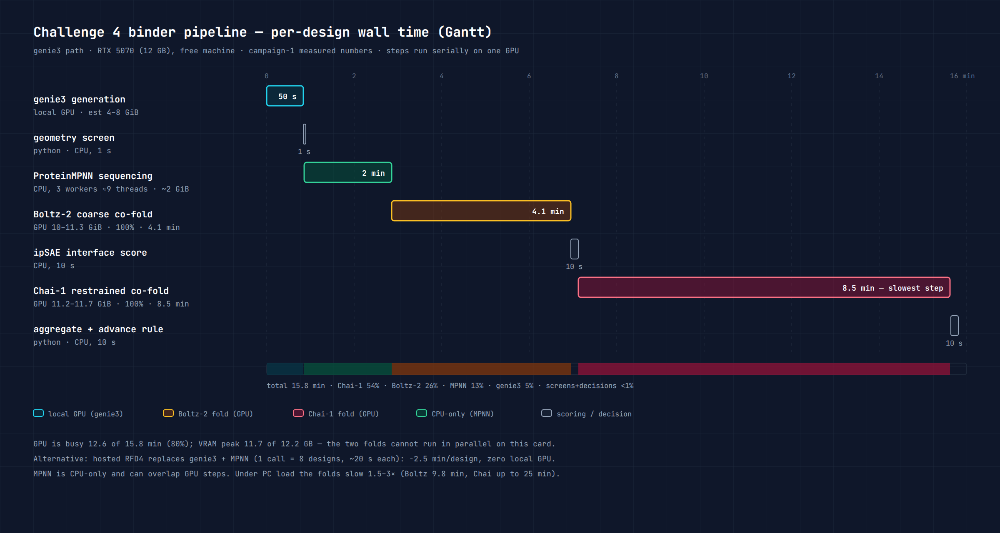

# 04 — TfR1 (conditional binder) · the complete history

This document tells the whole story of the TfR1 conditional-binder
campaign, from the captured challenge page to the submitted twenty
designs. It names every tool, every decision, and the reason for each.
The companion records are `lineage.json` (the site's own history),
`notes/` (the research), `campaigns/*/` (one plan and one results
page per campaign) and `records/` (the raw data).

Status: complete 2026-10-30, twenty designs, window closed 2026-11-01.
No wet-lab verdict exists; everything below is computational evidence,
and the few affinity figures that appear belong to other molecules.

Working-tree note: `submission/methodology.md` has been edited down
in the working copy — the committed version carried a header, per-claim
file citations, a final-twenty table and a challenge-3 coherence
section that the current file lacks — and
`experiments/c1-epitope-screen.yaml` (campaign 1's screen as a
reproducible spec) is deleted but not committed. Nothing here depends
on either; numbers come from `records/`, `campaigns/*/results.md`
and `lineage.json`.

---

## 1. The target and what the three objectives ask for

The assay presents the **human transferrin receptor 1** ectodomain
(TfR1, also CD71; UniProt P02786-1, residues 121-760, 640 amino acids)
as a disulfide-linked homodimer. The design is immobilised, the
receptor is in solution, and three conditions are measured: human at
pH 7.4, human at pH 6.0, and mouse at pH 7.4 (`notes/brief.md`,
captured 2026-10-23).

Three objectives, in the organizers' order:

1. **pH-selective binding** — a measurable KD against human TfR1 at
   pH 7.4 and no detectable binding at pH 6.0. Designs that bind at
   both pH values rank after these, by the ratio of their KD at 6.0 to
   their KD at 7.4.
2. **Mouse cross-reactivity** — ranked by how close the mouse-to-human
   KD ratio is to 1, among designs with a human KD below 1 µM.
3. **Affinity** — the lowest human KD at pH 7.4, at a named functional
   epitope with the evidence linked.

A design counts as binding when its sensorgram gives a fittable curve
and a KD, or — where it cannot be fitted — when the association shift
clears 300% over the negative control.

The organizers recommend an epitope: the **apical domain**, the tip of
each subunit that arenaviruses, parvovirus B19 and brain-shuttle
antibodies bind, which leaves the transferrin site free. They name
Tyr211 as the landmark. The two ectodomains, human and mouse, are 78%
identical overall but the recommended patch differs at six of nine
positions — so objectives 2 and 3 pull against each other from the
first decision onward. Chapter 4 is the measurement that settled it.

---

## 2. The biology in plain words

**What the receptor does.** Cells need iron, and iron does not travel
loose in blood — a protein called transferrin carries it. TfR1 sits on
the cell surface, grabs iron-loaded transferrin and pulls it inside in
a bubble of membrane; the cell acidifies that bubble, the acid makes
transferrin release its iron, and the receptor carries the empty
transferrin back out. It is a pump that runs on a pH change, abundant
on dividing cells and at the blood-brain barrier — which is why it is
a favourite delivery handle in medicine. Each subunit has three
domains, and the **apical domain** is the tip, away from the
transferrin site: viruses and engineered antibodies use it, so a binder
there does not compete with the receptor's day job.

**What a pH switch is, and why anyone wants one.** A binder that holds
at pH 7.4 (blood) and releases at pH 6.0 (the acidified bubble) is a
shuttle: it grabs its cargo outside the cell, rides in, and lets go
where the cell is acidic. The chemistry that buys it is one amino acid.
Histidine's side chain is near-neutral at pH 7.4 and largely positive
near pH 6.0 — the only common residue whose charge flips inside the
assay's own window.

**The direction rule, which decides everything about the switch.** The
challenge wants binding to *weaken* as the pH falls. So a binder
histidine facing a **positively charged** target residue is neutral at
7.4 and positive at 6.0, and the new like-charge repulsion weakens
binding — the asked direction. A binder histidine facing a
**negatively charged** residue gains an attraction instead, which
strengthens binding and inverts the objective. The earlier TNF-α
challenge in this repo measured exactly that inversion on its own
designs: every complex read tighter at pH 6.0, the wrong way
(`notes/epitope-analysis.md`, finding 3). So the anchors here had to
be conserved, exposed, *positively charged* target residues, and the
conserved glutamates nearby had to be avoided.

**The physical ceiling, stated before any design.** One titratable site
changes affinity by at most tenfold per pH unit and the assay window is
1.4 pH units, so one histidine buys about 25-fold in theory and much
less in practice; a large swing needs two or three coupled sites
(`campaigns/c3-switch-layer/README.md`). The methodology therefore
states a direction and a site count and never claims "no detectable
binding at pH 6.0", which is a wet-lab observation. And the mouse
objective matters because a binder that works in mice can be tested in
mice — while being the objective most easily lost by accident, since
the recommended epitope is the least conserved surface in the area.

---

## 3. The reference structures and what was measured on them

An experimental structure is solved by X-ray diffraction from a crystal
of billions of aligned copies — a frozen snapshot of real atoms; a
*predicted* structure (AlphaFold) is a computed guess. This campaign
used one of each, and the asymmetry is recorded wherever they meet.

| file | what it is |
|---|---|
| `inputs/11QC.cif` | human TfR1 ectodomain homodimer, chains A and B, 639 residues each (author 122-760), three N-linked NAG sugars per chain. The design target. |
| `inputs/11RN.cif` | the apical complex named in the brief — TfR1 with the parvovirus B19 VP1u receptor-binding domain. The only known-binder geometry on this epitope. |
| `inputs/1SUV.cif` | the transferrin complex, fetched to check rather than repeat the brief's claim that this epitope leaves the transferrin site free. |
| `inputs/AF-Q62351-F1.pdb` | mouse TfR1, an AlphaFold model, residues 123-763. The counter-species target. |
| `inputs/reference-structures/6WRV,6WRW,6WRX.cif` | further apical-domain references held for calibration. |

Every geometric number below was measured by
`scripts/epitope_analysis.py` and is reproducible with one command;
it writes `notes/epitope-analysis.csv`. Deep record:
`notes/epitope-analysis.md`.

| what was looked at | what was found | what it forced |
|---|---|---|
| human vs mouse identity | 498 of 638 aligned columns = **78.1%** | confirms the brief, and only visible when the chains are aligned rather than joined on numbering |
| the species numbering offset | mouse minus human is **+3 for 359 positions and +2 for 279** — there is an indel | never map human to mouse by a fixed offset. A first pass that joined on author numbering reported 5.5% identity against a stated 78% — that impossible number is what exposed the indel |
| the recommended patch (D204, R208, V210, Y211, N348, K371) | five of six substituted in mouse, the sixth falls in the indel; **zero conserved**; two are below the exposure line, so the usable patch is four residues; max CA-CA span 15.7 Å | a binder there is selected for human specificity: objective 3 only |
| the neighbourhood (every chain-A residue with a heavy atom within 10 Å of a named-patch side chain) | 44 residues, 27 conserved in mouse, **10 both conserved and exposed** | a conserved face sits right beside the recommended one, still inside the apical domain (roughly 189-382) |
| titratable chemistry at the epitope | **zero histidines** across all 44 residues; 7 Arg/Lys (conserved and exposed: 231 K, 344 K, 374 K); 5 Asp/Glu (conserved and exposed: 343 E, 350 E) | the whole switch must be built on the binder; the anchors are **344 K and 374 K**, and 343 E / 350 E are positions to keep histidine away from |
| the N251 glycan | NAG linked to N251 by a 1.44 Å bond, 11.2 Å from the named patch and **6.4 Å from the conserved face**; the sequon is conserved (human 251-253 → mouse 253-255) | drop 231 K from the hotspot sets and screen every footprint for reaching across N251 |
| can a binder span both protomers? | Y211 of chain A to Y211 of chain B is **90.1 Å** | no — every design is single-protomer. This reverses a TNF-α lesson, where the productive interfaces crossed protomers |
| the dimer as context | folded binders placed in the 11QC dimer frame sit **20.3 Å** from the second protomer and **5.1 Å** from the N251 glycan; the apexes are 93 Å apart | the single-protomer screen is safe here, checked rather than assumed |

Two reference points came from outside the structures. The organizers'
binder-prescreen carries a TfR1 arm of **6,695 reference sequences**
(54 confirmed binders, the rest disclosed patent claims), calibrated
over 927 fixtures: 103 of 105 verbatim known binders caught, zero
target-arm flags on 80 unrelated designs
(`campaigns/c6-selection/README.md`). And the patent record in
`inputs/poisk-tfr1-records.csv` places the brain-shuttle antibody
8D3 at peptides 373-375 — our K374 anchor — and 3M12 at K362-K371, so
the chosen anchors sit inside the region real binders use.

Unverified at this level: exposure uses a theoretical maximum-SASA
table (Tien et al. 2013) and the deposited coordinates, so it ranks
residues and is not absolute; glycan clearance is a distance to the
first sugar only.

---

## 4. The epitope decision: four patches, one survivor

The measurements produce three candidate sets plus the pair that
mattered most (`notes/epitope-analysis.md`,
`notes/strategies.md` §4):

| set | residues (11QC chain A) | span | conserved in mouse | glycan clearance | serves |
|---|---|---|---|---|---|
| **E0** named tip | 204, 208, 210, 211, 348, 371 | 15.7 Å | 0 of 6 | 11.2 Å | objective 3 |
| **E1** north | 206, 207, 209, 374 | 11.8 Å | 4 of 4 | 13.9 Å | objectives 1, 2, 3 |
| **E2** south | 343, 344, 347, 350, 351 | 14.9 Å | 5 of 5 | 16.2 Å | objectives 1, 2, 3 |
| **E12** dual anchor | 344, 374 | — | 2 of 2 | 13.9 Å | objectives 1, 2, 3 |

E1 carries one switch anchor, E2 the other and sits furthest from the
glycan, and **E12 is just the two anchors** — the thinnest possible
patch, asking the generator for nothing but the residues the switch
needs. Two more sets were tried later: **E3** = {231, 344, 374}, a
triple-cation set that walks into the glycan, and **H** = {R208, Y211,
K344, K374}, a hybrid of the organizers' tip and our anchors.

Outcome, in one line: **E12 advanced; E0 missed by one design; E1 and
E2 closed negative; E3 closed as a measured negative; H produced a
champion-class design and entered the submission.**

The hypothesis the challenge then tested, registered before any
generation (`notes/strategies.md` §3):

> A binder on the conserved, glycan-clear face of the apical domain,
> carrying two or three histidines facing a conserved target lysine,
> can serve objectives 1 and 2 with the same interface: the epitope is
> identical in both species, so cross-reactivity follows from the
> epitope choice, and the switch follows from like-charge repulsion as
> the histidines protonate near pH 6.

It was made falsifiable at three points, each with a pre-registered
discard rule: the conserved face may not dock at all (C1), the
histidines may destroy binding (C3), and the linkage sign may come out
negative as it did in the TNF-α challenge (C3).

---

## 5. The instrument problem: a co-fold screen that cannot read this target

The campaign's defining technical event happened before any design was
judged. **The standard co-folding screen does not work on TfR1's apical
tip**, and that was proven with controls rather than guessed.

**The fold target was measured first** — the plan's one unmeasured
risk. A 92-residue binder against the full protomer (Boltz-2, 5
samples, seed 42, receptor MSA capped at 1024 rows, binder on an empty
MSA) peaked at 15.61 GiB job RSS and 11.29 GiB of the 12.2 GB card,
~2.5 min for five samples, zero failures. **The fold target is the full
protomer**, numbering `fold = author − 121` (`notes/c1-triage.md`).

**The first batch folded and nothing landed.** The 96 campaign-1
designs produced 480 models; a v2 screen over 495 samples found not one
sample with a binder cleanly on its designed patch in any of the four
sets — 69 samples carried an off-site heavy-atom collision and the rest
floated. Four controls turned that from a bad day into a finding:

| control | result | what it proves |
|---|---|---|
| the TNF-α champion through this exact pipeline and MSA route | ipSAE 0.841-0.902 (its own earlier record 0.886) | the pipeline is not broken |
| the native VP1u domain + the 11QC protomer — a binder known to work, from the organizers' own reference complex | 0 of 5 samples at the verified footprint, 42-55 Å away, ipSAE 0.000 | the model cannot find this epitope even for nature's binder |
| the same with VP1u's own MSA, and again at 10 samples | unchanged, 42-50 Å; 0 of 10 docked | not an MSA or sampling artifact |
| the same against the 221-residue apical block | ipTM up to 0.53, but the pose sits on author 303-328, the dimer interface, 33-38 Å away | a confident wrong answer, which is worse than none |

The native footprint was re-verified straight from 11RN.cif: TfR1
author contacts with VP1u are 202, 203, 204, 208, 209, 210, 211, 212,
348, 371 — identical on both copies
(`notes/screen-predictor-options.md`).

**The second folder failed the same way.** Chai-1 needed three fixes
here (torch 2.14.1+cu130, for sm_120 kernels on an RTX 5070; MSAs
converted to `.aligned.pqt`, since plain `.a3m` is silently ignored;
`--no-use-esm-embeddings`, after the 5.5 GB ESM download broke twice),
then floated the native VP1u 42-55 Å away in all five samples, ipTM
0.19, pTM 0.87, no contacts. **The limitation is the target, not a
Boltz quirk.**

**The fix: direct the interface, then only compare.** With pocket
restraints on the ten footprint residues (8 Å), Chai-1 docks the native
domain at the footprint in all five samples — 10-14 of its residues
within 5 Å, zero contacts at the dimer patch — and its ipTM rises from
0.19 to **0.42-0.48**. The model can *build* an interface when told
where; it cannot *find* one here. That produced the primary instrument
and its permanent caveat:

- **The read**: Chai-1 under pocket restraints on the designed anchors,
  5 samples, mean ipTM.
- **The calibration**: the native known binder reads 0.42-0.48 under
  the identical protocol; measured dynamic range 0.21-0.75 across
  designs, replicate spread ±0.02 within a design.
- **The caveat, repeated on every results page**: a restrained pose is
  directed by construction. The number is a consistency read — does
  this sequence form a coherent interface at the designed site — and
  **not independent evidence of binding**.
- **The engagement gate** (added 2026-10-27, after it bit): a read
  counts only when the worst anchor distance is ≤ 8 Å and at least one
  binder residue sits at the designed site. Without it an off-site pose
  can read ~0.70 — the E2 design `e2_16` read 0.696 while sitting about
  55 Å away.

**What was demoted rather than dropped.** Boltz-2 stayed as a second,
diagnostic folder supplying ipSAE and pDockQ2 (Chai-1 writes no PAE, so
a second folder is the only route to them); those values are recorded
per design and explicitly do not score, stated in the selector's own
docstring. pDockQ2 was pre-registered as recorded-not-gated because an
earlier calibration found it non-discriminative. A third folder was
attempted and failed: OpenFold3 v0.5.1 installed and ran, then died at
a triangular-attention layer with CUDA OOM after ~24 minutes on the
715-residue complex, and the allocator workaround crashed the whole WSL
host (`records/openfold3-attempt-2026-10-30.md`). **The doctrine in
one sentence:** every instrument here was first run on something whose
answer was already known, and the ones that failed their control became
diagnostics rather than being used quietly.

---

## 6. The pipeline, stage by stage



*The whole pipeline as a funnel: 388 generated backbones across six
waves, the filter at every stage, and the tool behind every metric.
Green chips are free steps that run on the CPU in seconds, orange chips
cost GPU minutes, the pink chip is the verification round only the
final twenty earn. The note at the bottom shows the loops that fed new
variants back in — the histidine retrofit, the switch-transfer round
and the liability repairs all re-entered the funnel as new sequences on
proven backbones.*

**Stage 1 — Generation.** Local Genie 3 on one GPU and the hosted
NVIDIA RFD4-Proteina NIM, both conditioned on explicit hotspot sets.
The generation target is the apical block 180-400 of 11QC chain A (221
contiguous residues, renumbered 1-221, `block = author − 179`, every
hotspot letter asserted after the shift). RFD4 provenance is recorded
to the checkpoint (`chk_epoch_00000169_step_000000340000-ema.ckpt`, NIM
1.0.0, `thinking_medium` = 60 steps / 185 trunk passes, 8 designs per
call, ~2.5 min per call; `notes/rfd4-arm.md`). Six waves, 388
backbones: 96 + 97 in the triage, 81 in batch 2, 48 in batch 3, 42 in
wave 2, 24 two-chain units. Lengths 60-140 aa, mostly 60-110.
Generator-side quality across the first RFD4 pool of 97: motif
all-atom RMSD ≤ 0.49 Å, clash fraction ≤ 0.0003, sequence adherence
1.0.

**Stage 2 — Geometry and glycan screen** (free, CPU seconds).
`scripts/work/screen-gen-geometry.py`, pre-registered rule: minimum
binder-target CA distance ≥ 3.0 Å, at least 3 target CAs within 8 Å, a
designed hotspot within 12 Å. All 96 triage designs passed, each
sitting on its designed patch in the generator's own output (hotspot
CA-CA 4.3-6.4 Å for E0). The glycan screen is the part that removed
designs: **9 of 24** E3 designs and **2 of 24** two-chain units were
built into N251 and excluded.

**Stage 3 — Sequence assignment.** RFD4 designs carry the generator's
own sequences; the Genie 3 arm was sequenced with ProteinMPNN on CPU
(T = 0.1, seed 37), one sequence per design. *An honest divergence:*
the rule carried forward from the TNF-α challenge was "full-backbone
ProteinMPNN, never CA-only" — the same Genie 3 backbone capped at ipSAE
0.248 under CA-only sequencing and produced 18 members at 0.63-0.85
under full-backbone (`notes/lessons-c2-c3.md` B1) — and campaign 1's
own plan repeats it. In execution the Genie 3 arm shipped **CA-only**
sequences in C1 and C2, and eight of the submitted twenty descend from
that arm.

**Stage 4 — The restrained fold and the engagement gate** (GPU
minutes). Chai-1, pocket restraints on the designed anchors (8 Å),
5 samples, seed 42, serial on one GPU, ~12 min per design; aggregated
by `scripts/work/chai-restrained-scores.py`, which applies the gate.
The advance line was set at 0.45 — level with the native reference's
0.42-0.48. This is the binding instrument for the rest of the
challenge, and the only read that scores.

**Stage 5 — The switch layer** (GPU minutes plus free PROPKA).
`c3-pick-positions.py` selects binder positions whose side chain sits
3.5-8.5 Å from an anchor lysine NZ with relative SASA ≥ 0.20;
`c3-build-designs.py` builds each variant with the parent's own MSA and
restraint files, so the only change is the mutated sequence. Mechanism
read: PROPKA on the bound and free states of every engineered histidine
(`c3-histidine-pka.py`) plus a Wyman-linkage integration over
pH 6.0-7.4 (`tools/switch/linkage_score.py`). Chapter 7.

**Stage 6 — The mouse cross-fold** (GPU minutes).
`c4-prep-mouse-target.py` takes the mouse sequence from the AlphaFold
model, maps the anchors **through the alignment** (human K344/K374 →
mouse K346/K376 = fold indices 224/254), fetches a depth-1024 MSA, and
runs the identical protocol with its own superposition frame. Measures,
does not gate. Chapter 8.

**Stage 7 — Selection** (free, CPU seconds).
`campaigns/c6-selection/scripts/select-top20.py` applies the floors,
computes `total = 2.0·S + 1.5·X + 1.5·B + 1.0·E`, enforces one design
per 0.90-identity cluster, and writes the records;
`build-submission.py` writes the upload file from the selector's output
with asserts on count and name uniqueness. The final run scored
**314** designs, **129** failed the floors, **39** were held as
near-neighbours, one was dropped as an identical sequence, and **20**
were selected (recomputed from
`records/selection-all-2026-10-30.csv`). Chapter 11.

---

## 7. The pH switch: the histidine logic and what was measured

Objective 1, the hardest goal, and the campaign the earlier TNF-α
challenge never ran — the direct reason its submission could not claim
this objective.



*One family, three sequences, one backbone: the campaign-2 parent
`e12rfd4_r5d1` (restrained 0.779) and its single- and double-histidine
switch variants, each folded under the identical restraints against the
human apical domain. The engineered histidines face the conserved
anchor lysines K344 and K374; nothing else changes between the panels.*

**Where the histidines went.** In the strongest families the picked
positions were already **carboxylates** — the generators had
independently aimed an Asp or Glu at the anchor lysines, the same
interaction with the opposite sign (`notes/c3-switch.md`):

| family (parent read) | site at A223 (author K344) | site at A253 (author K374) |
|---|---|---|
| `e12rfd4_r5d1` (0.779) | D27, 4.51 Å, rSASA 0.269 | D8, 4.75 Å, rSASA 0.338 |
| `e12rfd4_r5d7` (0.761) | G43, 4.46 Å, rSASA 0.581 | A6, 8.21 Å, rSASA 0.430 |
| `e12rfd4_r4d5` (0.710) | V28, 6.35 Å, rSASA 0.250 | A9, 7.41 Å, rSASA 0.451 |
| `e12rfd4_r4d3` (0.682) | G16, 8.16 Å, rSASA 0.353 | D25, 4.12 Å, rSASA 0.219 |
| `e12b2_20` (0.735) | K34, 6.42 Å, rSASA 0.353 | A15, 3.69 Å, rSASA 0.248 |

**Gate 1 — binding must survive.** 29 variants (19 singles, 7 doubles,
a three-step ladder), 145 folds; a variant keeps its slot if its mean
restrained ipTM is within 0.10 of its parent. **21 of 29 kept.** The
top family is nearly untouched: parent 0.779 → 0.782 / 0.781 / 0.748
for one, two and three histidines. Eight collapsed; the worst
(`e12b2_8_s1`) lost 0.521, so that position was load-bearing.

*The limitation of gate 1, measured rather than argued.* The retrofit
replaces a deep carboxylate contact with a shallower imidazole one:
minimum heavy-atom distance to the anchor NZ is 1.78 Å (D27) and 2.83 Å
(D8) in the parent against 3.62 Å (H27) and 3.88 Å (H8) in the
variants. The contact is real — the restraints do not invent it — but a
flat ipTM on a directed read does not price the loss of a near-covalent
salt bridge. Gate 1 selects variants that keep the *interface*, not
necessarily the *affinity*.

**Gate 2 — the linkage sign, and why it was demoted.** The registered
gate was `delta_log_Ka > 0` from the Wyman-linkage scorer (PROPKA pKa
bound vs free, integrated over pH 6.0-7.4). 26 of 29 variants move
positive against their own parent (sign test p ≈ 1.5e-5). But an
external review observed that this is close to the expected output of
adding protonatable sites at an interface, and the **unmodified parents
carry a null with the same scatter: 10 of 81 read positive (~12%),
spanning +0.058 to +1.547**. The whole `b2_20` family's totals (+0.040
/ +0.058 / +0.085) land inside the densest part of that null, and the
raw top of the entire ranking is an *unmodified* parent (`e12b2_17`,
+1.547 — the extreme tail of the null, not an artifact: pH-linked
behaviour is TfR1's own biology). The gate can still fail, three
variants moved negative, but passing it does not demonstrate a switch.
**It was re-labelled a consistency check** (review finding 1,
accepted).

**The substance — the per-site pKa shift.** PROPKA on the bound and the
free state of each engineered histidine. The mechanism predicts the
bound-state pKa is *depressed*, because the anchor cation destabilises
the protonated form:

| variant | engineered His | pKa shift, bound vs free |
|---|---|---|
| `c3_e12rfd4_r4d5_d2` (the champion) | pos 28 | **−2.82** — the strongest site in the project |
| `c3_e12b2_20_d2` | pos 15 / 34 | −2.76 / −2.59 |
| `c3_e12b2_20_s2` | pos 34 (6.42 Å) | −2.16 |
| `c3_e12b2_20_s1` | pos 15 (3.69 Å) | −2.12 |
| `c3_e12rfd4_r6d2_s1` | pos 52 / 82 | −1.47 / 0.00 |
| `c3_e12rfd4_r5d1_s1` | pos 27 (4.51 Å) | −1.35 |
| `c3_e12rfd4_r5d1_s2` | pos 8 (4.75 Å) | −0.63 → **unresolved** |
| `c3_e12rfd4_r5d1_l3` | pos 31 (free pKa 7.09) | −0.53 → **unresolved** |
| `c3_e12b2_26_s2` (control, 8.05 Å, far edge) | pos 20 | **−0.05, flat** |
| `c3_e12rfd4_r6d5_s2` (control, 8.42 Å, far edge) | pos 25 | −0.15, flat |
| `c3_e12rfd4_r4d3_d2` (control) | pos 25 | **+0.48, wrong direction** |

The controls are the point: positions at the far edge of the engage
window shift by −0.05 and −0.15 and their variants' totals go negative,
and the one wrong-direction site drags its variant's total negative
too. **The instrument separates engaging from non-engaging sites at the
strong end only** — PROPKA's error on experimental benchmarks is about
0.8 pH units, larger than the 0.4-0.5 gap at the weak end, so the −0.53
and −0.63 sites are recorded as *unresolved*, not engaging (reviewer
finding 2, 2026-10-27).

**The ladder.** On the top family the totals increase strictly with
histidine count and separate by count with no overlap: 0 (the parent)
−0.057; one +0.029, +0.076, +0.146; two +0.560, +0.625; three +0.708.
Under the re-framed gate 2 that dose-response is consistency rather
than independent evidence — but it is the shape a working dose series
has, and it ships as the declared mechanism control the organizers'
rules allow. (A correction is on the record: an earlier note called the
ladder "not monotone"; that sentence was wrong, and the reason to
withhold magnitudes is the null scatter, not non-monotonicity.)

**Tuning guidance for the next batch.** The free pKas cluster at
5.92-6.37 with one at 7.09. A histidine at free pKa 6.0 is roughly 4%
protonated at pH 7.4 and 50% at 6.0 — a working but shallow switch. The
7.4 → 6.0 window is exercised hardest by free pKas near 6.8-7.0, so the
designed positions should aim there; the best-placed site measured
(`r5d1_l3` pos 31, free pKa 7.09) also shows the smallest bound shift,
so position choice and pull can work against each other.

**A design-side arm.** Proton-PottsMPNN redesigns an interface with
explicit protonation-state tokens. It was run off-label for this
direction — the engine's own campaigns pin the protonated state, while
we pinned the neutral HIS-S so the bound complex favours it and
acidification releases. The first sweep degenerated at high selectivity
weight into His/Arg-rich near-homopolymers; a capped rerun (≤ 12
mutations) gave four sane variants, best `ppmpnn_r4d5_l01_s0` at 0.752
engaged, 0.008 below its parent while carrying the designed switch. The
arm **closed at parity**: it showed the switch can be designed in
rather than screened for, and it did not beat the retrofit.

---

## 8. The mouse axis: measuring the species gap



*The champion `c3_e12rfd4_r4d5_d2` folded under the identical
restrained protocol against the human apical domain (restrained ipTM
0.782, 5 of 5 samples engaged) and against the mouse receptor (0.688).
Only the target changes: the same sequence, the same restraint set
mapped through the alignment to mouse K346/K376, the same five samples.*

Campaign 4 generates nothing and modifies nothing, which is what makes
the species difference readable (`notes/c4-mouse.md`,
`campaigns/c4-mouse-crossfold/mouse-scores.csv`). The bands were
fixed before the run: within 0.05 of the human read = top, within
0.15 = second, clearly weaker = third, human-only = floor.

| design | mouse | human | delta (human − mouse) | band |
|---|---|---|---|---|
| `e12rfd4_r4d5` | 0.760 | 0.710 | −0.050 | top |
| **`c3_e12rfd4_r3d4_d2`** | **0.603** | 0.621 | **+0.018** | top |
| `e12b2_31` | 0.507 | 0.453 | −0.053 | top |
| `e12b2_29` | 0.615 | 0.550 | −0.065 | second |
| `c3_e12rfd4_r4d5_d2` | 0.688 | 0.782 | +0.094 | second |
| `e12rfd4_r6d2` | 0.633 | 0.738 | +0.105 | second |
| `c3_e12rfd4_r5d7_d2` | 0.579 | 0.777 | +0.198 | third |
| `c3_e12rfd4_r5d1_d2` | 0.545 | 0.779 | +0.233 | third |
| `e12rfd4_r5d1` (parent) | 0.364 | 0.779 | +0.416 | floor |
| `e12rfd4_r5d7` (parent) | 0.266 | 0.761 | +0.496 | floor |
| `e12b2_20` (parent) | 0.257 | 0.735 | +0.478 | floor |

1. **The tightest human designs are the weakest cross-reads.** The
   three strongest human parents fall from 0.779 / 0.761 / 0.735 to
   0.364 / 0.266 / 0.257, deltas +0.42 to +0.50. Human affinity and
   species transfer are *opposed* in this data — the inverse of the
   TNF-α lesson, where cross-reactivity came only from tight designs.
2. **Two designs are mouse-competent, and one carries the switch.**
   `e12rfd4_r4d5` (mouse 0.760, delta −0.050) and
   `c3_e12rfd4_r3d4_d2` (0.603, +0.018, top band *and* a switch variant
   with site shifts −0.39 and −2.13). The best mouse read in the
   project belongs to a sibling, `c3_e12rfd4_r4d5_s2` at 0.768.
3. **The histidine retrofits improve the mouse read in most families** —
   `r5d7` 0.266 → 0.579, `r5d1` 0.364 → 0.545/0.551, `r3d4` 0.528 →
   0.603, while `r4d5` stays strong and `b2_20` is unchanged near 0.26.
   Recorded as an observation, with no explanation claimed.

Coverage grew with the campaign: 33 designs and 165 samples at first
(20 from C2 plus 13 from C3), then 58, then **63 designs** including
every member of the final twenty, which is what the selector's mouse
component ranks on.

**The caveat, restated in the campaign's own record.** A co-folding
model scoring two receptors it was never trained to discriminate is
weak evidence about species selectivity; two designs can score
identically and behave differently in the lab; the mouse structure is a
prediction and the human one experimental. The claim supported is "the
epitope is conserved and the interface reads on both receptors" —
**not** "the KD ratio is near 1".

---

## 9. The campaigns, one by one

Six campaigns. **Not every one is the same kind of experiment:** C1 is
the only one whose deliverable is a *decision* rather than designs; C2
varies the *generator*; C3 the *chemistry*; C4 the *species*, and
generates nothing; C5 the *architecture*; C6 adds no designs at all and
re-reads, ranks and repairs.

### C1 — the epitope triage (2026-10-23 → 10-25, re-screen 10-27)

*Tools:* Genie 3, ProteinMPNN, RFD4-Proteina NIM, Boltz-2, IPSAE,
Chai-1 with pocket restraints, the 11RN native complex as control.
*Strategy:* generate against four apical patches with two independent
generators, then decide by a pre-registered rule on a screen validated
with controls.



*The per-design cost of the campaign-1 pipeline — the two folds
dominate at about 80% of the wall time. The companion diagram
`viewers/c1-strategy-comparison.png` contrasts the local Genie 3
path with the hosted RFD4 path.*

*Numbers:* 96 Genie 3 designs (24 per set) and 97 hosted RFD4 designs,
all passing the geometry screen; 480 fold models and a v2 screen over
495 samples returning **zero** clean at-site samples (chapter 5); then
the directed re-read of 48 designs, 240 samples, under the amended rule
(a set advances when ≥ 25%, i.e. ≥ 6 of 24, reach mean restrained
ipTM ≥ 0.45):

| set | n | ≥ 0.45 | ≥ 0.50 | median | top three |
|---|---|---|---|---|---|
| E0 | 24 | 5 (21%) | 4 | 0.388 | e0_22 0.556, e0_21 0.543, e0_19 0.520 |
| E12 | 24 | 8 (33%) | 7 | 0.324 | e12_18 0.752, e12_9 0.655, e12_6 0.639 |

*Verdict:* **E12 advances; E0 is one design short and is carried as a
secondary arm, not eliminated.** The margin is reported for what it is:
E0's median is *higher* (0.388 vs 0.324) and E12's win rides its upper
tail; Fisher's exact on 5/24 vs 8/24 is p = 0.52, so the sets are
statistically indistinguishable on the deciding metric; and counting
designs with *any* sample ≥ 0.45 would give E0 exactly 6 of 24 and
advance it. A second-seed rerun of the four near-line designs settled
the count rather than the significance — pooled means 0.433, 0.441,
0.430, 0.436, all under 0.45, so **E0 stands at 5 of 24 on both
seeds**.

Two guards ran before the verdict was signed. The **restraint-count
confound**: the sets carry different numbers of hotspots (E0 six, E2
five, E1 four, E12 two), so two E0 designs were re-scored with only two
restraints — 0.412 and 0.405 against 0.400 and 0.437 at six, no jump
toward the E12 range (0.655, 0.752), so the confound is falsified. And
the **v1 screen correction**: v1's clash test looked only at the
designed residues, and under v2's minimum-over-all-atoms test all 12
samples v1 had called clean carry an off-site collision of 1.6-2.6 Å.

*The deferred screen, and its outcome.* E1 and E2 were left unscreened
by explicit decision on 2026-10-25 — at p = 0.52 between the measured
sets, nine GPU-hours would buy completeness prose, not a decision. The
screen ran anyway on 10-27 as the fallback task during an RFD4 outage:
all 48 C1-era E1/E2 designs folded, **0 of 48 engaged their designed
site** (E1: 2 of 24 above the bar, best `e1_13` 0.491, no binder
residue within 5 Å of any anchor, worst-anchor 26-59 Å; E2: 5 of 24,
best `e2_16` 0.696 with its pose at author 629-760, ~55 Å away). Both
sets closed negative, and that is where the engagement gate came
from.

### C2 — the binding families and their generator arms (2026-10-25 → 10-28)

*Tools:* Genie 3, RFD4-Proteina NIM, ProteinMPNN, Chai-1 with pocket
restraints. *Strategy:* turn the surviving epitope into a family, with
two generators and no pre-selection — geometry screen only, then fold
everything.

*Numbers:* 32 Genie 3 + 49 RFD4 = **81 designs, 405 folds**; 20 cleared
the 0.45 line, 17 at ≥ 0.50, 13 at ≥ 0.60, top `e12rfd4_r5d1` at
**0.779**. The pool is materially stronger than campaign 1's (17 vs 7
at 0.50; top 0.779 vs 0.752), all above the native reference ceiling of
0.48. *Generator comparison:* RFD4 11 of 49 (22%), Genie 3 9 of 32
(28%), **Fisher p = 0.605 — statistically indistinguishable**. The
TNF-α lesson that the generator dominates the outcome motivated running
both arms; this screen cannot separate them, and that is recorded
rather than spun.

*Robustness incident.* A host display-driver crash (nvlddmkm `0xD1`)
killed the pass at 44 of 81. It resumed on driver 621.01 with
`PYTORCH_CUDA_ALLOC_CONF=expandable_segments:False`, a WSL GPU-PV
allocator workaround that touches memory handling only. The design
killed mid-fold (`e12rfd4_r4d3`) completed on resume at 0.682, and the
pre- and post-crash halves are consistent. Wall span 16 hours, ~11.5 of
them folding.

*Batch 3 (10-26/27):* 39 designs, 195 samples, zero fold failures. The
**E12 extension** added 24 designs, 4 at the bar (17%, the same band as
the arm's own 22%), and produced a co-champion — **`b3_E12_r90003` at
0.776**, a statistical tie with `r5d1` — plus `b3_E12_r110007` at
0.692. The **E3 triple-cation set** closed as a measured negative on
three agreeing reads: 1 of 15 at the bar against the rule's 4, hotspot
obedience 0.50, 9 of 24 generated designs built into the N251 glycan
and excluded, and the folded remainder below the E12 class (median
0.274 vs 0.292, top 0.472).

*Wave 2 (10-27/28):* the RFD4 arm folded 26 of 26 and an RFdiffusion
arm 16 of 16, zero failures. The long-length extension (110-140 aa) did
**not** beat the short champions (best engaged 0.420) and 22 designs
above 126 aa stay held as the host-crash class. But the **hybrid set
H = {R208, Y211, K344, K374}** delivered `b4_H_r1d0000` at **0.777
(5 of 5 engaged, champion class)** and `b4_H_r1d0004` at 0.645; their
switch variants are in the submitted twenty.

### C3 — the pH switch layer (2026-10-26, transfer round 10-29)

*Tools:* the vendored switch geometry and rSASA filter, Chai-1 with
pocket restraints, PROPKA, the Wyman-linkage scorer, Proton-PottsMPNN.
*Strategy:* change the designs' chemistry, not their origin or target,
and re-read every variant with the identical instrument so it compares
directly to its parent. Chapter 7 is the full account: 29 variants, 145
folds, 21 keeping their binding, per-site shifts −0.5 to −2.8 at
engaging sites and flat at the far window edge, **13 carrying
forward**. The **switch-transfer round** (10-29) then built ten
histidine variants on the three strongest-binding switch-less parents;
the winner `c3_b4_H_r1d0000_53h` keeps its parent's binding (restrained
0.768, unrestrained 0.771 at 5 of 5) and replaced it in the twenty. Its
sibling `49h` carries the project's strongest linkage total (+1.153, a
modelled 14.2× selectivity) and heads the reserve — recorded, and
deliberately not quoted as a prediction.

### C4 — the mouse cross-fold (2026-10-26, extended 10-28/29)

*Tools:* Chai-1 with pocket restraints, ColabFold MSAs (depth 1024),
alignment-derived anchors. 33 designs and 165 samples at first, 63 by
the end; two mouse-competent candidates. Chapter 8.

### C5 — two-chain units against the single-chain class (10-26 → 10-29)

*Tools:* RFD4-Proteina (two designed segments), ProteinMPNN, Chai-1,
Boltz-2, IPSAE, DockQ, PRODIGY. *Strategy:* the only campaign with a
second designed chain — a pair that must hold the target *and* each
other — asking whether that beats the single-chain class at E12.

*Generation worked immediately:* the hosted request was extended with a
second expandable segment (chain C, entity 2, its own length range) and
the endpoint accepted it with zero validation errors, 8 designs in 95
seconds. Of 24 designs, 23 form a real B-C unit covering both anchor
lysines, 2 were excluded by the glycan screen, 22 went to folding.

*The registered test could not run on this host:* the assembled
three-chain fold sits at 11.9 of 12.2 GB VRAM and runs its trunk about
10× slow (775 s per recycle against an 82 s baseline). Two attempts,
one from a cold boot; the first ended in a host crash. The read was
taken per chain instead — 44 folds, all complete — and on the honest
aggregation (the *minimum* of the two chains, since both must bind) the
best unit reads 0.356; on the mean the best is 0.502 (`c5_r3d6`, whose
B chain reads 0.702 and C chain 0.303 — exactly the case a mean
flatters); zero designs reach 0.70 either way, and DockQ against the
design models is 0.00-0.19 for almost all. **But a chain designed to
brace against both the target and its partner, folded without its
partner, should read low**, so both numbers are the expected result of
the adaptation and are recorded as inconclusive, not negative. A
reviewer made the same point formally: the registered discard rule
fired on profile conditions (B-C intact, clashes) that were only ever
measurable on the assembled fold. A numbering incident was caught
before the verdict was signed — nine fallback restraint files carried
author instead of sequence numbering (off by 121), so those folds were
conditioned 39-48 Å from their intended residues; after the fix every
corrected fold sits 3.4-9.5 Å from its restraining residue, reads moved
by −0.17 to +0.13, and two designs that the mis-conditioning had
flattered dropped to the floor class.

*The rescue, which did run* (10-28/29): all 22 assembled units folded
against the **221-residue apical block** — the cheap target that fits —
with Boltz-2, pocket restraints on both binders at the E12 anchors
(block numbering 165/195), 5 samples each. Recomputed from
`records/c5-rescue-block-2026-10-29.csv`: 110 samples, **74 engage
both binders at the anchors**, 19 of 22 designs have at least one such
sample, **9 of 22 engage in all five**, the designed B-C brace forms
(contacts 1.8-2.9 Å), and the best units read mean ipTM 0.958
(`r1d0001`; best single model 0.9616), 0.923 and 0.901.

*Verdict:* the assembled units assemble; only the full-protomer
assembled fold remains out of reach here. The direction is recorded as
a **capability, not a competitor** — the rescue used a different target
and restraint set, and no comparable read exists against the
single-chain class, which carries the submission (all twenty entries
declared `single_chain`). Two instruments were calibrated inside this
campaign and then used elsewhere: **DockQ v2**, verified by scoring an
existing design's fold against its own design model at **0.897 total,
iRMSD 0.55 Å** (measured on `e12rfd4_r4d5`, the champion's *parent*),
and **PRODIGY**, which reproduced the published affinity estimate on
the native 11RN interface (1.3-1.7 µM against about 1 µM published)
before being pointed at any design
(`campaigns/c5-multi-chain/research.md`).

### C6 — evaluation, refinement and the final twenty (10-27 → 10-30)

*Tools:* the selector, binder-prescreen v0.5, MMseqs2, US-align,
Foldseek, Chai-1, Boltz-2, IPSAE, PROPKA 3.5.1, Mol*. *Strategy:* add
no designs; re-read what C2-C4 produced, rank it, and repair the
survivors' weaknesses. The count grew across three runs — 245 scored on
the first pass (98 failing the floors), 293 on the completed pool,
**314** on the final run with the switch-transfer variants and the
liability repairs added. Membership of the twenty survived the
from-scratch re-run with two adjacent ranks swapped: robustness
evidence gathered *after* the selection was frozen, where it could only
have embarrassed the result (`notes/review-2026-10-30.md`).

Four verification rounds landed inside this campaign.

1. **The multi-tool confidence matrix** (10-28). Boltz-2 restrained
   folds plus ipSAE cover the whole top-32 pool, every pose on-site
   under the engagement gate, later filled to all twenty.
   `b3_E12_r90003` is the most cross-validated design in the project
   (Chai 0.776, Boltz ipTM 0.808, ipSAE 0.50, pDockQ2 0.43) and sits at
   rank 15 because its switch evidence is thin, while the `r4d5` and
   `r5d1` champions carry the top Chai reads with low ipSAE. No single
   in-silico metric decides.
2. **The unrestrained read — the honest test** (10-29). Every final
   design re-folded with *no* restraints, 5 samples. **11 of 20 find
   the designed site on their own; 5 in every sample** — `53h` 0.771,
   the champion 0.725, `e12_9` 0.688, `r5d1_d2` 0.681, `21h` 0.667. The
   other nine read high only under restraints and are
   **restraint-dependent, recorded openly**
   (`records/unrestrained-engagement-2026-10-29.csv`).
3. **Novelty** (10-28). Prescreen v0.5, TfR1 arm, 6,695 references:
   20 of 20 pass with no prior-art or known-binder flags. Structural
   arm (US-align, coverage-aware) against the three known-binder
   reference structures held here: **0 of 20 hit TM > 0.5 across more
   than 70% of the design**; the maximum is 0.49 (`53h` vs VP1u) at 47%
   coverage, so even the near-miss is not one. Within the batch, median
   pairwise TM 0.37-0.38 and 8 fold clusters.
4. **The liability repair round** (10-30). Chapter 12.

---

## 10. Every tool, when and why

| tool | role | when | why |
|---|---|---|---|
| Gemmi / Biopython (`epitope_analysis.py`) | parsing, alignment, SASA, distances | before any generation | every epitope number comes from here, and it is the only place human→mouse mapping happens |
| Genie 3 (local) | backbone generation | C1, C2 | on the released TNF-α campaign with real outcomes it bound 8 of 23 (34.8%) against RFdiffusion3's 1 of 40 (2.5%); 66 s per design here |
| RFD4-Proteina NIM (hosted) | backbone generation | C1, C2, C5 | produced 17 of the 20 designs in the previous challenge's submission; free hosted pool in this window; builder in `nim/` |
| RFdiffusion arm | wave-2 control | C2 | 16 of 16 folded; underperforms here (best engaged 0.420) |
| ProteinMPNN | sequence design | C1-C3 | inverse folding on generated backbones (CA-only in the Genie 3 arm — chapter 6, stage 3) |
| Proton-PottsMPNN | pH-conditioned redesign | C3 | designs the switch in rather than screening for it; closed at parity |
| Boltz-2 | folding; ipSAE/pDockQ2 source | C1, C5 rescue, C6 | the first screen; fails its control here, so demoted to diagnostics and the block rescue |
| Chai-1 | the primary restrained read | C1-C6 | the only folder that docks the native control when directed (0.42-0.48 against 0.19 free) |
| OpenFold3 | attempted third folder | 10-30 | OOM at 24 min on the 715-residue complex; the workaround crashed the host. Installed, unused |
| IPSAE | ipSAE / pDockQ2 | C1, C5, C6 | the organizer-aligned interface screen; recorded per design, never scored here |
| PROPKA 3.5.1 | histidine pKa, bound vs free | C3, C6 | the switch mechanism's only direct measurement |
| Wyman linkage scorer | pH-linked affinity direction | C3 | gives the sign; demoted to a consistency check once the parent null was measured |
| DockQ v2 | pose vs design model | C5, champion family | calibrated at 0.897 / iRMSD 0.55 Å on an existing design before use |
| PRODIGY | interface dG / KD estimate | C5 | reproduced the published ~1 µM on the native interface before being pointed at designs |
| US-align, Foldseek | structural novelty, batch diversity | C6 | the top novelty grade's structural arm (TM < 0.5 over > 70% coverage) |
| MMseqs2 | identity, prescreen backend | C6 | required by the prescreen; supplies the within-batch duplicate rule |
| binder-prescreen v0.5 (organizers') | prior-art and known-binder screen | C6 | the TfR1 arm, 6,695 references; 20/20 pass, re-run after the swaps |
| Mol*, 3Dmol | structure explorers | reporting | the committed viewer pages under `viewers/` |
| `memlimit.py`, watchdogs, `kill_by_cmdline.py` | memory guard, resumable screens | everywhere | a 12 GB card on WSL; three host crashes happened during the campaign |
| external reviews (10-23, 10-26, 10-27, 10-30) | audits | throughout | re-framed gate 2, exposed the v1 clash test, forced the engagement gate, caught the stale coverage records |

---

## 11. How the designs were evaluated, and how "better" was decided

The bars were pre-registered on 2026-10-23, before any generation
(`notes/strategies.md` §7), and the selector is the single writer of
the ranking (`campaigns/c6-selection/scripts/select-top20.py`).

**Step 1 — the floors, in code and not in prose.** pLDDT ≥ 63;
sequence entropy ≥ 2.5 bits; no residue above 45% of the chain; no
homopolymer run of 6 or more; at least one engaged fold sample. They
exist because the previous challenge's floors were promised in prose
and applied by no code, which let a 24-residue design that was 64%
alanine rank 20th. On the final run **129 of 314 designs failed them**,
66 for having no engaged fold sample at all.

**Step 2 — the composite.** `total = 2.0·S + 1.5·X + 1.5·B + 1.0·E`,
maximum 30, normalised to 100:

| term | weight | what it measures | bands |
|---|---|---|---|
| **S** switch | 2.0 | the hardest goal | 5 for ≥ 2 sites with binding retention ≥ 0.85; 4 for ≥ 2 sites, or 1 site at retention ≥ 0.90; 3 for one site; 2 if the linkage moves the wrong way whatever the count; 1 for a parent with no switch layer |
| **X** mouse | 1.5 | objective 2 | 5 at ≥ 0.70, 4 at ≥ 0.60, 3 at ≥ 0.50, 2 at ≥ 0.40, 1 otherwise or with no engaged mouse read |
| **B** binding | 1.5 | objective 3, engagement-gated | 5 at ≥ 0.70, 4 at ≥ 0.60, 3 at ≥ 0.50, 2 at ≥ 0.45, 1 below |
| **E** expression | 1.0 | the risk of never making it | mean of a pLDDT band and a Kyte-Doolittle hydropathy band |

S carries the heaviest weight because the organizers' own prompt says a
weak but clearly pH-sensitive binder beats a strong insensitive one, and
X rides above B because the challenge ranks mouse second and affinity
third.

**Step 3 — the direction gate.** A linkage total moving the wrong way
caps S at 2 however many sites a design carries. Added with the
switch-transfer round, it immediately moved two high-ipTM designs
(`r6d2_s1`, `b2_26_s1`) out of the S5 class.

**Step 4 — diversity on the provable axis.** At most one design per
**0.90-identity cluster**, stricter than the prescreen's 0.95
within-batch rule; near-neighbours become the ranked reserve. On the
final run 39 designs were held this way and one as an identical
sequence. The rationale is the novelty rule's own shape: novelty is
judged per structural backbone, so twenty sequences on two backbones
carry two identities and one fold resembling something known removes
every design built on it. The twenty sit on **twenty distinct
backbones**. Ties break on switch evidence, then binding, then the
least-represented family.

**Step 5 — the pre-flight assertions.** Every design has a row in every
screen; every design has a human fold *and* a mouse fold, or it scores
the X floor and the record says why; every switch claim has a linkage
row; every design has an at-site contact; and the sequence in the CSV
is compared to the sequence that was folded **by hash, not by name**.
Each exists because its absence caused a real error in an earlier
challenge.

**What "better" explicitly did not mean.** Not the highest single read:
the top Chai ipTM in the pool (0.802, `c3_e12b2_20_s2`) is not rank 1,
and the most cross-validated design is rank 15. Not ipSAE: recorded for
all twenty, scoring nothing, because Boltz-2 fails its control here.
Not the linkage magnitude: the strongest linkage in the project sits in
the reserve. Rank 1 is the one design that carries all three objectives
at once.

---

## 12. The submitted twenty

Twenty designs, `single_chain` class, **60-108 amino acids**, written
in composite order by `build-submission.py` from the selector's output
(`submission/submission-04-tfr1.csv`). Full reads:
`records/final-candidates-2026-10-30.csv`; all 314 scored designs:
`records/selection-scores-2026-10-30.csv`.

| # | design | score | S | X | B | E | human | mouse | pLDDT | ipSAE | family |
|---|---|---|---|---|---|---|---|---|---|---|---|
| 1 | `c3_e12rfd4_r4d5_d2` | 95.0 | 5 | 4 | 5 | 5.0 | 0.782 | **0.688** | 84.8 | 0.012 | rfd4-e12-switch |
| 2 | `c3_e12rfd4_r5d1_d2` | 90.0 | 5 | 3 | 5 | 5.0 | 0.779 | 0.545 | 88.0 | 0.011 | rfd4-e12-switch |
| 3 | `c3_b4_H_r1d0000_53h` | 88.3 | 5 | 3 | 5 | 4.5 | 0.768 | 0.527 | 89.7 | 0.215 | wave2-hybrid |
| 4 | `c3_e12rfd4_r5d7_d2` | 88.3 | 5 | 3 | 5 | 4.5 | 0.777 | 0.579 | 88.4 | 0.438 | rfd4-e12-switch |
| 5 | `c3_e12b2_20_s2_n10q` | 78.3 | 5 | 1 | 5 | 4.5 | 0.786 | 0.261 | 78.9 | 0.452 | genie3-b2-e12-switch |
| 6 | `c3_b4_H_r1d0004_13_48` | 73.3 | 4 | 2 | 4 | 5.0 | 0.625 | 0.482 | 75.8 | 0.041 | wave2-hybrid |
| 7 | `c3_e12rfd4_r3d4_d2` | 73.3 | 3 | 4 | 4 | 4.0 | 0.621 | 0.603 | 86.1 | 0.000 | rfd4-e12-switch |
| 8 | `c3_e12rfd4_r6d2_s1_n30q` | 73.3 | 2 | 4 | 5 | 4.5 | 0.749 | 0.605 | 85.7 | 0.012 | rfd4-e12-switch |
| 9 | `c3_e12rfd4_r4d3_s1` | 68.3 | 4 | 1 | 4 | 5.0 | 0.667 | 0.273 | 86.9 | 0.057 | rfd4-e12-switch |
| 10 | `c3_e12b2_26_s1` | 61.7 | 2 | 2 | 5 | 4.0 | 0.757 | 0.400 | 78.8 | 0.011 | genie3-b2-e12-switch |
| 11 | `e12rfd4_r6d5` | 58.3 | 1 | 2 | 5 | 5.0 | 0.741 | 0.406 | 88.1 | 0.474 | rfd4-e12 |
| 12 | `c3_e12_18_21h` | 58.3 | 2 | 1 | 5 | 4.5 | 0.773 | 0.358 | 80.1 | 0.000 | genie3-e12 |
| 13 | `e12b2_8` | 58.3 | 1 | 2 | 5 | 5.0 | 0.747 | 0.474 | 79.4 | 0.013 | genie3-b2-e12 |
| 14 | `e12b2_29` | 55.0 | 1 | 4 | 3 | 4.0 | 0.550 | 0.615 | 71.3 | 0.103 | genie3-b2-e12 |
| 15 | `b3_E12_r90003` | 53.3 | 1 | 1 | 5 | 5.0 | 0.776 | 0.316 | 85.2 | **0.670** | rfd4-b3-e12 |
| 16 | `e12_9` | 51.7 | 1 | 2 | 4 | 4.5 | 0.655 | 0.455 | 78.9 | 0.131 | genie3-e12 |
| 17 | `e12b2_23` | 51.7 | 1 | 2 | 4 | 4.5 | 0.652 | 0.497 | 79.5 | 0.011 | genie3-b2-e12 |
| 18 | `b3_E12_r110007` | 48.3 | 1 | 1 | 4 | 5.0 | 0.692 | 0.351 | 83.2 | 0.012 | rfd4-b3-e12 |
| 19 | `e12rfd4_r4d6` | 48.3 | 1 | 1 | 4 | 5.0 | 0.648 | 0.397 | 85.4 | 0.011 | rfd4-e12 |
| 20 | `e12rfd4_r8d4` | 48.3 | 1 | 1 | 4 | 5.0 | 0.613 | 0.343 | 83.1 | 0.015 | rfd4-e12 |

**The lead candidate.** `c3_e12rfd4_r4d5_d2`, 76 residues — the
mouse-competent family's switch variant and the only design carrying
all three objectives at once: restrained 0.782 with 5 of 5 samples
engaged, mouse 0.688 (a ratio of 0.88, where objective 2 asks for near
1), switch class S5 with the project's strongest per-site pKa shift
(−2.82 at position 28) and binding retention 1.10 against its parent,
and 0.725 unrestrained at 5 of 5.

    AAAEAAYQHALEAAVIQLSAEGKLSFSHSGDTVVITTSSGKKFSFDSNDPAAAEEAILAAIKDVDPALYAELVALK

**The shape of the file, recomputed from the record.** Five designs at
switch class S5 and nine with no switch layer at all (parents entered
on binding and mouse); **4 of 20 read mouse ≥ 0.60** (0.688, 0.615,
0.605, 0.603), 7 clear 0.50, median **0.465**; human ipTM 0.550-0.786;
pLDDT 71.3-89.7; hydropathy −1.42 to +1.23; seven families across three
generator arms; twenty distinct backbones. ipSAE, the metric the
organizers align with, has median **0.014**, mean 0.134 and maximum
0.670, with 19 of 20 below 0.6 — see chapter 13, because that is the
most unflattering number in the project and it is published on purpose.
Seed-7 re-folds of the top three: champion 0.782 → 0.717, `r5d1_d2`
0.779 → 0.686, `53h` 0.768 → 0.771, the only one that does not move.

**The two refinement rounds that changed the set.** The
**switch-transfer round** replaced the two hybrid-epitope parents with
their own switch variants (`53h` and `13_48`), so the
strongest-binding backbones stopped entering the file with no switch
evidence. Then the **liability round**
(`records/liability-round-2026-10-30.csv`):

| variant | motif removed | swap | restrained, parent → variant | verdict |
|---|---|---|---|---|
| `c3_e12b2_20_s2_n10q` | NG, at the interface | N10→Q | 0.802 → 0.786 | **swapped in** — unrestrained 0.257 → 0.274, ipSAE 0.446 → 0.452, so the interface sequon goes away free |
| `c3_e12rfd4_r6d2_s1_n30q` | NG, outside | N30→Q | 0.738 → 0.749 | **swapped in** — equal or better on every comparable read (mouse 0.605 against the parent's 0.599) |
| `e12_9__n62q` | NG, at the interface | N62→Q | 0.655 → 0.675 | held — unrestrained site-finding regresses 0.083 |
| `c3_e12rfd4_r4d3_s1_n15q` | NG, at the interface | N15→Q | 0.667 → 0.602 | held — restrained drops 0.065 |
| `e12rfd4_r4d6__c8s` | free cysteine | C8→S | 0.648 → 0.495 | held — restrained drops 0.15; a free thiol is the lesser liability, and it is recorded |

The underlying screen
(`records/developability-qc-2026-10-29.csv`) found **zero
N-glycosylation sequons** in the shipped sequences — the one that
matters most for cell-free expression — 11 designs carrying a
deamidation motif (mostly the moderate DS/DG class), one with an odd
free cysteine, and **9 of 20 carrying a flagged position at or next to
the binding interface**, where deamidation could erode binding over
time. That last number is itself a correction: an earlier record
claimed the flagged motifs sat outside the interface, and checking each
against its fold's contact map showed seven of them do not.

---

## 13. What is honest and what is not yet known

- **Nothing here is wet-lab validated.** No record in this challenge
  reports an experimental measurement of any design. The few affinity
  figures that appear (PRODIGY's 1.3-1.7 µM on the native interface,
  the published ~1 µM it was calibrated against, the TNF-α campaign's
  outcomes) belong to other molecules.
- **The primary instrument is a directed read.** The restrained co-fold
  builds the interface it then scores. The native known binder
  calibrates at 0.42-0.48 and our champions sit near 0.78, clearly
  above it and reproducibly so (±0.02 within a design, top three within
  0.09 on a second seed) — but a consistency read is not independent
  evidence of binding. Only **11 of the 20** find their site with no
  restraints, and the other nine are recorded as restraint-dependent.
- **Against the one wet-lab-calibrated metric available, the file reads
  weak.** In the released TNF-α campaign, designs in the ipSAE 0.6-0.7
  band bound 0 of 22 while the ≥ 0.8 band bound 25.7% against a base
  rate of 8.7%. Our twenty have median ipSAE 0.014 and 19 of 20 below
  0.6. The mitigating facts are that Boltz-2 — the folder ipSAE comes
  from — fails its own control on this target, and that in the same
  calibration one real binder at 2.1 nM scored 0.06. Neither makes the
  number good.
- **The switch is a direction, not a magnitude.** The registered sign
  gate was demoted once the parent null was measured (10 of 81
  unmodified parents read positive, +0.058 to +1.547). The substantive
  evidence is the per-site pKa depression, and PROPKA's own error is
  about 0.8 units, so only shifts beyond about 1 unit discriminate.
  Four of the project's S5 designs carry such a site; the rest rest on
  site count and direction alone.
- **Two of the five S5 designs carry one engineered histidine, not
  two.** The S5 band reads "two or more sites", and the selector takes
  that count from the linkage scorer's `effective_sites` column where
  one exists, overriding the engineered-histidine count in
  `campaigns/c3-switch-layer/variants.csv`. For `53h` and
  `b2_20_s2_n10q` that means one designed histidine counted as two
  effective titratable sites, while the previous README,
  `notes/self-evaluation.md` and the campaign README describe both
  as "two engineered sites".
- **The mouse comparison is experimental structure against predicted
  structure**, and a co-folding model asked to discriminate two
  receptors it was never trained to discriminate is weak evidence about
  species selectivity.
- **The glycan is one sugar.** Every glycan clearance here is a
  distance to the first NAG; a real N-glycan extends 10-20 Å further
  and no model in this stack represents it. The E3 verdict is based on
  distance, not steric calculation.
- **The dimer was answered geometrically, not folded.** All folds are
  single-protomer by host necessity; the full 1,278-residue dimer is
  out of reach on a 12 GB card and was never attempted. The avidity the
  dimer allows — a target in solution binding two immobilised designs
  at once — can flatter the sensorgram and complicate the KD fit, and
  nothing here models it.
- **The multi-chain direction is a capability read, not a comparison.**
  The rescue proves the two-chain units assemble; it does not show them
  better or worse than the single-chain class.
- **A stated rule was not followed.** "Full-backbone ProteinMPNN, never
  CA-only" was carried forward as a hard lesson and written into
  campaign 1's plan; the Genie 3 arm shipped CA-only sequences in C1
  and C2, and eight of the submitted twenty descend from it.
- **Several records lag the set they describe.** The 2026-10-29
  verification records (unrestrained engagement, developability,
  structural novelty) describe the two liability repairs' *parents*,
  because the repairs entered the file on 10-30. The missing reads
  exist — in `liability-round-2026-10-30.csv`,
  `structural-novelty-2026-10-30.csv` and the mouse record — so the
  "20 of 20" coverage claims hold only when two records are read
  together. A review caught this as the third occurrence of the same
  pattern, and the fix was structural: the selector now regenerates its
  coverage record as its last step.

---

## 14. Where the records disagree

Found while writing this document. The primary record is preferred in
each case; the disagreement is listed rather than smoothed.

| claim | the disagreement | preferred |
|---|---|---|
| campaign-1 design count | `c1.../results.md` records 96 Genie 3 + 97 RFD4 = **193**; `lineage.json` says 96 + **121** = 217, and its own chapter G says "**220** designs, all 220 pass geometry"; `submission/methodology.md` says 217 | `results.md` and `notes/rfd4-arm.md`, whose own table is 24+24+24+25 = 97 |
| designs scored | the previous README says **336**; `methodology.md` and `design-method.md` say **293**; the live record holds **314** | `records/selection-scores-2026-10-30.csv` = 314. The 336 is the master inventory's count of designed *chains*; 293 is the previous run |
| master inventory | `notes/best-designs-by-campaign-2026-10-30.md` says 470 entries and "327 unique designed-binder sequences, 372 unique sequences"; an earlier commit message says 417 / 400 | the file: 470 rows (336 designs, 72 two-chain unit chains, 62 mouse-crossfold entries), **372** unique sequences |
| E1/E2 status | `lineage.json` and `notes/c1-triage.md` say the two sets carry no restrained read (deferred); `results.md`, `design-method.md` and the campaign summary say they were screened 2026-10-27 and closed negative, 0 of 48 engaged | `results.md` — the deferred screen ran; the lineage entry is stale |
| best two-chain unit | `c5.../results.md` and the best-designs note say **0.962**; the previous README and `lineage.json` say **0.958** | both, under different definitions: `r1d0001`'s best single model is 0.9616 and its mean over five models 0.958. Also `lineage.json` says 10 units engage in every sample; the record gives **9** |
| `e12rfd4_r4d5`'s human read | `notes/campaign-summary-2026-10-28.md` lists 0.760, the same value as its mouse read | **0.710**, per `c2.../results.md` and `notes/c4-mouse.md`; the summary appears to have copied the mouse column |
| closest prescreen similarity | `notes/self-evaluation.md` and `lineage.json` say "≤ 0.28" | the report: whole-sequence identity against all 6,695 references is **0.0**, while the *region* arm reaches **0.32** (`records/prescreen-report-2026-10-30.csv`); both 0.32 hits are disclosed patent claims, which the tool does not let decide a verdict |
| pLDDT and hydropathy of the twenty | `notes/self-evaluation.md` says "pLDDT 78-90" and hydropathy "in the +0.05 to +0.30 band" | the record: pLDDT **71.3-89.7** (`e12b2_29` is 71.3) and hydropathy **−1.42 to +1.23** |
| per-site pKa of the switch-transfer winners | the previous README, the notes and the campaign README quote −2.14 for `53h` | not in the primary record: `campaigns/c3-switch-layer/pka-per-site.txt` was last extended 2026-10-28, before the transfer round, and holds no row for `53h` or `13_48`; its "S5 addendum" also still describes "the six S5 designs in the final twenty", two of which the direction gate later demoted. The −2.14 is sourced only to prose |
| the arrows in `pka-per-site.txt` | the header says "delta = bound − free" and the main table reads free → bound (6.35 → 5.41, −0.94), while the S5 addendum reads the other way (3.41 → 6.23, −2.82) | the deltas are consistent and negative throughout; the addendum's arrows are reversed relative to the header |
| DockQ 0.897 "on the champion" | `methodology.md` and `design-method.md` attribute it to the champion | `c5.../research.md` records it on `e12rfd4_r4d5` — the champion's *parent* |
| `b3_E12_r90003`'s rank | `notes/self-evaluation.md` places it at **rank 13** | the submission file and the selection record put it **15th** |
| the `switch` column in `records/coverage-2026-10-30.csv` | reads `no` for all twenty, including the five S5 designs | a defect in the selector's coverage writer: it reads a key named `ph` that the score row never sets (`select-top20.py`, ~line 505). Harmless to the ranking, misleading in the record |
| ipSAE definition | the selector records the maximum over five Boltz-2 models; `records/ipsae-pool-2026-10-28.csv` records the mean | both are labelled in their own files, and for most designs they are close (the champion reads 0.012 either way), but they are not the same quantity |
| within-batch fold diversity | `lineage.json` reports median pairwise TM 0.37 with "one pair at 0.99"; the self-evaluation reports median 0.38, max 0.57, "no near-identical fold pair at all" | both describe real states at different times: the 0.99 pair (the champion and its Proton-PottsMPNN sibling) was moved to the reserve after review |

---

## Folder structure

```
challenges/04-tfr1/
├── README.md        this document
├── lineage.json     the campaign record the local web app renders
├── docs/figures/    the figures embedded above, plus a self-contained HTML build
├── campaigns/       one directory per campaign: its scripts, specs and results
├── records/         every measured table - selection, engagement, novelty, prescreen
├── notes/           the dated working log, the brief, the strategies and the lessons
├── submission/      the uploaded CSV, the methodology and the design-method text
├── scripts/work/    the scripts that produced the screens and the scores
├── nim/             target files prepared for the hosted RFdiffusion4 NIM
├── inputs/          committed target files (11QC, the mouse model)
├── viewers/         Mol* multiview pages and the pipeline diagrams
├── runs/            run outputs, gitignored - `pdt exp status`
└── submission-package-2026-10-30.zip   the package as uploaded
```

The fold outputs live outside the repo under `~/c4-work/`.
