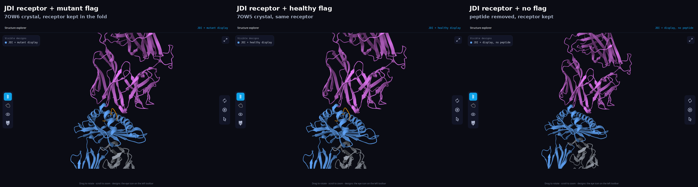
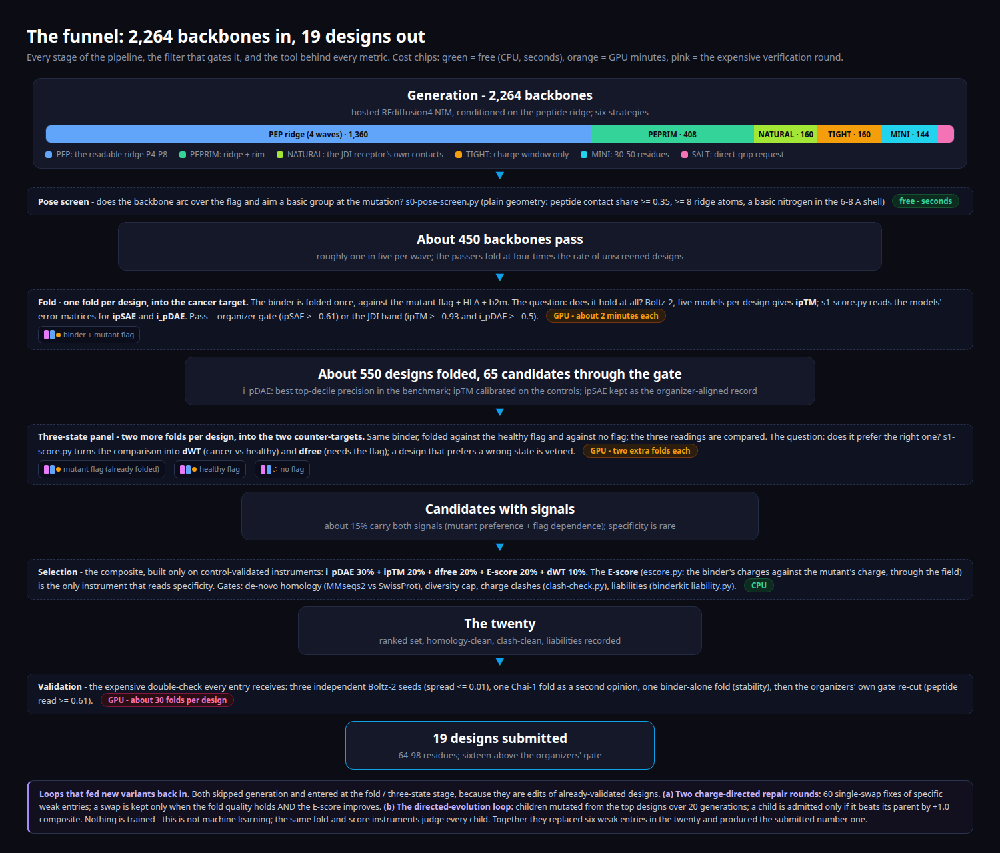
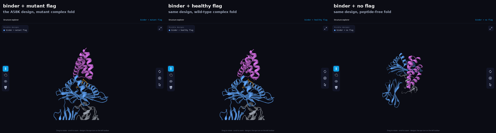

# 05 — KRAS G12D pMHC binder · the complete history

This document tells the whole story of the KRAS G12D pMHC binder campaign,
from the first scraped challenge page to the submitted nineteen designs. It
names every tool, every decision, and the reason for each. The companion
records are `lineage.json` (the site's own history), `notes/` (the
research), and `records/` (the raw data).

Status: submitted 2026-11-08, nineteen designs. The wet-lab verdict is not
in yet; everything here is computational evidence.

---

## 1. The target and what "specificity" means

The assay presents a ten-residue KRAS peptide (`VVVGADGVGK`, KRAS residues
7-16, with the G12D mutation) on HLA-A*11:01 plus beta-2-microglobulin. Three
objectives, in the organizers' order:

1. **Specificity**: bind the mutant complex, not the wild-type complex
   (`VVVGAGGVGK` - one atom, one charge: Asp to Gly at position 6).
2. **Peptide dependence**: bind only when the peptide is present. A binder
   that grabs the HLA frame alone would bind every cell.
3. **Affinity**: bind strongly.

**How to read peptide positions (P1-P10).** Each bead of the ten-bead flag
gets a number, counted from its start: P1 V, P2 V, P3 V, P4 G, P5 A,
**P6 D - the mutation bead**, P7 G, P8 V, P9 G, P10 K. So "P4-P8" means
positions 4 through 8 (the exposed middle stretch, called the ridge), and
"P4-P9" means positions 4 through 9 (the stretch the real receptor's atoms
hold). The letter P means *position* here, not the amino acid proline.
When a campaign says "conditioned on P4-P8", it means the generator was
told to build against that stretch of the flag. The two ends (P1-P3 and
P10) are buried anchors - no binder can reach them.

**Why this is an "unhealthy cell vs healthy cell" problem.** Every nucleated
cell displays peptide fragments on its HLA. The G12D peptide exists only in
cancer cells; the wild-type peptide exists in healthy cells. The two
complexes differ by a single buried charge. A binder that cannot tell them
apart would mark the whole body, not the tumor. This campaign is, from first
to last, a specificity campaign; affinity alone was never the goal.

**What the target's chemistry says.** Measured directly from the organizers'
crystals (7OW6 mutant, 7OW5 wild type): the Asp6 carboxylate is about 90%
buried (10.4% exposed), salt-bridged to the HLA's own Arg114 at 2.95 A and
hydrogen-bonded to Gln70 at 3.08 A. The published JDI T-cell receptor - the
one known discriminating binder - reads it from 7.5 A away, through the
electrostatic field, never by direct contact. This single measurement became
the campaign's design rule: place a positive charge 6-8 A above the mutation,
read the field, do not chase the atom.

---

## 2. The biology in plain words: T-cells, receptors, and why design a protein

**KRAS and the flag.** KRAS is a growth switch inside cells. The G12D
mutation jams it on, and the cell multiplies without limit. Every cell
constantly chops up its internal proteins and displays the fragments on its
surface, held up by a molecule called HLA. A cancer cell with mutant KRAS
therefore shows a mutant KRAS fragment - our target peptide - while healthy
cells show the normal one. The display is the difference between a cancer
cell and a healthy cell.

**T-cells and their receptors.** T-cells are the immune system's
inspectors. Each carries a T-cell receptor, a molecular hand built to grab
displayed fragments. When a receptor recognizes a fragment as wrong, the
T-cell kills the cell displaying it. One published receptor, the JDI, does
exactly this for KRAS G12D: it grabs the mutant display and leaves the
healthy one alone. Nature had already solved the recognition problem.

**Why design anything, then?** Because the molecule works and the delivery
often does not. In a patient: the tumor may hide the display or lose it;
the right T-cells are usually absent, because receptors are generated
randomly, one per T-cell; the T-cells that exist are often suppressed by
the tumor; and the natural receptor binds weakly - the JDI reads about
63 µM for the mutant, which is enough for an inspector and not enough for
a weapon. The field's fix is to separate recognition from delivery: take
the recognizing part out of the T-cell and put it into an engineerable
molecule. That recognizing part is exactly what this challenge asks us to
design.

**A designed binder versus a receptor.** Both are proteins. The
differences:

| | T-cell receptor | our designed protein |
|---|---|---|
| origin | evolved over millions of years, tested in real immune systems | designed in weeks, from scratch, with generative models |
| size and shape | two chains, ~300+ residues, anchored in the T-cell membrane | one chain, 64-98 residues, soluble |
| jobs | three: recognize, signal, trigger the kill | one: recognize. It cannot signal or kill |
| target range | one randomly generated receptor per T-cell, a huge repertoire | one target only: the KRAS G12D display |
| affinity | deliberately weak (about 63 µM for the JDI) | as strong as we can get |
| manufacturing | a membrane protein of an immune cell | an ordinary soluble mini-protein |

The receptor is an inspector with a badge, a radio and a gun. Our design is
a trained fingertip. It **replaces** the finding step - it does not assist
the receptor. In a therapy the binder is fused to a second module that
recruits any T-cell through a different surface handle (CD3, the route
approved T-cell engagers use), so the T-cell's own receptor plays no role.
The binder decides what to attack; the T-cell swings.

**What the competition actually measures.** Only the recognition half: does
the designed protein grab the mutant display and not the healthy one. No
killing, no delivery, no safety in a body - those wait for the wet lab and
for engineers downstream. The campaign below is the story of building that
fingertip.

## 3. The reference crystals and the JDI: what they are and what we did with them

**Why "crystals".** A single protein molecule is far too small for any
microscope to photograph. Scientists use a trick: they convince billions
of identical copies of the molecule to line up in a perfect repeating
grid - a crystal, like a salt or sugar crystal, but made of protein and
usually microscopic and fragile. X-rays fired through the crystal scatter
in a precise pattern, and mathematics turns the pattern into a map of
where every atom sits. A "crystal structure" is simply a structure solved
this way. One limitation mattered to us: a crystal is a frozen snapshot
taken near -170 C. It shows one pose, not motion - which is why key
designs were later cross-checked with a motion simulator.

**The reference files.** Each number below is a catalogue entry in
the Protein Data Bank, the world's public archive of such structures.

- **7OW6** (2.64 A sharpness) - the official title: "Crystal structure of
  a TCR in complex with HLA-A*11:01 bound to KRAS G12D peptide". In plain
  words: nature's solution caught in the act - the JDI T-cell receptor
  sitting on the cancer-flag display. The organizers gave us this file
  with the receptor computationally deleted, so the display has an empty,
  hand-shaped site to design into.
- **7OW5** (2.58 A) - the same experiment with the healthy flag instead of
  the mutant one. Our counter-target.
- **7OW4** (1.81 A, the sharpest) - the mutant display crystallized with
  no receptor at all. It shows that without the inspector holding it, the
  flag's middle goes floppy: two positions have no visible coordinates at
  all, and neighbours shift by up to 3 A.

**What we did with the JDI.** We could not submit the JDI itself - the
rules require our own designs, and a T-cell receptor is a huge two-chain
molecule that is hard to manufacture. So we used it three ways:

1. **As a teacher.** We measured its technique from the crystal: where it
   touches the display, and - the crucial part - where it deliberately
   does not. It never grabs the mutant's extra charge. It stays 7.5 A
   away and senses that charge through the electric field, like feeling a
   fire's warmth without touching the flame. Every design rule came from
   that: place a charged group at that distance, never chase the atom.
2. **As a measuring stick.** The JDI is a practice exam with the answer
   key. Before trusting any scoring tool, we ran the JDI through it. The
   standard fold-confidence scores read the JDI as strong (0.95) but
   answered the mutant-versus-healthy question backwards - so they were
   banned from ranking specificity. Our own E-score answered it correctly
   - so it became the instrument we trust. The Rosetta desolvation tool
   read "no difference" on the JDI - so it was thrown out.
3. **As the permanent control.** Every later tool - the motion simulator,
   the external model, the protonation calculator - was first tested on
   the JDI. A tool that cannot handle the known-good answer is never used
   for anything else.

**What we measured on it, and with what.** Every geometric number below is
ours, measured on the organizer files. The affinity values quoted
elsewhere (63 uM, 64 pM) are literature values from Poole et al. 2022 -
this project has no wet lab.

| what we looked at | what we found (plain words) | tool |
|---|---|---|
| how close the inspector's hand gets to the mutant charge | 7.5 A - never touches it; reads it from a distance | Biopython geometry script (`target_physics.py`, `c0-crystal-read.py`) |
| where it grips the display | 275 contact points, one fifth of them on the flag itself, concentrated on the flag's middle (positions P7, P8, P6) | same |
| how buried the mutant charge is | 90% hidden; already held by the display's own Arg114 (2.95 A) and Gln70 (3.08 A) | same |
| which parts of the flag are reachable | the middle only (positions P4-P8); both ends are buried anchors | same, SASA calculation |
| whether the flag moves | without the inspector the middle is floppy; with it, the mutation site is the most ordered part | same |
| how the JDI scores in our fold tools | 0.94-0.95 - strong, as a real binder should | Boltz-2 (`c0-probe-fold.sh`) + scorer (`s1-score.py`) |
| whether our tools read the mutant-versus-healthy question correctly | fold scores: strong but backwards; our E-score: correct sign (-0.67); Rosetta desolvation: zero, discarded | `s1-score.py`, `escore.py`, Rosetta ref2015 |
| the JDI's filter reads | hotspot contact fraction 1.0, off-epitope 0.05 | BindCraft2 (`c0-bc2-score.py`) |

## 4. The doctrine: calibrate instruments before trusting any of them (C0)

**The hypothesis.** One question stood before all design work: *can any
available confidence score tell the mutant complex apart from the
wild-type complex?* If yes, the whole campaign can rank on that score. If
no, specificity needs an instrument built for it. Campaign 3 (a different
challenge) had shipped a pipeline blind to its target's physics and caught
it after the fact. This campaign refused to repeat that.

**The control set.** Five references, folded and scored before any design:

- the JDI T-cell receptor - the published binder. Its affinity numbers
  (parent 63 µM for the mutant, no measurable wild-type binding; matured
  variants reaching 64 pM while keeping the window) are **literature
  values** from Poole et al. 2022, not measurements of ours - this project
  has no wet lab. What we measured on the JDI ourselves: its crystal
  geometry (Biopython, `scripts/target_physics.py` and
  `scripts/work/c0-crystal-read.py`), its fold reads (Boltz-2 via
  `c0-probe-fold.sh`, scored by `s1-score.py`: 0.94-0.95 peptide ipTM), its
  BindCraft2 filter reads (`c0-bc2-score.py`), its E-score (`escore.py`:
  -0.67), and its failed desolvation control (Rosetta ref2015). The
  positive control.
- the shuffled-peptide complex - a non-binder negative.
- the peptide-free complex - the second counter-target.
- the HLA chain alone - a sanity read.
- the organizer crystals themselves - geometry ground truth.

**The folding combinations, exactly.** Each control is one Boltz-2 fold
of the real crystal: "pos-g12d" and "pos-wt" carry five chains - A and B
are the two halves of the JDI receptor, C is the HLA display, D is
beta-2-microglobulin, E is the peptide. "neg-peptidefree" is the same
minus the peptide chain. "neg-shuffled" keeps the full mutant complex but
scrambles the receptor's sequences. The display never leaves the fold -
the receptor meets the peptide only where the cell presents it.



*The JDI receptor (magenta) on the display (HLA in blue, beta-2-microglobulin
in gray) in the three control folds: with the mutant flag, with the healthy
flag, and with the flag removed. The peptide is the small amber piece in the
groove - present in the first two panels, absent in the third.*

**The instrument matrix and its verdicts.** For each instrument: what the
control read, the number, and the action it forced. The tools behind the
rows: fold reads by `c0-probe-fold.sh` (Boltz-2) and `s1-score.py` (ipSAE,
i_pDAE, ipTM); BindCraft2 rows by `c0-bc2-score.py`; Chai-1 rows by
`c0-chai-msa.sh`; the E-score by `escore.py`; the desolvation row by
Rosetta ref2015; the ensemble row by BioEmu2; the histidine audit by
PROPKA plus `escore2.py`; the benchmark table is the published ProteinBase
analysis, reviewed in `notes/metrics-benchmark-2026-10-31.md`.

| instrument | control read | verdict | action taken |
|---|---|---|---|
| Boltz-2 fold scores | full complex: 5 models, ipTM 0.966, ipLDDT 0.975; HLA-only 0.903; free 0.487; shuffled 0.005; **mutant-vs-WT delta -0.043** | separates complexes from junk, cannot see the mutation (wrong sign) | rank fold *quality*, never specificity; deltas demoted to vetoes and a 10% tiebreak |
| BindCraft2 | Hotspot_Contact_Fraction 1.0, Off_Epitope 0.05 | same class as boltz | kept only as the source of i_pDAE |
| Chai-1 with MSAs | mutant 0.895 vs WT 0.877; free 0.797; shuffled 0.653 | the first correct sign, but a small margin | supporting evidence only, never the primary key |
| i_pDAE (ported from BindCraft2) | tracks ipSAE on the same designs: 0.82/0.90 (strong), 0.02/0.02 (broken); benchmark 72.5-80% top-decile precision | the best benchmark precision of the fold metrics | became the quality ranking instrument (30% weight) |
| ipSAE | benchmark 52.5-72.5%, near random at ESMFold2 | the weakest benchmark metric, but organizer-aligned | kept as the pre-registered gate and the record, never as the ranker |
| the benchmark table itself | 400 measured designs; i_pDAE 72.5-80% across models; OpenDDE + ipTM the best single pair at 80%; ensembles never beat the best pairs | one good metric per axis beats voting | no voting schemes; one best metric per axis |
| OpenDDE | the benchmark's best single predictor; acceptance test attempted twice | two host reboots in two attempts, the second with the GPU idle (bugcheck 0xD1) | shelved; the marginal value did not justify more reboots |
| Rosetta ref2015 desolvation ddG (2026-11-03) | JDI positive control reads **+0.0** without repack, -0.1 with repack | zero on the control | disqualified; the desolvation axis stayed unmeasured |
| BioEmu2 ensembles | K58-D6 at 7.4 +- 0.8 A across 16 frames (persistent); same-metric WT contrast 5.0 vs 4.5 A (flat) | persistence yes, discrimination no | stability evidence only |
| **E-score (explicit electrostatics)** | **JDI control reads -0.67, correct sign, charges 8-12 A out** | **the only specificity instrument that passes its control** | **became the specificity instrument (20% weight)** |
| PROPKA histidine audit (2026-11-03) | every shell histidine reads 0% protonated; two designs carry shell histidines at 6.88 and 6.10 A; across the set the closest shell atoms are polar (Ser/Thr/Tyr/Asn/Gln/His at 6-7 A) | a charge model cannot see polar readers | recorded as the instrument's class limit - the set's polar shells are undercounted, not bad |

**Where the E-score comes from.** The E-score is our own instrument, not
a published one. Its formula is one line of textbook physics - Coulomb's
law with a crude solvent correction:

    E = 83 * sum( q_binder * q_D6 / r^2 )

Here 83 is the Coulomb constant divided by a dielectric factor, r is the
distance between a binder charge and the mutant carboxylate, and the
dielectric grows with distance (eps = 4r) - a long-standing crude way to
approximate the screening effect of water, the same class of term used in
molecular-mechanics binding estimates (MM-GBSA-class). The charges are
standard force-field values: each carboxylate oxygen -0.5, lysine +1,
arginine +0.5 per nitrogen, histidine from PROPKA's protonation fraction.
A second, smaller term records how much the binder buries the carboxylate
(a desolvation proxy, following the Wu 2022 finding that desolvation can
decide single-residue discrimination). The idea comes from the published
JDI mechanism (Poole et al. 2022: "indirect electrostatic interactions,
not visible in static structures") and from the community's rigorous APBS
difference-map analysis of this exact target - the E-score is the
lightweight, per-design version of that same physics. Its only validation
is its control: the JDI reads the correct sign (-0.67). The magnitudes are
model-dependent; the sign is the signal.

**The crystal measurements, in plain words.** We examined the target
directly before designing anything, with one question in mind: the two
complexes differ by one tiny piece - so where is that difference, and how
can a binder reach it? Every number below is ours, measured on the
organizer files with Biopython in `scripts/target_physics.py` and
`scripts/work/c0-crystal-read.py`.

| what we looked at | what we found | what we decided because of it |
|---|---|---|
| how much of each peptide bead sticks out of the groove | the two ends are buried (2-5% visible); the middle is open (position 7 is 84% visible) | build the binder against the middle only (positions 4-8) - the ends are unavailable |
| where the natural receptor puts its fingers | 275 touch points, one in five on the flag itself, mostly on its middle | copy that way of holding: touch mostly the flag, not the stand |
| how visible the mutant's extra charge is | almost invisible - only about 10% sticks out | we cannot grab it directly; we must sense it from a distance |
| whether something is already holding that charge | yes - the display's own Arg114 grips it (2.95 A) and Gln70 sits on it (3.08 A) | do not fight for the charge; its grip is already taken |
| how far the natural receptor stays from the charge | 7.5 A - it never touches it | our designs put a charged group at that same distance |
| how strong the mutant's electric signal is there | clear and negative (roughly 1-2 kT/e; a published analysis measured up to 8.4) | place a positively charged group (Arg, Lys, His) above positions 6-7 |
| what removing the flag exposes | a large bare patch of the groove (678 A2) | never let the binder touch that bare patch - it would then hold all three targets |
| whether the flag moves when nothing holds it | yes - its middle goes limp (two positions disappear; neighbours shift up to 3.2 A) | design against the held (closed) shape; the free middle is unreliable |
| how much the flag wiggles while held | the mutation site is the most still part of the flag | the mutation is a stable thing to read |
| the 9-bead version of the flag | its charge never reaches Arg114 - wrong register, a decoy | ignore the 9-bead version; design only for the 10-bead flag |
| whether water sits at the interface | the files show almost no ordered water, but the real surface is wet | treat water as part of the surface; never rely on a fixed water anchor |
| how the assay captures our binder | by its tail (the C-terminus) | keep the tail away from the interface; never grip the tags |

**The conclusion, and the actions it forced.** The mutant's signal is one
buried negative charge. It cannot be touched. It can be read from 6-8 A
through the field. Every design rule followed from that single conclusion:
arc over the P4-P8 ridge, peptide-first footprint, no groove-floor
contacts, a basic nitrogen in the shell above P6-P7, rank with the
instruments that passed their controls (the E-score for specificity,
i_pDAE and ipTM for interface quality, dfree for peptide dependence), and
counter-fold every candidate against the wild type and the peptide-free
states. The rest of this
document is the execution of those rules.

## 5. The pipeline, stage by stage

Each stage below states its hypothesis, the numbers it produced, and the
decision that followed.



*The whole pipeline as a funnel: 2,264 generated backbones, the filter at
every stage, and the tool behind every metric. Green chips are free
steps, orange chips cost GPU minutes, the pink chip is the expensive
verification round. The purple note at the bottom shows the two loops
that fed new variants back in - charge-directed repair rounds and the
directed-evolution loop, which is not machine learning: nothing is
trained, and every child is judged by the same fold-and-score
instruments.*

**What each color in the funnel's first layer means.** The diffusion
settings were identical everywhere; the difference is the conditioning -
which atoms of the target each generation run was told to build against:

| color | strategy (backbones) | recipe | the hypothesis it tested |
|---|---|---|---|
| blue | PEP ridge (1,360) | hotspots on the readable ridge, peptide positions P4-P8 | the main bet: build against the part of the flag that is actually exposed |
| green | PEPRIM (408) | ridge plus rim - a few flanking residues of the stand for extra anchor | more anchor, more stable hold, without touching forbidden surfaces |
| lime | NATURAL (160) | the JDI receptor's own 17 contact atoms | copy exactly where nature's reader puts its fingers |
| amber | TIGHT (160) | only the minimal 6-atom window around the mutation shell | the smallest possible target area - pure specificity pressure |
| cyan | MINI (144) | the ridge idea, length-constrained to 30-50 residues | a small format: cheaper to make and easier to express |
| pink | SALT (8) | a direct-grab request: reach the buried charge itself | the deliberately wrong control - predicted to fail, and it did |

Within the blue slice, the 1,360 backbones are four separate runs of the
same recipe (the waves), not one run. The pink slice is a probe of eight
designs, not a full campaign.

**Why the fold step and the three-state panel are two different things.**
Both steps fold the same binder; what changes is the target on the other
side. The fold step folds each design once, into the cancer version of the
target (mutant flag + HLA + beta-2-microglobulin), and answers one
question: does it hold at all? The three-state panel then folds the
survivors two more times - against the healthy flag, and against the
display with no flag - and compares the three readings of the same binder:
dWT (mutant reading minus healthy reading; positive means it prefers the
cancer version) and dfree (mutant reading minus flag-free reading;
positive means it needs the flag). The fold step asks "can the key turn
the lock?"; the three-state panel asks "does it turn the cancer lock, but
not the healthy lock, and not a lock with no pin in it?" The binder
sequence never changes between the folds - only the target does. And the
order exists for cost: the first fold is the cheap gate that removes the
designs that do not hold at all, so only the survivors earn the extra
folds.

**Stage 1 - Generation.** *Hypothesis:* the mutation sits under a readable
ridge (P4-P8), so backbones conditioned on that ridge will read it.
*Procedure:* the hosted RFdiffusion4 NIM, six conditioning sets, each with
a reason: PEP (the ridge P4-P8), PEPRIM (ridge plus rim, more anchor),
NATURAL (the JDI receptor's own 17 contact atoms, backbone-dominated),
TIGHT (a 6-atom window over P5-P7 - the charge problem alone), MINI (the
same ridge with a 30-50 residue chain), SALT (a direct-grip request on the
carboxylate). *Numbers:* 2,264 backbones collected (2,247 unique). TIGHT
produced 25 folds, 4 JDI-like, **0 strict passers** - the tight window
starves the interface. MINI produced 37 folds, 11 JDI-like (30%), and the
project's strongest peptide dependence (dfree +0.701) - short chains work.
The late waves (C11) produced 200 designs, 30 pose passers, zero swaps -
more of the same conditioning adds nothing. *Decision:* keep the surface-
describing sets (PEP, PEPRIM, NATURAL, MINI); treat the charge window as
one rule among many, not a campaign. After C9 the generator itself was
frozen: every alternative scored worse than the released model.

**Stage 2 - The pose screen.** *Hypothesis:* two cheap geometric rules
predict which backbones are worth an expensive fold: the binder must arc
over the ridge (peptide contact share >= 0.35 with >= 8 ridge atoms), and
it must place a basic nitrogen in the 6-8 A shell above P6-P7. *Numbers:*
about 20% of backbones pass each wave, and **the passers fold at four
times the rate of unscreened designs**. A later test (C7) confirmed the
logic: five features that name *where a charge sits* relative to the
mutation picked 3 of 8 never-folded candidates correctly (38% vs the 15%
pool baseline, including the project's best wild-type discriminator);
a surrogate trained on sequence composition alone folded its top 50 to
**zero** hits. *Decision:* the screen stayed the mandatory triage before
any GPU spend, and its charge-shell rule became the specificity tier of
the pool. One caveat was recorded: the screen is sidechain-blind, so
CA-only generator output defeats it (the C9 lesson).

**Stage 3 - Sequence assignment.** *Hypothesis:* ProteinMPNN can assign
sequences to a screened backbone without moving it. Then a second
hypothesis (C6): redesigning the surface with the interface frozen keeps
the function while naturalizing the molecule. *Numbers:* 8 children per
parent, 80 folded; 6 of 10 parents got children equal-or-better on the
mutant reads (best gain +0.08 i_pDAE); all children folded alone at pLDDT
0.93-0.97, slightly above their parents. But the wild-type discrimination
**collapsed in 8 of 10 children** - a frozen interface is not enough. Two
exceptions kept both signals and entered the set. *Conclusion:* stability
is easy to preserve; specificity lives in the exact sequence. *Decision:*
children enter only on the full composite, and the finding redirected the
optimization work from surface redesign toward charge-directed single
swaps (the repair rounds) and the evolution loop.

**Stage 4 - Folding and the reads.** *Hypothesis:* Boltz-2 with five
diffusion models gives a stable interface read, calibrated against the
known binder. *Numbers:* the JDI reads 0.94-0.95 peptide ipTM in its own
complex; "JDI-like" was set at >= 0.8; the design pool spans 0.23-0.98.
The pre-registered gate was the organizer-aligned **mean peptide
ipSAE >= 0.61**. Stage 1 folded 239 designs. The gate then hit a practical
problem: only 9 designs passed it, and 20 slots existed. *Decision
(amendment, recorded):* the tri-state set became the gate passers UNION
the JDI band (iptm_pep >= 0.93 AND ipdae_pep >= 0.5) = 23 designs; the
band contains all 9 gate passers, so pre-registration was preserved, not
weakened. i_pDAE was added as the ranking read after the benchmark showed
its top-decile precision (72.5-80%) beats ipSAE's (52.5-72.5%).

**Stage 5 - The three-state panel.** *Hypothesis:* the two counter-targets
separate the two specificity objectives. *Definitions:* dWT = mutant
iptm_pep minus wild-type iptm_pep (objective 1, cancer versus healthy
cells); dfree = mutant HLA-read minus peptide-free HLA-read (objective 2,
peptide dependence). *The C0 warning applied:* fold-score deltas read the
wrong sign on the control, so they **veto but never rank** - a design
whose wrong-state read exceeds its mutant read by more than 0.05 is
dropped. **The folding combinations, exactly:** every candidate is folded
three times, always with the display present - mutant state (HLA +
beta-2-microglobulin + mutant peptide + binder), wild-type state (the
healthy peptide), peptide-free state (HLA + beta-2-microglobulin + binder,
no peptide). The binder never meets a naked peptide, because the assay
never presents one. Extra folds: three seeds of the mutant state for
validation, one Chai-1 fold of the mutant state, and one binder-alone
(apo) fold - the only fold without the target.



*One submitted design (the A58K variant) folded in the three states every
candidate went through: the mutant complex, the wild-type complex, and the
peptide-free complex. Same colors as above; the design is the magenta
helical bundle. In the peptide-free panel the flag is gone and the binder
visibly shifts its pose - which is what the peptide-free fold exists to
catch.*

*Numbers:* of 239 folded, 40 tri-stated, 6 carried both signals
(dWT >= 0.15 and dfree >= 0.2). Specificity is rare: about **15% of
tri-stated candidates**. *Decision:* mine broadly, filter hard - which is
why seven generation campaigns ran.

**Stage 6 - The composite and the gates.** *Hypothesis:* ranking on the
control-validated instruments will surface the designs most likely to work
in the assay. *The composite (final weights):* i_pDAE 30%, ipTM 20%,
dfree 20%, E-score 20%, dWT 10% (dWT was demoted from 45% after an
external audit showed the original sort key was a metric our own C0 had
disqualified). *The gates, with their numbers:*

- de-novo homology gate: 60 of 279 designs (21%) were >= 90% identical to
  natural proteins and were excluded - including one that had converged on
  an antibody V-region;
- diversity cap: two designs per generation run (three parent/child pairs
  at 84-88% identity were collapsed to their best member);
- charge-clash screen: same-sign charged atoms within 4 A - the set reads
  at most 2 such pairs, 19 of 19 submitted designs at 0-1;
- liability screen: 11 designs carry minor flags (Asp-Pro sites,
  deamidation motifs, hydrophobic runs); one design is the single
  expression risk to watch;
- the evolution loop's admission rule: a child displaces its parent only
  on a **+1.0 composite margin** with three-seed validation - no churn on
  ties.

**Stage 7 - Validation and the final cuts.** *The battery:* three Boltz-2
seeds per design (median scores 0.960-0.993, spread <= 0.01); a Chai-1
MSA cross-check (supporting only - several reads sit inside the negative
band, recorded honestly); a binder-alone fold (pLDDT >= 0.93); the
homology screen. *The final cuts:* on 2026-11-04 the twenty were moved
onto the organizers' own epitope gate - six validated gate readers entered
and six entries left. On 2026-11-08 the organizers' ipSAE gate
(peptide_read >= 0.61) was applied: 16 of 20 passed. The four below it
were audited one by one: L58K-Q15K (0.554, folded twice in independent
batches at 0.574 and 0.554, best model 0.644) was restored - its
wild-type separation is 0.554, the largest in the set, and its reads on
the strong instruments are the best of all entries; wave2-049 and
wave2-054 were restored similarly on their separations (0.543 and 0.444).
E23K (0.545, wild-type read 0.313 - the weakest separation of the four)
was dropped on both counts. *The reasoning on the record:* ipSAE is the
weakest of the benchmark metrics, so removing a design on ipSAE alone
would contradict the protocol's own ordering; the gate is kept as the
organizer-aligned record while the strong metrics decide. *Result:*
nineteen designs submitted, 64-98 residues, sixteen above the gate.

## 6. The campaigns (C0-C14, thirteen in all)

Each campaign below names its date, strategy, tools, and result. The full
texts live in `lineage.json` and are rendered on the website.

**Why the numbering has gaps.** The work was logged as twenty
numbered runs (C0-C19); `lineage.json` then merged the ones that answer
the same question into thirteen campaigns, and this chapter follows that
merge. C12 (the salt wave) sits inside C11, C13 (the surrogate screen)
inside C7, C15-C16 (evolution generations 2-20) inside C14, and C17-C19
(the custom-generator project, the fine-tune verdict, the pristine batch)
inside C9. Nothing is omitted - only renumbered.

**Not every campaign is the same kind of experiment.** Three kinds appear
below. (1) *Different region*: the same generator asked to build against a
different stretch of the flag - C3 offers nature's own contact stretch
(P4-P9), C4 only the mutation's neighbourhood (P5-P7), the later waves add
the rim or a salt-bridge request. (2) *Different format*: the same region,
a different size of output - C5 builds 30-50 residue minibinders on the
same ridge. (3) *No new generation at all*: campaigns that re-use what
already exists - C2 mines the unfolded pool, C6 redesigns sequences on
frozen interfaces, C8 folds the same binders against variant peptides.

**C0 - instrument calibration** (2026-10-29, extended to 11-03). Tools:
Gemmi, Boltz-2, Chai-1, BindCraft2, IPSAE, FreeSASA. The control set plus
the crystal measurements described above. Later: the instrument audit (the
E-score's histidine blindness, fixed with PROPKA - the corrected score
equalled the old one because every shell histidine reads 0% protonated) and
the failed Rosetta desolvation test. Verdict: fold confidence, contact
physics and shape ensembles all fail their controls here; only explicit
electrostatics reads specificity.

**C1 - the main funnel** (2026-10-31). Tools: RFD4 NIM, ProteinMPNN,
Boltz-2, IPSAE, Chai-1. Four waves, ridge conditioning. 239 designs folded,
40 tri-stated, 6 dual-signal (both WT discrimination and peptide
dependence). Specificity is rare: about 15% of tri-stated candidates.

**C2 - peptide-only readers** (2026-11-01). Tools: the existing pool,
Boltz-2. A mining campaign: the 1,121 unfolded designs from earlier waves
were re-mined by peptide contact share (>= 0.45). Logic: a binder that
touches mostly the peptide has fewer chances to hold on to the HLA frame,
which is identical on healthy cells. 44 of the 45 folded; the leader (`wave1-pep run-033 design_0003`) cleared
the strict gate and entered the submitted set at rank 11. (`lineage.json`
still calls it "submission entry 2" and names a second design as "entry 11"
that is not in the submission at all - stale text from before the late
re-cuts.)

**C3 - the natural reader's pattern** (2026-11-01). Tools: Gemmi,
RFD4 NIM, Boltz-2. The JDI TCR's exact contact atoms (17 atoms, spread over
flag positions P4-P9 - the stretch the real receptor holds -
backbone-dominated) were measured from the real crystal and used as the
hotspot set. Of 32 folds, 9 were JDI-like (28%) and 4 passed the strict
gate (12.5%) - the best strict-pass rate of any conditioning set, and the
only set with experimental provenance; two submission entries. (On the
JDI-like axis C5's 30% is higher; the two campaigns lead on different
measures, and `lineage.json` attaches the 28% to the wrong one of them.)

**C4 - charge first** (2026-11-01). Tools: RFD4 NIM, ProteinMPNN, Boltz-2,
IPSAE. A too-tight 6-atom window on
P5-P7 (only the mutation's immediate neighbourhood, three beads wide).
Zero strict passers of 25 - the interface starves. Honest negative with a
clear cause.

**C5 - minibinders** (2026-11-01). Tools: RFD4 NIM, ProteinMPNN, Boltz-2,
IPSAE. The same ridge, but 30-50 residue chains. 11 of 37 folds JDI-like
(30%, tied for the best yield per folded design) and one design carries the
project's strongest free-state dependence (dfree +0.701). Short, stiff,
cheap to make - and the format paid off late: four of the submitted
nineteen are evolution children of one mini backbone, including rank 2.

**C6 - the optimization loop** (2026-11-01). Tools: ProteinMPNN (run from
the LigandMPNN codebase), Boltz-2, Chai-1, Gemmi. Children with the
interface frozen (atoms within 8 A fixed). Children stay stable (apo folds
equal or better), but naturalization erodes the WT discrimination signal in
8 of 10 children. The finding: specificity lives in the exact sequence, not
in the interface geometry alone.

**C7 - predicting a winner without folding it** (2026-11-02 -> 11-03).
Tools: the pose screen's own features, scikit-learn, Boltz-2. Two attempts. First: five hand-mined features read off the project's own
dual-signal winners picked 3 of 8 never-folded candidates (a 2.5x lift over
the pool base rate, including the project's best WT discriminator). Second:
a scikit-learn sequence-composition surrogate, cross-validated, whose top
50 candidates folded to **zero** hits. The finding: features that name
*where a charge sits* relative to the mutation carry signal; features that
only count what is in the sequence cannot see where the charges land after
folding.

**C8 - cross-panning** (2026-11-02). Tools: Boltz-2, IPSAE. The same
binders folded against the
9-mer register, G12V and G12C peptides (42 folds): the fold scores move by
at most 0.068 between variants. The confidence instrument cannot resolve
single-point peptide changes - the C0 finding confirmed at the variant
level. No red flags, no discrimination evidence; specificity ranking stays
on the three-state panel.

**C9 - the generator hunt** (2026-11-02 -> 11-08). Four attempts to replace
or improve the hosted generator, and the frozen released model won all
four: genie3's CA-only route scored 0 of 70; BoltzGen reached 0.101 peptide
read against RFD4-Proteina's 0.577 on an identical funnel; the reward-tuned
LoRA hit the 12 GB wall after six verified attempts, and the checkpoint
trained on rented silicon produced clean proteins 14 A away from the
peptide; finally, 100 raw designs from the frozen model passed the
organizer gate nine times but lost the wild-type test to the evolved
champions by an order of magnitude. Verdict: the generator becomes a
trusted frozen input. The discriminating power lives in the selection loop,
not in the generator.

**C10 - wave four and the final selection** (2026-11-02 -> 11-08). Tools:
RFD4 NIM, ProteinMPNN, Boltz-2, IPSAE, Chai-1, MMseqs2, BioEmu2, PROPKA.
The strongest generation wave (10 of 39 JDI-like, top i_pDAE 0.870), then
the selection protocol of chapter 5. The set then evolved: two charge-directed repair
rounds (11-02, 11-03) and the evolution loop's generation 1 replaced six
weak entries; generation 4 (11-04) replaced three more. On 11-04 the twenty
were re-cut onto the organizers' own epitope gate (six validated gate
readers entered, six entries left). On 11-08 a two-for-two panel swap
brought two strong readers back, then the organizers' ipSAE gate
(peptide_read >= 0.61) was applied: sixteen of twenty passed; three of the
four below it were restored on their wild-type separation; one design
(E23K) left. The submitted set is **nineteen designs**, sixteen above the
gate, 64-98 residues.

**C11 - conditioning for a direct grip** (2026-11-02, with the salt wave
logged as C12). Tools: RFD4 NIM, Boltz-2, PROPKA. Two waves that
pushed the conditioning instead of the selection. The fifth wave asked for
more of the best earlier conditioning (200 designs: 30 screen passers, zero
swaps - the affinity-strong ones read wrong-sign electrostatics). The salt
wave asked for a direct ionic contact with the Asp6 carboxylate - the
thing the physics says is hard. The generator settled at 8-10 A anyway.
Together the two waves prove the field-reading doctrine by the failure of
its alternative: the buried charge cannot be touched, so it must be read
from above.

**C14 - the evolution loop, generations 1-20** (2026-11-03 -> 11-05).
Tools: `evo.py` (the project's own breeder), Boltz-2, E-score, Chai-1,
PROPKA. The project's most productive campaign. Twenty generations of mutate-and-select
over the submitted set: for each top parent, single swaps at unsampled
shell positions 5-13 A from the mutation, plus combo mutants stacking known
repair hits; fold, E-score, tri-state, and admit a child only on a +1.0
composite margin with three-seed validation. The wins concentrate at the
front: generation 1 produced the number-one design (Q15K: score 90.5,
E -3.65, dWT +0.747 - a project record on the discrimination axis);
generation 4 promoted three single-lysine swaps with the set's best
E-scores (-3.75). From generation 5 the loop plateaued, and generations 13-20
promoted nothing at all; four loop bugs were found and fixed along the way,
two of them repetition bugs (children re-bred byte-identical, a breeder
blind to its own swapped-in winners). Cost: about 2.5 hours per generation.

---

## 7. Every tool, when and why

| tool | role | when | why |
|---|---|---|---|
| Gemmi | structure parsing, measurement, PDB/CIF writing | everywhere | the backbone utility |
| RFdiffusion4 NIM (hosted) | backbone generation | all campaigns | the only practical generator; later proven best (C9) |
| RFdiffusion3 (local copy) | generation, parity check | C9 | inspect and verify the frozen generator |
| Genie 3 | third generator trial | C9 | CA-only output lost the side-chain information; 0 of 70 |
| BoltzGen | competing generator | C9 | measured on the identical funnel; 0.101 vs 0.577 |
| LoRA fine-tune (diffusers, peft) | reward-tuned generator | C9 | closed on the 12 GB card; rented-GPU checkpoint failed |
| ProteinMPNN | sequence design | C1-C6, C9 | inverse folding on screened backbones |
| LigandMPNN (codebase) | ran the ProteinMPNN model (`--model_type protein_mpnn`) for the C6 children | C6 | interface frozen, surface redesigned |
| Boltz-2 | folding and all fold reads | everywhere | the workhorse oracle |
| Chai-1 | second folding instrument | C0, C1, finalists | the only fold model with the correct sign on controls |
| BindCraft2 | i_pDAE source | C0 | best top-decile benchmark precision |
| OpenDDE | independent oracle trial | C1, later shelved | failed the JDI acceptance test; shelved with the verdict recorded |
| ipSAE | organizer-aligned gate | stage 1, final cut | the organizers' metric; weakest bench precision, so record not ranker |
| MMseqs2 | homology gate, MSA fetching | C1, C10 | exclude natural near-copies (21% of designs were >= 90% identical to immune proteins) |
| FreeSASA | buried-surface measurement | C0 | the Asp6 burial numbers |
| PROPKA | histidine protonation | 11-03 audit | the E-score's histidine fix |
| BioEmu2 | equilibrium ensembles | 11-02 | persistence of the reading under motion; flat on WT/mutant |
| Rosetta ref2015 | desolvation ddG | 11-03 | built and disqualified - the control reads zero |
| scikit-learn | sequence surrogate | C7 | its top 50 folded to zero hits |
| ATLAS, SKEMPI2 | wet-lab label sets | C9 | calibrating scores against real affinities |
| Mol*, Playwright/Chromium | 3D viewers, site screenshots | reporting | visual verification of poses |
| Claude/Codex (via the user) | external reviews | 11-02, 11-03, 11-08 | audits that found the ranking flaw, the histidine blindness, and a false record entry |

---

## 8. How the sequences were evaluated, and how "better" was decided

The evaluation protocol was **pre-registered on 2026-10-31**
(`notes/evaluation-protocol.md`), before the finalists existed.

**Step 1 - the gate.** Mean peptide ipSAE >= 0.61 over five models
(organizer-aligned). Companion reads recorded per design: iptm_pep (JDI
calibration: the known binder reads 0.95; "JDI-like" means >= 0.8),
ipdae_pep, ipdae_hla, peptide_share, p6_min_dist.

**Step 2 - the three-state panel.** Every stage-1 passer is folded against
the mutant complex, the wild-type complex, and the peptide-free MHC. Two
deltas result: **dWT** (mutant minus WT - the cancer-vs-healthy axis) and
**dfree** (mutant minus peptide-free - the dependence axis).

**Step 3 - vetoes.** The C0 calibration says fold-score deltas do not rank
(wrong sign on the control), so deltas veto instead: a design whose wild
type or peptide-free read exceeds its mutant read by more than 0.05 is
dropped.

**Step 4 - the composite.** The ranking rides on validated instruments
only. Current weights:

| term | weight | what it measures |
|---|---|---|
| i_pDAE | 30% | interface quality (best benchmark precision) |
| ipTM | 20% | fold confidence (calibrated on controls) |
| dfree | 20% | peptide dependence |
| E-score | 20% | explicit electrostatics - the only control-passing specificity instrument |
| dWT | 10% | wild-type discrimination (disqualified as a primary key; a weak tiebreak) |

This design was itself evidence-driven: the first ranking put dWT at 45%
until an external review showed the sort key was a metric our own C0 had
disqualified, and the design with the pool's best interface pDAE was
sitting unsubmitted at rank 38. The corrected ranking fixed both. Later the
score gained the organizers' gate term (v4).

**Step 5 - gates.** De-novo eligibility (any SwissProt hit at >= 90%
identity excludes - it caught a design that had converged on an antibody
V-region); a diversity cap of two designs per generation run; charge-clash
screen (same-sign charged atoms within 4 A); liability screen (Asp-Pro
cleavage sites, deamidation motifs, hydrophobic runs).

**Step 6 - validation battery.** Every submitted design: three-seed Boltz-2
folds (spread <= 0.01), Chai-1 MSA cross-check, binder-alone fold
(pLDDT >= 0.93), homology screen.

**Step 7 - the two late re-cuts.** On 11-04 the set was moved onto the
organizers' own epitope gate; on 11-08 the ipSAE gate was applied, three
near-misses were restored on their wild-type separation (with the reasoning
recorded), and one design left. Nineteen submitted.

---

## 9. How the designs aim at unhealthy cells, not healthy ones

This is objective 1, and it runs through every stage:

1. **The target itself is the cancer signature.** The designs bind the
   G12D peptide as presented by HLA-A*11:01. The mutant peptide is a
   cancer-only molecule; the wild-type peptide is what healthy cells show.
2. **The wild-type complex is folded for every candidate** (the tri-state
   panel), and the dWT axis measures the separation. A design that prefers
   the wild type is vetoed outright. The final set's best discriminator
   (Q15K) separates the two states by +0.747 ipTM - a project record.
3. **Peptide-first footprints are enforced from generation onward.** The
   pose screen requires the binder to arc over the peptide ridge. A binder
   touching mostly the HLA frame would bind any cell, healthy included -
   the frame is identical everywhere. The C2 campaign re-mined the pool
   specifically for maximum peptide contact share.
4. **Peptide-free MHC is a counter-target, not an afterthought.** A design
   that holds the empty groove is vetoed. The final set's designs hold the
   reading only with the peptide present.
5. **The reading is of the mutation itself.** The E-score measures the
   binder's charged groups against the mutant carboxylate - the one atom
   that differs between the cancer and healthy complexes - and it is the
   only instrument whose control passes on this target.
6. **The honest limit.** Every statement above is computational prediction.
   The wet lab decides. What we can say is that the selection loop was
   built, from C0 onward, to prefer designs that separate the two states,
   and that the submitted set carries the largest separations the project
   produced.

---

## 10. The submitted nineteen

Sixteen of nineteen sit above the organizer gate. Rank 1 scores 90.5 on the
composite and is the strongest wild-type discriminator of the project. The
full table with per-design reads, families and mutations is
`records/submitted-19-metrics-2026-11-08.csv`. By origin: nine are
evolution-loop children (C14), two are charge-repair children, and eight are
wave designs entered unmodified. By ancestry, as the metrics file labels
them: PEP 9 (waves 1-2), MINI 4, the wave-3 NIM set 2, NATURAL 2, PEPRIM 2.
The wave-3 entries run the PEP recipe, so counted by recipe rather than by
label PEP holds 11 of the nineteen. The TIGHT and SALT sets contributed
nothing, as their campaigns (C4, C11) predicted.

## 11. What is honest and what is not yet known

- Nothing here is wet-lab validated. The challenge's assay will decide.
- The fold-based instruments cannot rank single-point specificity; this was
  proven with controls three separate times and drove the entire strategy.
- The best specificity instrument is a homemade heavy-atom Coulomb score.
  It passed its control where three published instrument classes failed,
  but a charge model cannot see polar readers - the set's shell residues
  are mostly polar (Ser/Thr/Tyr/Asn/Gln/His at 6-7 A).
- Nine external-review findings were verified and acted on during the
  campaign; two review claims were refuted with recomputation; one false
  claim inside our own records was found and struck. The trail is in
  `records/*-review-2026-11-08.md`.

---

## Folder structure

```
challenges/05-pmhc/
├── README.md        this document
├── lineage.json     the campaign record the local web app renders
├── docs/figures/    the figures embedded above, plus a self-contained HTML build
├── campaigns/       one directory per campaign: its scripts, specs and results
├── records/         every measured table, the reviews and the final cut
├── notes/           the dated working log, the research and the evaluation protocol
├── submission/      the uploaded CSV, the methodology and the design-method text
├── scripts/work/    the scripts that produced the screens, the scores and the figures
├── custom-model/    the custom-generator project (C9): training, scoring, verdict
├── nim/             target files prepared for the hosted RFdiffusion4 NIM
├── inputs/          committed target files (7OW4, 7OW5, 7OW6, the peptides)
├── viewers/         Mol* multiview pages, one per campaign
└── videos/          rendered clips
```

The fold outputs live outside the repo under `~/c5-work/`.
